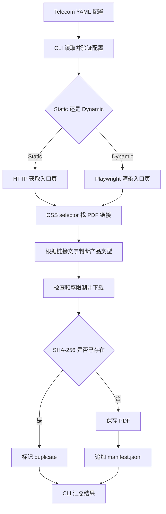
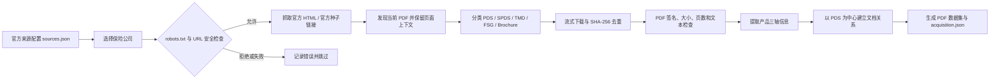
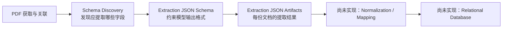
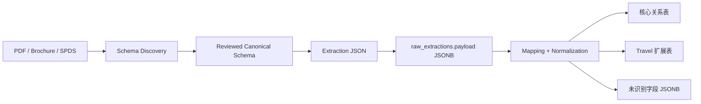

# 06. Project architecture, consensus refinement, and PostgreSQL storage (Part 1 of 2)

[Conversation index](../aiLogJamesW0203_English.md)

Session ID: `019fcbf7-3415-7a10-8370-45d1f1a501a4`

Recorded UTC range: 2026-08-04T08:50:48.378Z to 2026-08-19T11:02:13.110Z

Messages in this file: 182 of 279

Chinese prose is translated into English. Existing English and fenced code are retained; inline identifiers, paths and link destinations retain their original spelling. Statements describe what the participants said at the recorded time; historical results have not been rerun for this archive. Image attachments appear as text placeholders. See the index for scope and export rules.

---

<a id="msg-dc6c4f1c1bf7a2f1"></a>

### [2026-08-04T08:50:48.378Z] User

Help me see what Meicong did after me. What is the current project overview?

---

<a id="msg-695059502410fb49"></a>

### [2026-08-04T08:50:58.773Z] Codex

I'll start with Git history, author timelines, and workspace status to locate Meicong's changes after your last commit, then combine README and architecture docs into the current overview. Read-only throughout, without file changes.

---

<a id="msg-81ea3b4592dc77d3"></a>

### [2026-08-04T08:51:08.514Z] Codex

Timeline located: your configured Git identity is JamesW0203; your latest commit is July 22's `ec36ac5`, followed by two Meicong commits on another remote branch on July 31 and August 3. Next I'll confirm exactly which modules those commits added/replaced relative to your version and whether they entered your current branch.

---

<a id="msg-5d87dd1beb4384af"></a>

### [2026-08-04T08:51:41.844Z] Codex

A key point: this is not 'Meicong continuing after your commit'; the branches diverged from `d24758b`. Your branch has 2 unique commits, while Meicong's `origin/merged-pipeline` has 3; a final diff therefore mixes her additions with your unmerged fixes. I'll explain 'what she actually did' separately from 'capabilities on your side that merging could lose.'

---

<a id="msg-1f1277870b5c6a8f"></a>

### [2026-08-04T08:52:23.312Z] Codex

Remote updates are authorized and syncing; I'll preserve your uncommitted `.gitignore` changes without switching branches or overwriting anything.

---

<a id="msg-bb1f40fa6555b231"></a>

### [2026-08-04T08:52:56.242Z] Codex

Confirmed: offline checks on your current branch are healthy—source compiles and all 229 unit tests pass. Next I'll export Meicong's remote branch into `/tmp` and run the same checks, without touching your workspace or calling model APIs. The overview can then distinguish 'code claims' from 'at least offline tests actually run.'

---

<a id="msg-ccf8477d7bf88791"></a>

### [2026-08-04T08:53:34.318Z] Codex

Meicong's remote branch also passes offline compilation and all 231 tests, 2 more than your current branch. This still does not verify real PDFs, ground truth, or paid model calls. I also found its directory structure differs from current local architecture docs and am checking which docs/contracts exist only in your workspace or branch, avoiding treating README descriptions as an already unified architecture.

---

<a id="msg-636ace503913fff9"></a>

### [2026-08-04T08:54:29.698Z] Codex

I found a state issue more important than 'tests pass': `contracts/` on your current branch is no longer tracked, but local contract files remain hidden by `.gitignore`, so those 229 tests may rely on local leftovers. I'll retest a clean export of `HEAD` to see whether a fresh clone reproduces your branch.

---

<a id="msg-54863a07848b79c2"></a>

### [2026-08-04T08:55:15.794Z] Codex

Review complete. Conclusion: Meicong did not build directly on your latest commit; on another branch, `origin/merged-pipeline`, she completed a substantial integration of PDF parsing, Schema application, and evaluation.

The branch relationship is roughly:

```text
d24758b
├─ 你的分支 feat/eval-cost-stability
│  ├─ a474b5b Windows review / alias 修复
│  └─ ec36ac5 基于来源目录的 holdout 评估修复
│
└─ Meicong 的 origin/merged-pipeline
   ├─ 8122316 评估流水线与 Schema 验证
   ├─ ff8b6d2 接入 PDFingestor
   └─ c69c57c 对齐 PDFingestor 提取流程
```

##### What Meicong did afterward

Your latest commit was `ec36ac5` on 2026-07-22. She then made two commits:

1. `ff8b6d2`, 2026-07-31: integrate PDFingestor

   - Added `src/PDFingestor/`, about 940 lines, including:
     - PDF page parsing
     - Reading-order reconstruction
     - Multi-column text handling
     - Table extraction and Markdown rendering
     - SHA-256 caching
   - Schema discovery/extraction no longer upload original PDFs or primarily depend on MinerU.
   - PDFs first become local Markdown with page, block, and table information, then go as text to OpenAI, Anthropic, or DeepSeek.
   - Reorganized original `src/extract/` into:
     - `src/schema/contract.py`
     - `src/schema_application/analyze.py`
     - `src/schema_application/extractor.py`
     - `src/schema_application/prompts.py`
   - Substantially rewrote `src/run.py` with three subcommands: `discover`, `extract`, and `batch`.
   - Dataset defaults now look for `konkrd-data/data/private_health/...`.

2. `c69c57c`, 2026-08-03: unify the PDFingestor workflow

   - Default `LLM_DOCUMENT_INPUT` changed from `pdf` to `markdown`.
   - Discovery/extraction explicitly reject PDF mode, enforcing PDFingestor's local text representation.
   - Restored `src/pipeline/extractor.py` as a compatibility entry point.
   - Fixed CLI, provider/model configuration, and many tests.
   - README examples changed to:
     ```bash
     python src/run.py discover ...
     python src/run.py extract ...
     python src/run.py batch --evaluate ...
     ```

Her branch also includes `8122316`, slightly earlier than your latest commit but absent from your current branch:

- Added ground-truth loading and PDF/product matching.
- Added batch extraction and evaluation reports.
- Metrics include field precision/recall, value accuracy, hallucination rate, product accuracy, hospital-category recall, and extras-service precision/recall.
- Added Schema loader, validator, and Pydantic data models.
- Added dependencies: `pymupdf`, `pdfplumber`, `pydantic`, `rapidfuzz`, `pandas`, `pyyaml`.

##### Current project overview

Using Meicong's `origin/merged-pipeline` as the latest version, the workflow is:

```text
PDF 数据集
  → PDFingestor 本地解析
  → Schema discovery
  → JSON Schema 严格验证
  → 多次候选投票 / 人工 review
  → 在 holdout PDF 上应用 Schema
  → 失败分析与 refinement feedback
  → 生成 final_schema.json
  → 批量提取
  → 和 labelled ground truth 比较并生成评估报告
```

Major capabilities cover:

- Multiple models from OpenAI, Anthropic, and DeepSeek
- JSON-only structured output with at most two repair retries
- Schema discovery, stability tests, consensus voting, and human review
- PDFingestor text/table parsing
- Single-PDF and batch extraction
- Ground-truth product matching and quality evaluation
- Cost estimation and refinement loop

##### Actual current state and risks

Most important points:

- Your checkout is still `feat/eval-cost-stability`, not Meicong's branch.
- Unique commits are `2 vs 3`; the branches are unmerged.
- `origin/main` remains at April 21, behind the working branches by 16 and 17 commits, and does not represent the current project.
- One uncommitted workspace change: `.gitignore` added `/contracts`.
- Your current workspace passes 229 tests directly because ignored local `contracts/` files exist.
- A completely clean export of current `HEAD` produced 104 errors across 229 tests, all due to JSON Schema contracts missing from the commit. Your branch therefore cannot independently reproduce from a clean clone.
- Meicong's clean exported branch compiles and passes all 231 tests.
- Direct merging produces at least text conflicts in `src/refine/human_review/decisions.py` and `tests/test_analyze.py`, plus further semantic conflicts.

In particular, do not overwrite your version directly with Meicong's branch, which currently omits:

- The `ec36ac5` fix 'calculate applicability and fill rates from PDF source directory categories.'
- Separate evaluation of model `product_type` versus actual source categories.
- Windows file-lock compatibility in `a474b5b`.
- The fix preventing consensus-voting aliases being silently discarded.
- Offline vocabulary alignment tool `src/vocab/align.py`.

Overall: `origin/merged-pipeline` is currently closer to a reproducible integrated main line, but your correctness fixes should be ported back into it rather than simply choosing one branch or overwriting. No project files were modified.

---

<a id="msg-95ecdf76d5896de8"></a>

### [2026-08-04T22:38:32.093Z] User

I've changed the API provider in my current branch's env to OpenAI. How should I test it?

---

<a id="msg-08a77ec6b6dfa829"></a>

### [2026-08-04T22:38:51.663Z] Codex

I'll give testing steps for the actual checked-out branch rather than reuse Meicong's `discover` subcommand. Since this involves OpenAI, I'll first read OpenAI usage guidance, then check only `.env` variable names and resolved settings without displaying or reading API key contents.

---

<a id="msg-c3bce56aad691763"></a>

### [2026-08-04T22:39:41.755Z] Codex

Configuration check passed: the branch resolves to `provider=openai`, `model=gpt-5`, and `document_input=pdf`; the API-key variable is configured, and local data contains 1105 PDFs. This branch does not autoload `.env`; export it before testing in each new terminal. I'll choose an existing PDF and give a minimum-cost real API smoke-test command.

---

<a id="msg-18ef6e7a21e9416e"></a>

### [2026-08-04T22:40:10.384Z] Codex

Your `.env` is correctly recognized by this branch:

```text
provider=openai
model=gpt-5
document_input=pdf
```

I suggest three test layers.

###### 1. Load `.env` in every new terminal first

This branch does not automatically load `.env`:

```bash
set -a
source .env
set +a
```

Confirm configuration without API calls:

```bash
.venv/bin/python -c \
'from src.common.model_config import resolve_selection; print(resolve_selection())'
```

###### 2. Offline tests

No OpenAI calls or token consumption:

```bash
.venv/bin/python -m compileall src tests
.venv/bin/python -m unittest discover -s tests
.venv/bin/python src/run.py --help
```

Note: current workspace tests depend on locally ignored `contracts/` files; clean clones fail due to missing JSON Schema contracts, which needs fixing during branch integration.

###### 3. Minimal real OpenAI test

Send only one PDF, cheaper than default per-category sampling:

```bash
.venv/bin/python src/run.py \
  --samples "data/private_health/raw/PDFs/ACA/combined/Basic-Hospital-Cover.pdf" \
  --timeout 600 \
  --output outputs/private_health/openai_smoke_schema.json \
  --usage-log outputs/private_health/openai_smoke_usage.jsonl
```

`--provider` and `--model` are deliberately omitted to verify `.env` actually takes effect.

On success, expect:

```text
Wrote schema draft to outputs/private_health/openai_smoke_schema.json
```

Inspect results:

```bash
.venv/bin/python -m json.tool \
  outputs/private_health/openai_smoke_schema.json
```

Inspect token usage:

```bash
tail -n 3 outputs/private_health/openai_smoke_usage.jsonl
```

If the output already exists, the program may automatically write `openai_smoke_schema_1.json`.

Note: this branch's `document_input=pdf` uploads original PDFs to OpenAI and incurs API costs. Confirm that the PDF can be sent to an external service before testing. Common errors:

- `401`: invalid API key or not exported correctly.
- `404/model_not_found`: account lacks access to `gpt-5` or the model name is unavailable.
- structured-output validation failed: the API call succeeded, but output failed the project Schema. Up to two repair retries mean potentially three calls' cost.

---

<a id="msg-d65189e20209e568"></a>

### [2026-08-04T22:42:26.444Z] User

401 - {'error': {'message': 'You do not have access to the organization tied to the API key.', 'type': 'invalid_request_error', 'code': 'invalid_organization', 'param': None}, 'status': 401} Why does this happen? Tests used to work, but the last two attempts failed.

---

<a id="msg-dcc599ab5557195f"></a>

### [2026-08-04T22:42:40.031Z] Codex

This 401 concerns OpenAI account/organization authentication, not models, PDFs, or prompts. Since it worked before and suddenly failed twice, I'll focus on two common changes: leftover organization/project settings in `.env`, or whether access to the key's organization was revoked, disabled, or switched. I'll troubleshoot using official OpenAI guidance, showing only whether variables exist, never keys.

---

<a id="msg-936dfd901f1340d8"></a>

### [2026-08-04T22:43:41.614Z] Codex

Local checks ruled out one common cause: project `.env` sets no `OPENAI_ORG_ID`, `OPENAI_PROJECT_ID`, or custom `OPENAI_BASE_URL`, and code explicitly passes only an API key. So 'changed access to the API organization this key belongs to' looks likelier than selecting the wrong model. I'll also inspect local usage logs to establish whether previous successful tests were OpenAI and used the same key variable.

---

<a id="msg-edbc5dc92bb7ca82"></a>

### [2026-08-04T22:44:32.025Z] Codex

This error almost certainly indicates invalidated permissions for the API key's OpenAI Platform organization, not the model, PDF, prompt, or balance.

OpenAI officially categorizes this as 401 authentication failure; balance or quota issues are generally 429. [Official error guidance](https://developers.openai.com/api/docs/guides/error-codes#api-errors)

I checked the current project:

- `.env` configures only `MY_OPENAI_API_KEY`
- No incorrect Organization, Project, or Base URL
- Code prioritizes `MY_OPENAI_API_KEY`
- All historical local success logs are `deepseek/deepseek-v4-pro`
- No historical successful OpenAI-call logs found

So 'tests worked before' may mean earlier calls actually used DeepSeek; if you're sure you used OpenAI, organization permissions for that key may have changed recently.

The most common causes are:

- An organization administrator removed you from the API organization.
- The original project or organization was deleted, archived, or disabled.
- An old legacy/user key became invalid after an organization migration.
- The key belongs to another OpenAI Platform account or a school/team organization.
- An administrator regenerated or revoked the key.
- Your ChatGPT account still works, but API organization permissions no longer exist. ChatGPT subscriptions and Platform API permissions are separate systems.

##### Suggested troubleshooting order

1. Sign in to the OpenAI Platform account that generated this key:

   [Organization settings](https://platform.openai.com/settings/organization/general)

2. Check:

   - Whether the relevant organization page opens
   - Whether you are still an organization member
   - Whether the relevant project exists
   - Whether you can still see or manage the key on the API Keys page

3. If this organization is provided by Meicong, your school, or your team:

   - Ask the organization owner to reinvite you
   - Confirm access to the relevant project
   - If necessary, ask an administrator to create a new project key

4. For your own account, create a new key in a currently valid project and replace:

```dotenv
MY_OPENAI_API_KEY=新的key
```

Do not send keys in chat or commit them to Git.

##### After updating, first test authentication without generation costs

Reopen the terminal and run:

```bash
unset OPENAI_ORG_ID OPENAI_ORGANIZATION OPENAI_PROJECT_ID OPENAI_PROJECT
unset OPENAI_API_KEY OPENAI_BASE_URL

set -a
source .env
set +a
```

Then query only the model list, without sending PDFs or generating tokens:

```bash
.venv/bin/python -c \
'import os; from openai import OpenAI; client=OpenAI(api_key=os.environ["MY_OPENAI_API_KEY"]); print("Authentication OK, models:", len(client.models.list().data))'
```

On success, output resembles:

```text
Authentication OK, models: 42
```

If a new key still yields the same `invalid_organization`, local configuration is not the issue; account/organization permissions are still unrestored and need administrator action or OpenAI Support. Official documentation says authentication updates usually propagate within 15 minutes, though sometimes longer. [OpenAI authentication guidance](https://developers.openai.com/api/reference/overview#authentication)

Until authentication passes, don't repeatedly run PDF smoke tests—retrying the same invalid key will not restore it.

---

<a id="msg-c34bc75744cdef08"></a>

### [2026-08-04T22:50:00.433Z] User

Where do you think the current project could expand?

---

<a id="msg-851d30eb970364e5"></a>

### [2026-08-04T22:50:14.138Z] Codex

I'll use `idea-refine` to filter directions by 'research value, engineering feasibility, existing-code reuse, and Capstone demonstration potential.' The project has discovery, refinement, PDFingestor, and an evaluation foundation; the next priority is selecting a main line with a clear research question and measurable results, rather than accumulating features.

---

<a id="msg-f7a8c2bdf88f3d5b"></a>

### [2026-08-04T22:50:41.852Z] Codex

First narrow the question to:

> How can existing PDFingestor, dynamic Schemas, iterative refinement, and evaluation solve a real insurance-document extraction problem for a specific user group and produce measurable Capstone research results?

Before recommending directions, please confirm three points:

1. Main goal: high-quality academic Capstone, demonstrable product, or near-production system?
2. Target users: insurance consumers, insurer data teams, regulators/researchers, or course assessors?
3. Main success criterion: improved extraction accuracy, automatic Schema discovery, cross-insurer generalization, cost/speed optimization, or a complete usable application?

Answer in one sentence if you like, for example:

> Primarily Capstone research, targeting insurance data analysts, aiming to show automatic refinement improves cross-insurer extraction accuracy.

Once these three are established, I'll offer 5–8 specific extensions and select the most worthwhile one based on research value, implementation cost, differentiation, and code reuse.

---

<a id="msg-a3f0d74b43f9054f"></a>

### [2026-08-04T22:52:50.934Z] User

Expansion into different verticals. For example, the current version only does health insurance. What other verticals could it expand into?

---

<a id="msg-066a0944863a27e0"></a>

### [2026-08-04T22:53:08.354Z] Codex

Understood. You want to expand from 'private health insurance PDF Schema discovery' into 'a general extraction framework transferable across document domains.'

Two more points need confirmation to judge the most worthwhile verticals:

1. Who uses the new vertical: enterprise data teams, government researchers, consumers, or mainly research experiments?
2. What should success prove: just running another vertical, or low-cost transfer of the same automatic Schema discovery/refinement method with measurable accuracy?

A simple answer might be:

> Mainly Capstone experiments, aiming to demonstrate low-cost transfer to other verticals and compare extraction accuracy across them.

After confirmation, I'll compare insurance, finance, energy, legal, education, and public government documents and recommend the best second vertical.

---

<a id="msg-48bf5a6617011c81"></a>

### [2026-08-04T22:53:44.862Z] User

1. Enterprises. 2. Low-cost transfer.

---

<a id="msg-5f2d5663591b8fed"></a>

### [2026-08-04T22:53:49.676Z] Codex

The goal is clear: enterprise data teams, with the central question 'can the same schema discovery/refinement workflow transfer to new document domains with little configuration and labeling cost?' I'll filter verticals accordingly, prioritizing accessible public PDFs, verifiable field structures, clear business value, and no need to rewrite core architecture.

---

<a id="msg-23a2af4c518c1995"></a>

### [2026-08-04T22:54:24.982Z] Codex

Code scanning exposed a key fact: although the CLI has a `vertical` concept, Schema contracts, prompts, categories, output paths, and evaluation remain heavily hardcoded to `private_health`. A second vertical therefore tests not merely 'extracting another PDF type,' but encapsulating domain knowledge into a pluggable vertical pack without duplicating the pipeline. I'm checking Australian public enterprise document sources to avoid recommending a domain without obtainable data or feasible ground truth.

---

<a id="msg-b9b5ad90c34fe4ab"></a>

### [2026-08-04T22:55:55.222Z] Codex

The goal can now be defined as:

> How can enterprise data teams provide only a few sample documents and domain configuration to transfer the extraction pipeline from private health insurance to another vertical without rewriting core code?

Based on public-data availability, business value, and migration cost, these 7 verticals are worth considering.

| Vertical | Typical documents | Migration cost | Ground truth | Business value | Generalization evidence |
|---|---|---:|---:|---:|---:|
| Telecom plans | Critical Information Summary | Low | Easy | High | Medium-high |
| Energy retail | Basic Plan Information Document | Low | Easy | High | Medium-high |
| General insurance | Home/Car/Travel PDS | Very low | Moderate | High | Lower |
| Chemical compliance | Safety Data Sheet | Medium-low | Easy | Very high | Moderate |
| Enterprise agreements | Enterprise Agreement | Moderate | Moderate | High | High |
| Tender procurement | Tender/RFP documents | Medium-high | Harder | Very high | High |
| Annual/ESG reports | Annual/Sustainability Report | High | Harder | High | Very high |

##### 1. Telecom CIS—most recommended second vertical

Typical fields:

```text
provider
plan_name
service_type
monthly_price
minimum_total_cost
contract_length
data_allowance
download_speed
excess_data_charge
international_calls
roaming
early_termination_fee
equipment_cost
```

Why it fits:

- Australian telcos must publish a Critical Information Summary for every product or plan.
- Different operators produce visually different documents with highly similar semantic fields.
- Ideal for testing cross-provider Schema discovery and alias normalization.
- Businesses can build plan catalogs, monitor competitors, detect price changes, and check compliance.
- Sufficiently different from health insurance while retaining 'product type—cost—limits—conditions' structure.

ACMA explicitly states each telco product, service, and plan should have a CIS including costs, contract terms, limitations, and exclusions, so public data and comparable fields are abundant. [ACMA CIS guidance](https://www.acma.gov.au/choosing-right-product-or-plan)

This is the best balance between implementation cost and research value in my view.

##### 2. Energy-plan BPID—lowest-risk transfer

Typical fields:

```text
retailer
plan_name
fuel_type
tariff_type
usage_charge
daily_supply_charge
controlled_load_rate
solar_feed_in_tariff
discount
benefit_period
exit_fee
billing_frequency
green_energy_percentage
```

Advantages:

- Many fields are in tables, ideal for testing PDFingestor table parsing.
- Costs, discounts, and terms partly reuse insurance Schema structures.
- Clear enterprise uses: energy procurement, price comparison, and retailer competitor analysis.
- Energy Made Easy defines BPIDs as key energy-plan information documents and recommends comparing usage charge, supply charge, discount, exit fee, etc. [Energy Made Easy](https://www.energymadeeasy.gov.au/hot-topics/understanding-energy-plans?page=1)

Easier than telco, but slightly weaker evidence of cross-domain generalization because it still involves plan-comparison documents.

##### 3. General-insurance PDS—easiest, but weaker research contribution

Possible extensions:

- Car insurance
- Home insurance
- Travel insurance
- Pet insurance
- Life insurance

Fields include:

```text
insured_events
coverage_limit
excess
waiting_period
exclusions
optional_benefits
claim_conditions
geographic_coverage
cooling_off_period
```

The advantage is extensive reuse of existing health insurance logic. ASIC also notes general-insurance PDSs include exclusions, caps, limits, and other product conditions. [ASIC Insurance PDS](https://asic.gov.au/for-consumers/insurance/)

The problem is proximity to the current vertical. It makes sense as product expansion, but is weaker research evidence of 'general transferability.' Assessors may see it as merely adding another insurance type.

##### 4. Chemical Safety Data Sheets—enterprise compliance

Typical fields:

```text
product_identifier
supplier
hazard_classification
signal_word
hazard_statements
precautionary_statements
ingredients
first_aid
firefighting_measures
storage_conditions
exposure_limits
ppe
transport_classification
revision_date
```

Advantages:

- Clear demand in manufacturing, logistics, mining, and laboratories.
- Useful for SDS ingestion, hazardous-goods management, and missing-compliance checks.
- Documents are usually public with authoritative field standards.
- Evaluation can expand from 'correct values' to 'complete mandatory sections.'

Australian SDSs require 16 specified sections and review at least every five years, making ground-truth contracts relatively easy to establish. [Safe Work Australia](https://www.safeworkaustralia.gov.au/safety-topic/hazards/chemicals/safety-data-sheets/preparing-safety-data-sheets)

The limitation is that regulation already defines the Schema, reducing automatic discovery's significance; better for 'compliance validation' than discovering unknown Schemas.

##### 5. Enterprise agreements—most valuable cross-domain research test

Typical fields:

```text
employer
agreement_title
agreement_id
industry
approval_date
commencement_date
nominal_expiry_date
covered_employees
classification_levels
base_rates
allowances
overtime_rates
leave_entitlements
consultation_terms
termination_terms
```

Advantages:

- Moving from product to legal/HR documents genuinely tests generality.
- Many complex tables test PDFingestor.
- Clear demand from HR, payroll, and industrial relations teams.
- The Fair Work Commission provides current agreements, historical lists, and PDFs, with some metadata directly usable as ground truth. [Fair Work Commission](https://www.fwc.gov.au/work-conditions/enterprise-agreements/find-enterprise-agreement)

Wage tables, classifications, and clause hierarchies are more complex than insurance fields, potentially requiring nested objects and clause references.

##### 6. Tenders and RFPs—highest enterprise value, harder evaluation

Typical fields:

```text
buyer
tender_id
title
submission_deadline
contract_term
budget
eligibility
mandatory_requirements
evaluation_criteria
deliverables
insurance_requirements
submission_method
contact_details
```

Business applications:

- Automatically discover eligible tenders
- Extract mandatory requirements
- Build bid/no-bid workflows
- Compare contractual obligations and deadlines

A strong commercial product direction, but challenges include:

- Documents often comprise multiple attachments.
- Schemas are less stable than plan documents.
- Ground truth needs extensive manual labeling.
- Many key fields are long clauses, not simple scalars.

Better as a third vertical than the first transfer experiment.

##### 7. Annual and ESG reports—strongest stress test

Potential extractions:

```text
revenue
profit
employees
scope_1_emissions
scope_2_emissions
energy_consumption
safety_incidents
board_composition
climate_targets
material_risks
reporting_framework
```

High enterprise analysis value, public documents, and plentiful tables/long text.

But it introduces all of:

- Very long PDFs
- Cross-page tables
- Unit and currency normalization
- Synonymous metrics
- Year-to-year definition changes
- Nested and time-series data

More suitable as an 'ultimate challenge set' than a low-cost second vertical.

##### Initial ranking

For low-cost transfer:

1. **Telco CIS**—best overall balance
2. **Energy BPID**—easiest implementation
3. **Safety Data Sheet**—highest enterprise compliance value
4. **Enterprise Agreement**—highest generalization research value
5. General insurance PDS
6. Tender/RFP
7. Annual/ESG reports

I suggest choosing one of these research routes:

- **Low-risk route: Health Insurance → Telco CIS → Energy BPID**
  - Demonstrate configurable transfer across product-comparison documents.
  - Data and ground truth are easiest to establish.

- **Strong research route: Health Insurance → Telco CIS → Enterprise Agreements**
  - Validate vertical packs with CIS first.
  - Then use legal/HR documents to show applicability beyond product brochures.

My current preference is **Telco CIS**. It avoids dragging the project into OCR, complex legal reasoning, or time-series analysis, while forcing genuine abstraction of `private_health` hardcoding.

Next choose two or three verticals of greatest interest; I'll compare feasibility, data scale, ground-truth cost, and MVP scope more rigorously.

---

<a id="msg-b6afa238b92de4a5"></a>

### [2026-08-04T22:59:48.699Z] User

My current summary is: 1. sim card plan
2. internet plan
3. utilitys plan
4. Car insurance
   Home insurance
   Travel insurance
   Pet insurance
   Life insurance

---

<a id="msg-0d82586a9a69a6d6"></a>

### [2026-08-04T22:59:57.646Z] Codex

The list is directionally right, but the taxonomy needs correcting: these are not 8 peer verticals, but 3–4 vertical families. In particular, `SIM card plan` and `internet plan` belong to telecom; Car/Home/Travel/Pet belong to general insurance, while Life insurance differs significantly in product structure, underwriting, and legal semantics and is best separate. I'll converge the assessment around that grouping.

---

<a id="msg-04316c0212b8e2ed"></a>

### [2026-08-04T23:01:16.917Z] Codex

Your summary can narrow to 3 main verticals rather than 8 peer verticals:

```text
1. Telecom
   ├─ SIM/mobile plans
   └─ Home internet plans

2. Energy retail
   ├─ Electricity plans
   └─ Gas plans

3. General insurance
   ├─ Car insurance
   ├─ Home insurance
   ├─ Travel insurance
   └─ Pet insurance

4. Life insurance（建议以后单独做）
```

##### Direction assessment

| Direction | Business value | Migration difficulty | Ground truth cost | Generalization evidence | Recommendation |
|---|---:|---:|---:|---:|---|
| Telecom | 4/5 | 1/5 | 1/5 | 4/5 | First expansion |
| Energy retail | 4/5 | 2/5 | 2/5 | 4/5 | Second expansion |
| General insurance | 5/5 | 3/5 | 3/5 | 4/5 | Third expansion |
| Life insurance | 5/5 | 5/5 | 5/5 | 5/5 | Defer |

##### 1. Treat Telecom as one vertical

SIM and Internet plans share many fields:

```text
provider
plan_name
service_type
monthly_price
contract_length
minimum_total_cost
activation_fee
equipment_cost
included_data
excess_usage_charge
early_termination_fee
```

Then add conditional fields by product type:

```text
mobile:
  prepaid_or_postpaid
  calls
  sms
  roaming
  data_rollover
  network

internet:
  connection_type
  download_speed
  upload_speed
  modem
  installation_fee
  typical_evening_speed
```

Suggested product types:

```json
[
  "mobile_prepaid",
  "mobile_postpaid",
  "home_internet"
]
```

Ideal as the first extension because it can test:

- Whether new verticals require only configuration and contracts.
- Whether `applies_to` handles conditional mobile/internet fields.
- Whether aliases normalize terminology across operators.
- Whether one pipeline produces comparable plan catalogs.

The biggest potential issue is that some plans exist only on dynamic web pages without PDFs. Phase one should collect only products with CIS/PDFs.

##### 2. Rename Utilities to Energy Retail

'Utilities' is too broad and may include:

- Electricity
- Gas
- Water
- Waste
- Internet
- Council services

These are not one product category. Start by defining:

```text
vertical = energy_retail
product_types = electricity, gas
```

Core fields:

```text
retailer
plan_name
fuel_type
tariff_type
usage_charge
daily_supply_charge
controlled_load_rate
solar_feed_in_tariff
discount
benefit_period
exit_fee
billing_frequency
green_energy_percentage
```

The most worthwhile research concerns complex pricing structures:

```text
single_rate
time_of_use
demand_tariff
controlled_load
tiered_usage
```

The challenge is not PDF extraction itself, but attaching context to every price:

```json
{
  "amount": 0.32,
  "unit": "AUD/kWh",
  "period": "peak",
  "region": "NSW",
  "effective_date": "2026-07-01"
}
```

This pushes the current Schema beyond simple scalars into nested structures with units and applicability conditions, offering more research value than merely adding fields.

##### 3. Stage General Insurance expansion

Car, Home, Travel, and Pet can belong to a `general_insurance` family, but do not implement them all initially.

In phase one, do only:

```text
car_insurance
home_insurance
```

Because they share:

```text
insurer
product_name
cover_type
insured_events
excess
sum_insured
coverage_limits
optional_benefits
exclusions
cooling_off_period
claim_conditions
```

Then add in phase two:

```text
travel_insurance
pet_insurance
```

Travel introduces:

```text
destination_region
trip_duration
traveller_age
medical_coverage
cancellation_limit
luggage_limit
rental_vehicle_excess
pandemic_coverage
```

Pet introduces:

```text
animal_type
breed_restrictions
age_limit
annual_benefit_limit
reimbursement_percentage
condition_sub_limits
waiting_periods
pre_existing_conditions
```

Their conditions differ significantly from Car/Home, so including them in the first MVP would quickly inflate the Schema.

##### 4. Keep Life Insurance separate

Do not put Life insurance in the same vertical pack as Car/Home/Travel/Pet.

Life insurance typically includes:

```text
term_life
total_and_permanent_disability
trauma_cover
income_protection
```

And involves:

- Eligibility
- Age limits
- Occupational classifications
- Medical underwriting
- Changes in coverage amounts
- waiting period
- benefit period
- stepped/level premium
- exclusions and underwriting

Its core model is 'person—risk—benefit,' while general insurance is closer to 'property/event—loss—compensation.' Forcing one Schema creates many inapplicable fields.

##### Recommended route

```text
Private Health
     ↓
Telecom
  mobile + internet
     ↓
Energy Retail
  electricity + gas
     ↓
General Insurance
  car + home
     ↓
General Insurance expansion
  travel + pet
     ↓
Life Insurance
```

The first three steps validate different capabilities:

| Stage | What it validates |
|---|---|
| Telecom | Configurable verticals and conditional fields |
| Energy | Units, regions, time, and nested pricing |
| General insurance | Long documents, coverage clauses, limits, and exclusions |

##### Criteria for 'low-cost transfer'

Ideally, adding a vertical requires only a vertical pack:

```text
verticals/
  telecom/
    config.json
    discovery_prompt.md
    aliases.json
    discovered_schema.schema.json
    evaluation.py
```

Without modifying:

```text
src/common/
src/refine/
src/stability/
核心 extraction loop
```

Suggested research metrics:

- How much core code changes for a new vertical.
- How many sample PDFs stabilize Schema discovery.
- How many documents require manual labels.
- Development time for transfer.
- Discovery/extraction API cost.
- Extraction accuracy on documents from new providers.
- Accuracy improvement before and after refinement.

The convincing result is not 'six supported document types,' but:

> Adding Telecom requires only a vertical pack and a few samples; the core pipeline remains unchanged and achieves measurable accuracy on unseen operators' documents.

I suggest formally deciding first:

```text
MVP vertical: telecom
MVP product types:
- mobile_prepaid
- mobile_postpaid
- home_internet
```

Defer Life insurance and avoid starting every insurance type simultaneously. This best fits 'enterprise use + low-cost transfer.'

---

<a id="msg-d51cb909089fd714"></a>

### [2026-08-04T23:21:40.650Z] User

Can you check out a new branch from remote main for Telecom vertical data acquisition, such as collecting providers' brochure PDFs?

---

<a id="msg-a1517dbb17d8ad05"></a>

### [2026-08-04T23:22:21.170Z] Codex

Yes. From latest `origin/main`, I'll create `codex/telecom-data-acquisition` and use a separate worktree to preserve your current branch's uncommitted `.gitignore` changes. Following project rules, commit only the collector, source list, tests, and instructions, not downloaded raw PDFs.

I'll use `git-workflow-and-versioning`, `spec-driven-development`, `test-driven-development`, and `incremental-implementation` in order: establish branch and scope, define Telecom acquisition contracts, drive download/validation with offline tests, then obtain an initial batch of official public PDFs for smoke verification.

---

<a id="msg-5e9bee4a06f56bf5"></a>

### [2026-08-04T23:23:09.610Z] Codex

Implementation assumptions first, to prevent uncontrolled collection scope:

1. Initially collect only official public PDFs from Australian telcos, excluding paid, login-only, or restricted content.
2. Focus on CIS, plan summaries, and brochures, categorized `mobile_prepaid`, `mobile_postpaid`, and `home_internet`.
3. Use Python standard-library downloading without new dependencies; validate PDF headers, Content-Type, size, and SHA-256 deduplication.
4. Write raw PDFs to ignored `data/telecom/raw/PDFs/`; commit only official-source configuration and reproducible metadata lists.
5. Cover Telstra, Optus, Vodafone, TPG, iiNet, Aussie Broadband, and other major providers first; direct automated downloads may not work for every site, and failures must be recorded rather than bypassed.

I'll create the isolated branch and spec first; under spec workflow, confirm scope before writing the collector or downloading.

---

<a id="msg-dee35d42d01c1061"></a>

### [2026-08-04T23:24:32.405Z] Codex

The separate worktree is being created; OneDrive file writes are slower than ordinary local directories. The current branch and uncommitted contents have not been switched or overwritten.

---

<a id="msg-79db19e8f1799bef"></a>

### [2026-08-04T23:24:45.991Z] Codex

Remote `main` is older than the current working branch, but already contains an untested generic scraper and car/home/travel insurance YAML configuration. This changes implementation: instead of a separate downloader, I'll assess/reuse `src/scraper/`, adding safety validation, source configuration, and offline tests for Telecom. `main` lacks the `docs/` files repository instructions require, so I'll rely on current README, code structure, and project rules supplied in this session.

---

<a id="msg-c426a96228de9257"></a>

### [2026-08-04T23:25:14.658Z] Codex

The isolated branch was created, but the adjacent worktree is outside allowed writable paths, preventing patch-tool editing. It is clean with no work yet, so I'll move this newly created empty worktree into ignored `tasks/telecom-data-worktree/` inside the repo, retaining the branch and avoiding pollution of current `git status`.

---

<a id="msg-9423a81d7b23703a"></a>

### [2026-08-04T23:32:14.805Z] Codex

OneDrive is noticeably slow checking out the nested worktree, but the operation continues. I'll write nothing until it completes; if it fails, the branch remains safely present.

---

<a id="msg-777704c3f3567deb"></a>

### [2026-08-04T23:33:46.827Z] Codex

Created and checked out from latest `origin/main`:

```text
codex/telecom-data-acquisition
```

The separate worktree is at:

[Telecom worktree](/Users/yangyajing/Library/CloudStorage/OneDrive-TheUniversityofMelbourne/UoM/MAST90106/proj/CapstoneProject-unimelb/tasks/telecom-data-worktree)

Your current `feat/eval-cost-stability` and uncommitted `.gitignore` changes are unaffected.

The acquisition feature spec draft is complete:

[telecom-data-acquisition.md](/Users/yangyajing/Library/CloudStorage/OneDrive-TheUniversityofMelbourne/UoM/MAST90106/proj/CapstoneProject-unimelb/tasks/telecom-data-worktree/docs/specs/telecom-data-acquisition.md)

Suggested first-batch scope:

- Current plans only
- Official public PDFs only, no HTML plans yet
- Telstra, Optus, Vodafone, TPG, iiNet, Aussie Broadband
- Categories `mobile_prepaid`, `mobile_postpaid`, `home_internet`
- No raw PDFs or runtime manifests committed to Git
- No new dependencies or bypassing login, CAPTCHA, or robots.txt

Please confirm this scope; afterward I'll write the implementation plan, offline tests, Telecom configuration, and run one real public-PDF collection.

::git-create-branch{cwd="/Users/yangyajing/Library/CloudStorage/OneDrive-TheUniversityofMelbourne/UoM/MAST90106/proj/CapstoneProject-unimelb/tasks/telecom-data-worktree" branch="codex/telecom-data-acquisition"}

---

<a id="msg-9dd5f309afa4ae40"></a>

### [2026-08-04T23:35:11.587Z] User

First explain this crawler's logic to me.

---

<a id="msg-f6e5dbb3f03fab5c"></a>

### [2026-08-04T23:35:27.003Z] Codex

I'll use `understanding-anything` to unpack the existing crawler, distinguishing 'what the code does now' from 'what the spec proposes to strengthen.' The branch currently contains only the existing scraper and my spec; crawler logic is unchanged.

---

<a id="msg-ea3f69bbe7dfee44"></a>

### [2026-08-04T23:36:40.843Z] Codex

Think of the existing crawler as:

> 'Use official entry pages configured in YAML, find PDF links, classify/download them, and deduplicate with SHA-256.'

It is not a search engine and does not automatically traverse the internet or entire official sites.



##### 1. Configuration entry point

Invocation:

```bash
python src/run.py crawl \
  --vertical telecom \
  --config src/scraper/configs/telecom.yaml
```

The CLI reads YAML and converts it into `ScraperConfig`. [src/run.py](/Users/yangyajing/Library/CloudStorage/OneDrive-TheUniversityofMelbourne/UoM/MAST90106/proj/CapstoneProject-unimelb/tasks/telecom-data-worktree/src/run.py:57)

Expected Telecom configuration resembles:

```yaml
vertical: telecom
crawl_strategy: static

sources:
  - fund_code: telstra
    entry_url: https://www.telstra.com.au/...
    pdf_selector: "a[href*='.pdf']"
    product_type_hints:
      prepaid: mobile_prepaid
      postpaid: mobile_postpaid
      internet: home_internet

rate_limit:
  requests_per_second: 0.5
  retry_attempts: 3
  backoff_seconds: [2, 5, 10]

respect_robots_txt: true
```

Here, `fund_code` is effectively a provider code. It can be renamed later, but the first version need not expand scope for that.

##### 2. Check robots.txt

Before each provider, the crawler reads:

```text
https://provider-domain/robots.txt
```

If the entry page is disallowed, it skips the source. [base.py](/Users/yangyajing/Library/CloudStorage/OneDrive-TheUniversityofMelbourne/UoM/MAST90106/proj/CapstoneProject-unimelb/tasks/telecom-data-worktree/src/scraper/base.py:24)

Two current limitations:

- Checks only entry pages, not final PDF URLs.
- Defaults to proceeding when robots.txt requests fail.

Whether to retain the latter needs an explicit implementation decision; I prefer logging warnings on failure rather than proceeding silently.

##### 3. Discover PDF links

Currently two crawler types.

###### Static crawler

Downloads HTML with `httpx`, then finds links using Beautiful Soup and CSS selectors:

```python
for anchor in soup.select(source.pdf_selector):
    href = anchor.get("href")
```

Relative links become absolute via `urljoin`. [crawler.py](/Users/yangyajing/Library/CloudStorage/OneDrive-TheUniversityofMelbourne/UoM/MAST90106/proj/CapstoneProject-unimelb/tasks/telecom-data-worktree/src/scraper/crawler.py:27)

For example:

```html
<a href="/documents/mobile-prepaid-cis.pdf">Prepaid CIS</a>
```

Becomes:

```text
https://provider.com/documents/mobile-prepaid-cis.pdf
```

###### Dynamic crawler

If JavaScript loads PDF links, Playwright opens the page, waits for the selector, then obtains links. [crawler.py](/Users/yangyajing/Library/CloudStorage/OneDrive-TheUniversityofMelbourne/UoM/MAST90106/proj/CapstoneProject-unimelb/tasks/telecom-data-worktree/src/scraper/crawler.py:67)

But current code has an issue: each source can declare `crawl_strategy`, yet the factory reads only the top-level strategy, preventing reliable mixing of static and dynamic sources in one config. This needs fixing.

##### 4. Determine product type

Current logic reads link text and matches `product_type_hints`:

```text
"Prepaid Mobile CIS" → mobile_prepaid
"Postpaid Plan Summary" → mobile_postpaid
"NBN Internet Plan" → home_internet
```

But the fallback remains health-insurance hardcoded:

```python
if "hospital" in lowered:
    return "hospital"
if "extra" in lowered:
    return "extras"
return "general"
```

So files without matching Telecom hints are incorrectly labeled `general`. [crawler.py](/Users/yangyajing/Library/CloudStorage/OneDrive-TheUniversityofMelbourne/UoM/MAST90106/proj/CapstoneProject-unimelb/tasks/telecom-data-worktree/src/scraper/crawler.py:54)

Planned changes:

- Prioritize configured hints.
- Consider anchor text, URL, and nearby headings together.
- Mark uncertain types `unclassified` without guessing.
- Prevent health-insurance fallbacks entering Telecom.

##### 5. Downloads, retries, and rate limiting

Download links sequentially:

- Default maximum 0.5 requests per second, about one every 2 seconds.
- At most 3 attempts on failure.
- Default waits of 2, 5, and 10 seconds before retries.
- HTTP redirects followed automatically.

Download logic is in [downloader.py](/Users/yangyajing/Library/CloudStorage/OneDrive-TheUniversityofMelbourne/UoM/MAST90106/proj/CapstoneProject-unimelb/tasks/telecom-data-worktree/src/scraper/downloader.py:35).

##### 6. SHA-256 deduplication

Compute SHA-256 after downloading content:

```text
相同内容 + 不同 URL → 只保存一份
```

If the hash already exists, return:

```json
{
  "status": "duplicate"
}
```

Otherwise write:

```text
data/telecom/raw/PDFs/
  telstra/
    mobile_prepaid/
      document.pdf
  optus/
    home_internet/
      document.pdf
```

##### 7. Save provenance manifest

Each successful PDF download records the following in `manifest.jsonl`:

```json
{
  "url": "原始PDF链接",
  "local_path": "本地路径",
  "hash": "SHA-256",
  "downloaded_at": "下载时间",
  "fund_code": "telstra",
  "vertical": "telecom",
  "product_type": "mobile_prepaid",
  "source_page": "发现该PDF的页面",
  "metadata": {
    "anchor_text": "Prepaid Mobile CIS"
  }
}
```

This lets you later determine:

- Where the file came from
- When it was obtained
- Which page linked to it
- Whether it duplicates another file
- Its provider and product type

##### What the existing crawler still lacks

Before actually collecting Telecom data, address:

- No check for a true `%PDF-` header; HTML error pages may be saved as `.pdf`.
- No validation that final redirects remain on approved official domains.
- PDF selectors usually match only URLs ending in `.pdf`, potentially missing query-string links.
- URL filenames may include query parameters or overwrite same-named files.
- A failed provider page may interrupt the entire crawl.
- Robots prohibitions are skipped silently without reasons.
- CLI `--vertical` is not checked for consistency with YAML `vertical`.
- Per-source static/dynamic settings do not actually take effect.
- Only successful downloads are recorded, without complete failure/skip reasons.

So I plan not to rewrite the crawler, but to:

```text
保留：
配置驱动 → 页面发现 → 分类 → 下载 → 去重 → manifest

补强：
域名白名单 + PDF 验证 + Telecom 分类
+ source 级错误隔离 + 清晰报告 + 离线测试
```

For version one, stick with 'explicitly configured official entry pages,' without recursively crawling entire provider sites. This keeps sources auditable and costs low, and reduces irrelevant terms, privacy documents, or other PDFs being collected.

---

<a id="msg-6e2683a0bc2b6570"></a>

### [2026-08-04T23:37:29.093Z] User

Okay, help me do it.

---

<a id="msg-cb9d661aaa3ceba8"></a>

### [2026-08-04T23:37:40.512Z] Codex

Understood; the spec is considered approved. Starting implementation: write plan and todo into the branch, follow TDD by failing scraper safety/Telecom classification tests first, add minimal implementation, then configure official sources, run offline tests, and one restricted real collection. Raw PDFs remain only in ignored directories without commits. I'll also use `context-engineering` to constrain reading scope and `security-and-hardening` for untrusted webpages, redirects, and file contents.

---

<a id="msg-9ffd32f3b62769f1"></a>

### [2026-08-04T23:38:44.210Z] Codex

Understood. I'll implement the agreed MVP: save the implementation plan and acceptance checklist on the new branch, use offline tests to drive crawler changes, then perform one controlled real crawl. The original working branch and `.env` remain untouched.

---

<a id="msg-e92e35da4d028e48"></a>

### [2026-08-04T23:39:28.562Z] Codex

Test boundaries established: no OpenAI calls or reading your current branch's `.env`. I'll first write offline tests for third-party redirects, HTML posing as PDFs, filename collisions, duplicate content, and individual provider failures not collapsing the whole crawl.

---

<a id="msg-8992dcb27560dc9a"></a>

### [2026-08-04T23:42:41.481Z] Codex

The first offline tests went from failing to passing (8 tests). Next I'll verify official public CIS/plan-document entry pages for six operators, then write `telecom.yaml`, using official domains only rather than search pages or third-party PDF aggregators.

---

<a id="msg-14dd0551c773e081"></a>

### [2026-08-04T23:46:36.795Z] Codex

Six-provider configuration and operating docs are added, preserving one real difference: some operators, such as Telstra's current catalog, publish CIS as HTML rather than PDFs. The crawler explicitly reports 'no eligible PDFs' rather than mis-saving HTML as `.pdf`. Now full offline regression checks.

---

<a id="msg-2ca1e78e186f9a53"></a>

### [2026-08-04T23:46:52.735Z] Codex

All offline unit tests pass, but CLI help exposed existing coupling: even running only `crawl`, `src/run.py` eagerly imports PDF extraction's `fitz`, preventing crawler help without PyMuPDF. I'll make imports subcommand-specific so Telecom data acquisition does not depend on extraction or OpenAI environments.

---

<a id="msg-6e4e5fa60a4bfec8"></a>

### [2026-08-04T23:47:15.716Z] Codex

Full offline regression now passes, and crawler CLI is decoupled from extraction dependencies. Next is a real smoke crawl: follow 0.5 requests/second and `robots.txt`, download only into Git-ignored `data/telecom/raw/PDFs/`, and commit no third-party PDFs or manifests.

---

<a id="msg-d21df1fd68492f27"></a>

### [2026-08-04T23:48:42.445Z] Codex

The real crawl is still running without error output; time mainly goes to each site's `robots.txt`, official responses, and 0.5 req/s limits. I'll wait, then validate PDF signatures, hashes, and manifests after completion, not merely CLI success counts.

---

<a id="msg-2965935d13f7675f"></a>

### [2026-08-04T23:50:24.836Z] Codex

This live run has exceeded a reasonable duration with no output, indicating blockage in the existing no-timeout network call `RobotFileParser.read()` rather than download rate limiting. I'll terminate the hung smoke run, add explicit robots request timeout and User-Agent, then reverify to prevent indefinite waits on a provider site.

---

<a id="msg-2c5be53874896af8"></a>

### [2026-08-04T23:53:10.521Z] Codex

The second live run is no longer stuck on a single robots request, but the command is designed to summarize output only at the end, so there is no per-site progress during execution. It is still within the controlled limits of a 10-second robots timeout and a 30-second page timeout per site; once it finishes, I will adjust the configuration or crawler based on the hosts that actually failed, rather than treating a timeout as success.

---

<a id="msg-e596cbab50424151"></a>

### [2026-08-04T23:54:44.106Z] Codex

The live crawl successfully downloaded 60 valid PDFs, but a manifest audit found that the first version's filtering was too broad: it included Telstra business software documents and iiNet voice/business CIS documents, and the old health fallback incorrectly classified “Extra Large” as `extras`. This shows that the safety checks work, but the semantic scope is still inadequate; I will tighten it to “current consumer mobile/home internet,” fix classification, and generate a clean corpus.

---

<a id="msg-d71333a2cb01743f"></a>

### [2026-08-04T23:57:36.145Z] Codex

The second crawl with tighter filtering is underway. The first 60 raw smoke-test documents have been moved to the recoverable location `/private/tmp/konkrd-telecom-smoke-initial-20260805/telecom`, rather than deleted directly; the new manifest will reflect only the corrected current consumer scope.

---

<a id="msg-da958a1e91a01940"></a>

### [2026-08-05T00:00:15.789Z] Codex

The final smoke corpus has converged to 29 documents: 11 from TPG, 15 from iiNet, and 3 from Aussie Broadband, all with a `%PDF-` signature and complete provenance; Telstra, Optus, and Vodafone explicitly report no eligible links in static PDF-only mode. I am now performing a final code diff review and updating the acceptance checklist, focusing on backward compatibility and keeping raw data out of Git.

---

<a id="msg-6c7ca3fae9508460"></a>

### [2026-08-05T00:01:07.410Z] Codex

All acceptance checks passed: 11 offline tests, compileall, CLI help, and diff check; the 29 live PDFs and the manifest are all Git ignored. Next I will stage only the source code, configuration, tests, and documentation and commit them to `codex/telecom-data-acquisition`; I will not stage `data/telecom`, `.env`, or caches.

---

<a id="msg-e9a86681764a8831"></a>

### [2026-08-05T00:02:07.883Z] Codex

Completed and committed to a new branch.

- Branch: `codex/telecom-data-acquisition`
- Commit: `57dc679 feat: add telecom PDF data acquisition`
- Worktree: [telecom-data-worktree](/Users/yangyajing/Library/CloudStorage/OneDrive-TheUniversityofMelbourne/UoM/MAST90106/proj/CapstoneProject-unimelb/tasks/telecom-data-worktree)
- Configuration: [telecom.yaml](/Users/yangyajing/Library/CloudStorage/OneDrive-TheUniversityofMelbourne/UoM/MAST90106/proj/CapstoneProject-unimelb/tasks/telecom-data-worktree/src/scraper/configs/telecom.yaml)
- Usage documentation: [telecom-data-acquisition.md](/Users/yangyajing/Library/CloudStorage/OneDrive-TheUniversityofMelbourne/UoM/MAST90106/proj/CapstoneProject-unimelb/tasks/telecom-data-worktree/docs/telecom-data-acquisition.md)
- Tests: [test_scraper.py](/Users/yangyajing/Library/CloudStorage/OneDrive-TheUniversityofMelbourne/UoM/MAST90106/proj/CapstoneProject-unimelb/tasks/telecom-data-worktree/tests/test_scraper.py)

Main results:

- Covers Telstra, Optus, Vodafone, TPG, iiNet, and Aussie Broadband.
- Supports `mobile_prepaid`, `mobile_postpaid`, and `home_internet`.
- Adds an HTTPS/domain allowlist, redirect checks, PDF signature, Content-Type, a 50 MiB limit, SHA-256 deduplication, collision-safe filenames, and a provenance manifest.
- `robots.txt` has an explicit timeout and cannot hang indefinitely.
- Failure of one provider does not stop the other sources.
- The crawler CLI no longer depends on OpenAI, `.env`, or PDF extraction's `fitz`.

The real crawl obtained 29 valid PDFs:

- TPG：11
- iiNet：15
- Aussie Broadband：3

The sources are the official [TPG CIS](https://www.tpg.com.au/terms_conditions/CIS), [iiNet CIS](https://www.iinet.net.au/about/legal/cis/), and [Aussie Broadband NBN plans](https://www.aussiebroadband.com.au/internet/nbn-plans/) pages. In this run, the static pages for Telstra, Optus, and Vodafone exposed no PDFs meeting the filtering conditions; the CLI reports this explicitly rather than mistakenly saving HTML.

Validation results: all 11 offline tests passed; all 29 files have a `%PDF-` signature; the raw PDFs and manifest remain Git ignored. The branch is currently 1 commit ahead of `origin/main` and has not been pushed.

::git-stage{cwd="/Users/yangyajing/Library/CloudStorage/OneDrive-TheUniversityofMelbourne/UoM/MAST90106/proj/CapstoneProject-unimelb/tasks/telecom-data-worktree"}

::git-commit{cwd="/Users/yangyajing/Library/CloudStorage/OneDrive-TheUniversityofMelbourne/UoM/MAST90106/proj/CapstoneProject-unimelb/tasks/telecom-data-worktree"}

---

<a id="msg-fc6e97381efec1dc"></a>

### [2026-08-10T14:22:34.852Z] User

The group also discussed potential new business verticals, with Yuval confirming that car insurance and travel insurance were higher priority than telecom or mobile plans, and clarified that car rental insurance would be included under travel insurance rather than separate car insurance.Haochen: Research car insurance and travel insurance verticals for potential business expansion
This is roughly what we discussed in our last meeting. I now want to expand the current project's verticals to travel insurance and car insurance. Which do you think would be easier to expand into?

---

<a id="msg-a1dcd97357c49368"></a>

### [2026-08-10T14:22:44.437Z] Codex

I will compare them using “business value × low-cost migration × data availability × reuse of the existing PDF/schema pipeline.” I will use `idea-refine` to narrow the two verticals down to an actionable choice, and check the project's existing car/travel scraper configurations and current official Australian sources.

---

<a id="msg-d43d44f22c03fb48"></a>

### [2026-08-10T14:23:19.068Z] Codex

The code shows that the main project is not currently in a “generic vertical plugin” state: many contracts, prompts, categories, and output paths remain tied to `private_health`. So we should ask more than “which market is bigger”; the more useful question is which vertical can demonstrate, with the fewest changes, that the existing schema discovery → extraction → evaluation loop can truly generalize. Next I will check the official PDS structures and comparable fields for both insurance types.

---

<a id="msg-555fd701392f9929"></a>

### [2026-08-10T14:24:42.449Z] Codex

Conclusion: **Prioritize Travel Insurance, with Car Insurance in the second phase.**

This is not because car insurance is unimportant, but because Travel Insurance fits the current technical approach of “discover schemas from PDFs → structured extraction → stability evaluation” better and has lower migration costs.

| Dimension | Travel Insurance | Car Insurance |
|---|---:|---:|
| Comparable data in PDFs | High: Benefit Tables, limits, exclusions | Medium: many key values are in personalized quotes |
| Reuse of the existing health pipeline | High: coverage, limits, and exclusions are similar | Medium: requires vehicle, driver, and valuation models |
| Business value without a quote API | Relatively high | Relatively low |
| Schema complexity | Relatively high but structured | Superficially simple, but actually depends on quote context |
| Recommended order | **First** | Second |

Why Travel is a better fit:

1. Travel PDS documents usually contain relatively clear benefits and limits, such as medical, cancellation, baggage, personal liability, and rental vehicle excess. This closely resembles private health's current `coverage + limits + exclusions` extraction pattern. The Australian government's Moneysmart also lists medical, cancellation, baggage, and car hire as core travel insurance comparison areas. [Moneysmart Travel Insurance](https://moneysmart.gov.au/other-types-of-insurance/travel-insurance)

2. The car rental insurance mentioned in the meeting can naturally be modeled as a Travel benefit:

```text
rental_vehicle_excess
├── covered
├── benefit_limit
├── policy_excess
├── eligible_vehicle_types
├── named_driver_required
└── exclusions
```

For example, Allianz and Cover-More both include rental vehicle excess in their travel insurance plans and Benefit Tables, rather than in standard private car insurance products. [Allianz Rental Vehicle Excess](https://www.allianz.com.au/travel-insurance/rental-car-excess.html), [Cover-More Rental Vehicle Excess](https://www.covermore.com.au/travel-insurance/benefits/rental-car-insurance-excess)

3. Core Car Insurance purchase decisions often depend on real-time, personalized quotes:

- Age and driving history
- Residential address
- Vehicle model and use
- agreed value / market value
- Chosen excess
- listed drivers
- premium and discounts

This information is usually not fully available in a public PDS; it is generated in the quote flow or Certificate of Insurance. Moneysmart also explicitly states that prices depend on age, driving history, and location; vehicle payout values are also divided into agreed value and market value. [Moneysmart Car Insurance](https://moneysmart.gov.au/car-insurance/choosing-car-insurance)

Therefore, with PDF extraction alone, Car Insurance can compare “terms,” but has difficulty comparing what users care most about: “how much I will actually pay and how much I can claim after an accident.”

Another important reality is that the main project remains clearly tied to private health; adding a new vertical is not actually as simple as adding a folder:

- Default CLI paths are hardcoded in [src/run.py](/Users/yangyajing/Library/CloudStorage/OneDrive-TheUniversityofMelbourne/UoM/MAST90106/proj/CapstoneProject-unimelb/src/run.py:27)
- Sampling categories are fixed to health types: [src/schema/sampler.py](/Users/yangyajing/Library/CloudStorage/OneDrive-TheUniversityofMelbourne/UoM/MAST90106/proj/CapstoneProject-unimelb/src/schema/sampler.py:11)
- Schema validation requires the vertical to be `private_health`: [src/schema/validation.py](/Users/yangyajing/Library/CloudStorage/OneDrive-TheUniversityofMelbourne/UoM/MAST90106/proj/CapstoneProject-unimelb/src/schema/validation.py:23)
- JSON contracts are also registered under `private_health/*`: [src/common/json_contracts.py](/Users/yangyajing/Library/CloudStorage/OneDrive-TheUniversityofMelbourne/UoM/MAST90106/proj/CapstoneProject-unimelb/src/common/json_contracts.py:19)

So the recommended route is:

1. First extract a lightweight `VerticalProfile` configuration layer to remove private-health hardcoding.
2. Use Travel Insurance as the first vertical to truly validate generalization.
3. Initially cover the following in the Travel MVP:
   - international single-trip
   - domestic
   - annual multi-trip
   - medical
   - cancellation
   - baggage
   - rental vehicle excess
   - personal liability
   - policy excess
   - age/pre-existing-condition restrictions
4. Defer the following:
   - Real-time quotes and premium comparison
   - Personalized medical risk assessment
   - Claims advice
   - A separate car rental insurance vertical
   - Car Insurance
5. Once the Travel schema and holdout evaluation are stable, implement Car Insurance, and then decide whether to integrate a quote flow/API.

If the sole goal is “the simplest technical demo within a week,” Car Insurance has simpler basic categories; but given your goals—**enterprise use, low-cost migration, and validating the project's business expansion potential**—I would clearly choose **Travel Insurance first**.

---

<a id="msg-a8eab37befb941d1"></a>

### [2026-08-10T14:31:43.703Z] User

If we focus on travel insurance, how should we design a crawler to collect these companies' travel insurance brochures?

---

<a id="msg-f0a6007d0a127a1f"></a>

### [2026-08-10T14:31:56.468Z] Codex

I will first design it as a “configurable data acquisition system,” rather than writing a disposable script for each company. I will use `api-and-interface-design` to define the boundaries between the crawler, provider configuration, PDF validator, and manifest, while reusing the secure downloading logic already verified in our Telecom branch.

---

<a id="msg-6eeadd455a58f96c"></a>

### [2026-08-10T14:32:09.569Z] Codex

Safety design directly affects the architecture: web pages, redirects, and PDFs are all treated as untrusted input. Provider configuration must declare an official domain allowlist, and the downloader must validate HTTPS, the final redirect domain, Content-Type, the `%PDF-` signature, file size, and SHA-256; this can be reused directly from the Telecom crawler, while Travel mainly adds classification rules for “document type” and “product type.”

---

<a id="msg-45f647f87a6231c5"></a>

### [2026-08-10T14:33:54.751Z] Codex

The best approach is to reuse the previous Telecom crawler's downloading and safety validation capabilities, while designing separate “document discovery rules” and a data model for Travel Insurance. Do not write a separate crawler for each company or download every PDF found in a search.


###### 1. Define what to collect

For the first version, I recommend collecting only:

| Document type | Handling |
|---|---|
| PDS / Policy Wording | Core document; must be downloaded |
| SPDS | Must be saved and linked to the PDS it amends |
| Benefits Summary / Brochure | Download for quick comparison |
| TMD | Optional; preserve information about the product's target customers |
| FSG, Claim Form, privacy policy | Skip for the MVP |

Initially limit product categories to:

- `international_single_trip`
- `annual_multi_trip`
- `domestic`

Car rental excess is a benefit within Travel Insurance and should not become a separate vertical.

###### 2. Avoid unlimited recursive crawling

Insurer homepages often do not link directly to PDFs, but instead:

```text
Travel Insurance
  → Product / Policy Documents
    → Current PDS
    → SPDS
    → Archived PDS
```

Therefore, the crawler should only be allowed to:

1. Visit the entry pages in the configuration.
2. Follow one eligible “PDS / policy documents / policy wording” page.
3. Discover PDFs on that page.
4. Prohibit further general recursion.

This avoids crawling into quotes, claims, FAQs, and the entire corporate website.

###### 3. Configuration-driven

Add only configuration for each company, not another Python crawler:

```yaml
vertical: travel_insurance

sources:
  - provider_code: allianz
    entry_urls:
      - https://www.allianz.com.au/travel-insurance.html

    allowed_domains:
      - allianz.com.au
      - www.allianz.com.au

    max_follow_depth: 1

    follow_page_hints:
      - policy information
      - product disclosure
      - policy wording

    include_document_hints:
      - pds
      - product disclosure statement
      - policy wording
      - supplementary
      - benefits summary

    exclude_document_hints:
      - claim form
      - privacy
      - financial services guide
      - archived

    product_type_hints:
      annual multi-trip: annual_multi_trip
      domestic: domestic
      comprehensive: international_single_trip
```

The first batch can cover:

- [Allianz Travel Insurance](https://www.allianz.com.au/travel-insurance.html)
- [Cover-More PDS](https://www.covermore.com.au/pds)
- [Southern Cross Domestic Policy Wording](https://scti.com.au/our-policies/domestic/policy-wording)
- [Southern Cross Comprehensive](https://scti.com.au/our-policies/comprehensive)
- [Southern Cross Annual Multi-Trip](https://scti.com.au/our-policies/annual-multi-trip)

Once that works, add companies such as nib and 1Cover.

###### 4. Data model for Travel documents

One PDS may cover multiple plans, so a file cannot be forced into a single product directory. I recommend recording the following in the manifest:

```json
{
  "document_id": "sha256...",
  "provider_code": "allianz",
  "document_type": "pds",
  "product_types": [
    "international_single_trip",
    "annual_multi_trip",
    "domestic"
  ],
  "title": "Travel Insurance Product Disclosure Statement",
  "source_page": "https://...",
  "discovered_url": "https://...",
  "final_url": "https://...",
  "effective_from": "2026-01-01",
  "version_status": "current",
  "section_heading": "Current policy documents",
  "amends_document_id": null,
  "content_type": "application/pdf",
  "size_bytes": 1234567,
  "sha256": "...",
  "downloaded_at": "2026-08-10T...",
  "retrieval_status": "downloaded"
}
```

Store all files together:

```text
data/travel_insurance/raw/PDFs/
  allianz/
    pds/
    spds/
    benefit_summary/
  cover_more/
  southern_cross/

data/travel_insurance/manifests/documents.jsonl
```

###### 5. Required protections during downloading

These capabilities from the existing Telecom crawler can be migrated directly:

- Check `robots.txt`
- Allow HTTPS only
- Domain allowlist
- Revalidate the final domain after redirects
- Validate both `Content-Type` and the `%PDF-` file signature
- Streaming downloads and file size limits
- SHA-256 deduplication
- Failure of a single provider does not affect other providers
- Prefer static HTML, using Playwright only as a fallback for JS pages

The reusable implementation is located at:

- [base.py](</Users/yangyajing/Library/CloudStorage/OneDrive-TheUniversityofMelbourne/UoM/MAST90106/proj/CapstoneProject-unimelb/tasks/telecom-data-worktree/src/scraper/base.py>)
- [crawler.py](</Users/yangyajing/Library/CloudStorage/OneDrive-TheUniversityofMelbourne/UoM/MAST90106/proj/CapstoneProject-unimelb/tasks/telecom-data-worktree/src/scraper/crawler.py>)
- [downloader.py](</Users/yangyajing/Library/CloudStorage/OneDrive-TheUniversityofMelbourne/UoM/MAST90106/proj/CapstoneProject-unimelb/tasks/telecom-data-worktree/src/scraper/downloader.py>)

However, migrate only the scraper module; I do not recommend merging the entire old Telecom branch into the current project.

###### 6. Version identification is the biggest challenge

Do not determine whether a version is current based on the PDF filename alone. Read all of the following:

- The heading of the section containing the link, such as `Current documents` or `Previous documents`
- The link text
- The effective date in the surrounding text
- The effective date extracted from the PDF's first page

Mark documents that cannot be clearly identified as:

```json
"version_status": "needs_review"
```

Rather than discarding them directly. SPDS documents must also be retained, because they may amend the current PDS.

###### 7. Legal and data boundaries

“Publicly downloadable” does not automatically mean “permitted for commercial redistribution.” For example, Allianz's website terms restrict commercial or public use of website content, so each company's terms of use and scope of authorization must be confirmed before enterprise adoption. [Allianz Terms of Use](https://www.allianz.com.au/terms-of-use.html)

The safer MVP boundaries are:

- Crawl only official public pages.
- Use raw PDFs only for internal research; do not commit them to Git or distribute them publicly.
- Do not enter quote flows, fill in user information, or bypass login.
- Do not call OpenAI from the crawler; it is responsible only for deterministic data acquisition, with the results passed to the existing schema/extraction flow afterward.

I recommend setting the first version's target as: 3 insurers, 3 Travel product types, the three document types PDS/SPDS/Benefits Summary, and a reproducible manifest. The scope is small, but already sufficient to test whether the Travel vertical can be migrated at low cost.

---

<a id="msg-9b7d46cb1914b2ee"></a>

### [2026-08-10T14:37:19.612Z] User

Selected earlier text 1:

Document typeHandlingPDS / Policy WordingCore document; must be downloadedSPDSMust be saved and linked to the PDS it amendsBenefits Summary / BrochureDownload for quick comparison

User request:

##### My request for Codex:
These three should be linkable to one another, don't you think?

---

<a id="msg-8b307e22495132a6"></a>

### [2026-08-10T14:37:44.776Z] Codex

###### Annotation 1

Yes, these three document types must be linked. Ideally, introduce an intermediate layer, `product_release` (product version/document package), rather than just simple file-to-file references.

```text
Travel Insurance 产品
└── Product Release（某个生效版本）
    ├── PDS / Policy Wording：合同主体
    ├── SPDS：对 PDS 的修改
    └── Brochure / Benefits Summary：该版本的营销与权益摘要
```

Recommended relationship model:

```json
{
  "product_release_id": "allianz-travel-2026-01",
  "provider_code": "allianz",
  "product_types": [
    "international_single_trip",
    "annual_multi_trip",
    "domestic"
  ],
  "effective_from": "2026-01-01",
  "effective_to": null,
  "status": "current",

  "documents": {
    "primary_pds": ["doc_pds_001"],
    "supplements": ["doc_spds_001"],
    "brochures": ["doc_brochure_001"]
  }
}
```

Each individual document stores:

```json
{
  "document_id": "doc_spds_001",
  "document_type": "spds",
  "title": "Supplementary Product Disclosure Statement",
  "effective_from": "2026-05-10",

  "product_release_ids": [
    "allianz-travel-2026-01"
  ],

  "relationships": [
    {
      "relationship_type": "amends",
      "target_document_id": "doc_pds_001",
      "confidence": "high",
      "evidence": "Page states that this SPDS supplements the PDS dated 1 January 2026"
    }
  ]
}
```

I recommend supporting these relationships:

| Source document | Target document | Relationship |
|---|---|---|
| SPDS | PDS | `amends` |
| Brochure | PDS | `summarizes` |
| Benefits Summary | PDS | `summarizes_benefits_of` |
| New PDS | Old PDS | `supersedes` |
| TMD | Product Release | `targets_market_for` |

Match relationships in the following priority order:

1. The document body explicitly mentions the PDS name and date.
2. The same official document page or the same “Current documents” section.
3. Matching provider, product name, and applicable products.
4. Overlapping effective periods.
5. Filename or URL clues.

If a relationship can only be inferred from product names or dates, record:

```json
{
  "confidence": "medium",
  "association_status": "needs_review"
}
```

Do not automatically treat it as a confirmed relationship.

Pay particular attention to the following:

- One SPDS may amend multiple PDS documents.
- One Benefits Summary may cover multiple plans.
- The same PDF may apply to Single Trip, Annual Multi-Trip, and Domestic simultaneously.
- When a PDS is replaced, the old brochure must not be automatically linked to the new PDS.

Therefore, the underlying relationships should be many-to-many, with `product_release_id` grouping related files from the same period into one logical document package. Subsequent Schema Discovery should take this package as input, rather than treating the three PDFs as unrelated samples.

---

<a id="msg-d9ff76da072d9775"></a>

### [2026-08-10T14:40:20.670Z] User

Okay, produce a PRD for me, and I also want to check out a new branch. Tell me the best place to branch from.
I will show this document to others, so make it detailed and clearly explain the reasons behind each point.

---

<a id="msg-07962e2ade16975a"></a>

### [2026-08-10T14:40:33.983Z] Codex

I will first check remote `main`, the current branch, and uncommitted changes before choosing the safest branch starting point. I will use the “specification document” and “Git workflow” skills for this task: the former ensures the PRD is complete enough for direct team review, and the latter avoids affecting changes in the current working directory when creating the new branch.

---

<a id="msg-36f0d67a25e5c1bb"></a>

### [2026-08-10T14:41:06.799Z] Codex

I have confirmed that the project's established capabilities still focus on private health; Travel Insurance is a new vertical, rather than a small change. Next I will compare `origin/main` with your current feature branch; if the current directory has uncommitted work, I will isolate it with a separate worktree instead of switching away from your work directly.

---

<a id="msg-cc1366ba4ba8cd7c"></a>

### [2026-08-10T14:41:50.715Z] Codex

The branch starting point is now fairly clear: remote `main` is still at 2026-04-21, while your current `feat/eval-cost-stability` has 16 additional commits containing the current architecture for JSON contracts, multiple models, evaluation, stability, refinement, and more. The Travel vertical needs to reuse these capabilities, so I recommend branching from the current feature branch's committed HEAD (that is, `origin/feat/eval-cost-stability`); after that branch merges into main, rebase the Travel branch onto the latest main.

---

<a id="msg-38e3f546f79d6b3c"></a>

### [2026-08-10T14:43:10.322Z] Codex

Git permission to create the branch/worktree was not approved, so I will not bypass the restriction or switch or alter the Git state of your current branch. I will continue by writing the detailed PRD as an unstaged Markdown file in the repository; the document will also include the branch recommendation and exact checkout commands, so they can be executed and the document moved across once authorization is granted.

---

<a id="msg-2cb6d0cc91c6504b"></a>

### [2026-08-10T14:43:25.143Z] User

Can you check whether Meicong's branch or my branch is the better one to branch from?

---

<a id="msg-6b85bff371624ae2"></a>

### [2026-08-10T14:43:33.004Z] Codex

This does need to be settled first. I will compare Meicong's branch and your current `feat/eval-cost-stability` by “relevance to the Travel crawler, architectural currency, and future merge costs,” rather than judging only by commit date.

---

<a id="msg-cdfaff1b02c97610"></a>

### [2026-08-10T14:43:59.572Z] Codex

Both branches diverged from the same `d24758b`: Meicong's branch adds 3 commits (PDFingestor, schema application, and evaluation alignment), and yours adds 2 correctness fixes. For Travel Insurance, the key is not who has more commits, but whether the acquired PDFs can enter a complete processing chain; I will rerun both sets of offline tests and inspect dependency differences before giving you a clear conclusion.

---

<a id="msg-b53cf40b318b8d79"></a>

### [2026-08-10T14:44:37.805Z] Codex

I found a signal that needs extra verification: the statistics for your latest commit show several `contracts/*.json` files deleted, but these files are still visible in the current working directory; local leftovers may be masking a “clean checkout” issue. To avoid giving you incorrect advice, I will perform an actual clean-checkout test using the commit snapshot.

---

<a id="msg-2e91d40e29df37d0"></a>

### [2026-08-10T14:45:22.472Z] Codex

Conclusion: branching from Meicong's `origin/merged-pipeline` is the better choice.

| Comparison | Meicong's branch | Your branch |
|---|---|---|
| Branch | `origin/merged-pipeline` | `origin/feat/eval-cost-stability` |
| Latest commit | `c69c57c` | `ec36ac5` |
| PDF processing | Includes PDFingestor, schema application, and evaluation | Still uses the original document preprocessing and extraction |
| Clean-checkout tests | 231 tests, all passed | 229 tests, 104 errors |
| Suitability for Travel expansion | More complete PDF → Schema → Extraction chain | Important correctness fixes, but the current commit is incomplete |

The most critical issue is that, although tests pass in your current working directory, this is because ignored `contracts/` files remain locally. In a genuine clean checkout of `ec36ac5`, `contracts/*.schema.json` is absent from Git, causing 104 test errors, mainly:

```text
FileNotFoundError:
contracts/artifact_envelope.schema.json
contracts/private_health/discovered_schema.schema.json
```

Therefore, I do not recommend creating the new Travel branch directly from your current commit; otherwise it will fail on another computer, in CI, or when someone else clones it.

Recommended approach:

```bash
git fetch origin

git worktree add \
  -b codex/travel-insurance-acquisition \
  tasks/travel-insurance-worktree \
  origin/merged-pipeline
```

Then selectively migrate the valuable changes from your branch:

- `a474b5b`: human review and alias/vocabulary fixes; evaluate before cherry-picking.
- `ec36ac5`: do not cherry-pick it in full because it also deletes contracts. Extract only the evaluation/applicability logic and tests.
- Travel Insurance cannot directly reuse private health's `hospital/extras/combined` directory categories; these need to become Travel product types and document-package relationships.

Also, both Meicong's and your modern branches have deleted the old `src/scraper/`. So the approach should be:

1. Create the new Travel branch from Meicong's branch.
2. Migrate the mature secure downloading logic from the previous Telecom crawler.
3. Add a Travel-specific PDS, SPDS, and Brochure relationship model.
4. Integrate Meicong's PDFingestor and schema application chain.

Permission to create a worktree was not approved earlier, so I have not actually created a branch or written the PRD yet. I recommend continuing now with the `origin/merged-pipeline` approach above.

---

<a id="msg-5d9e59839019807c"></a>

### [2026-08-10T14:47:51.159Z] User

Don't include anything codex-related. The new branch can be named feat/travel- insurance.

---

<a id="msg-fe2803db3cc71336"></a>

### [2026-08-10T14:48:01.678Z] Codex

Understood. I will not use the `codex/` prefix or bring in the Codex branch history from the Telecom worktree. Git branch names cannot contain spaces, so I will normalize your `feat/travel- insurance` to `feat/travel-insurance` and create a separate worktree from `origin/merged-pipeline`.

---

<a id="msg-93fad7894946fa77"></a>

### [2026-08-10T14:48:29.106Z] Codex

The branch name is set to:

```text
feat/travel-insurance
```

The starting point is:

```text
origin/merged-pipeline
```

Permission to create a separate worktree was denied again just now, so the branch has not been created. The current directory also has an uncommitted `.gitignore` change; if you would prefer switching branches directly in the current directory without a worktree, please tell me explicitly and I will use a regular checkout.

---

<a id="msg-22e853d696d78bc8"></a>

### [2026-08-10T14:48:29.315Z] User

For now, just generate the PRD for me.

---

<a id="msg-c598576c9c058544"></a>

### [2026-08-10T14:49:17.029Z] Codex

Okay. In this round I will only generate the PRD, without creating or switching any branches or changing code. I will write it to `docs/specs/`, covering business goals, scope, the PDS/SPDS/Brochure relationship model, crawling flow, safety boundaries, acceptance criteria, testing, and phased implementation, and explain the reasons behind each design decision.

---

<a id="msg-a4f8b78ed727b304"></a>

### [2026-08-10T14:53:21.910Z] Codex

The PRD draft has been written. I am now doing a final documentation check: ensuring there is no `codex` naming, all sections are complete, Markdown has no obvious formatting issues, and no existing code or your `.gitignore` change has been touched apart from this PRD.

---

<a id="msg-51d8f0ce7f829a97"></a>

### [2026-08-10T14:54:00.633Z] Codex

The detailed PRD has been generated:

[PRD for Acquiring and Linking Official Travel Insurance Documents](</Users/yangyajing/Library/CloudStorage/OneDrive-TheUniversityofMelbourne/UoM/MAST90106/proj/CapstoneProject-unimelb/docs/specs/travel-insurance-document-acquisition-prd.md>)

It has 912 lines and includes:

- Business background, goals, non-goals, and applicable assumptions
- A many-to-many relationship model for PDS, SPDS, Benefits Summary, and Brochure
- 15 functional requirements and their design rationale
- Data contracts, directories, CLI, and acquisition flow
- Safety, compliance, dependencies, and legal boundaries
- Testing strategy, monitoring metrics, and phased implementation
- MVP acceptance criteria, risks, and questions for review
- The `feat/travel-insurance` branch and recommended `origin/merged-pipeline` baseline

No branch was created, no code was changed, and no code tests were run in this round. The document also contains no `codex` naming.

Note: your currently modified `.gitignore` ignores the entire `docs/` directory, so this file will not currently appear in `git status`; I did not change your `.gitignore`.

---

<a id="msg-1b2a27808a7ad6fe"></a>

### [2026-08-10T22:38:29.741Z] User

#### Files mentioned by the user:

##### travel-insurance-prd-review.md: /Users/yangyajing/Library/CloudStorage/OneDrive-TheUniversityofMelbourne/UoM/MAST90106/proj/CapstoneProject-unimelb/docs/specs/travel-insurance-prd-review.md

##### My request for Codex:
This is Claude's review. What do you think?

---

<a id="msg-b3ef9861f87b21a6"></a>

### [2026-08-10T22:38:41.505Z] Codex

I will compare Claude's review against the original PRD item by item to determine which points must be corrected, which are reasonable enhancements, and which may expand the MVP scope. I will use a document review approach, focusing on whether the feedback changes requirement boundaries, acceptance criteria, or architectural decisions.

---

<a id="msg-96decccae2b41dce"></a>

### [2026-08-10T22:39:30.166Z] Codex

At first glance, this review is valuable, especially on confidence rules, metric measurability, and product classification dimensions; however, it describes “a scraper in another experimental branch” as an existing module in the current baseline, and that claim needs to be qualified. I am checking several key facts and will divide the feedback into “adopt directly, adopt with adjustments, and not recommended.”

---

<a id="msg-00690ce10aaa305a"></a>

### [2026-08-10T22:41:12.269Z] Codex

Overall assessment: this is a high-quality review that identifies genuine implementation gaps in the original PRD, rather than merely criticizing wording. I would adopt roughly 80%, but do not recommend applying every point unchanged.

My view is that the PRD can be revised from `v0.1` to `v0.2`, then proceed to implementation after the revisions.

###### Blocking issues I fully agree with

- B3: all runtime JSON must use the existing artifact envelope.
- B4: without explicit decision rules, `high/medium/low` cannot actually be implemented or accepted.
- B5: the 95% metric lacks a sample size, denominator, annotation protocol, and dispute resolution mechanism.
- B6: `comprehensive` and `annual_multi_trip` are not the same dimension; the current taxonomy will systematically misclassify products.
- B2: the lineage of the three branches is not yet reconciled, so the baseline cannot be treated as settled fact.

B6 can be improved further. The review recommends splitting it into `trip_scope + plan_tier`, but `trip_scope` still mixes geography and frequency. Three orthogonal dimensions would be more reasonable:

```json
{
  "geographic_scope": "international | domestic | inbound",
  "trip_frequency": "single_trip | annual_multi_trip",
  "plan_tier": "comprehensive | essentials | basic | medical_only | unknown"
}
```

###### Points to adopt with adjustments

**B1: avoiding a duplicate downloader is the right direction, but the premise is overstated.**

The Telecom scraper is not in `origin/merged-pipeline`; it is on a separate independent branch, which diverged from Meicong's branch after the old `main`. `python src/run.py crawl` also exists only in the Telecom branch; Meicong's current CLI has no crawl subcommand.

So it cannot simply say:

> Must extend the current `src/scraper/`

A more accurate statement would be:

> In Phase 0, evaluate and migrate the verified URL safety, PDF validation, SHA-256 deduplication, rate limiting, and manifest implementations from the Telecom branch; after migration, establish a single downloader owner and prohibit implementing a second download chain.

This reuses existing work without incorrectly describing an experimental branch as an established module in the current integrated baseline.

**B7: the untrusted PDF concern is correct, but two states should be separated.**

A PDF can be “successfully downloaded” but “fail to parse.” Scans, encrypted files, or files exceeding parsing resource limits should not cause the entire acquisition to be marked as failed. I recommend separating:

```json
{
  "retrieval_status": "downloaded",
  "validation_status": "valid_pdf",
  "parse_status": "no_text_layer | encrypted | resource_limit | parsed"
}
```

If the body cannot be parsed, send the version and relationships to the review queue; acquisition of the raw PDF still succeeds.

Prompt injection primarily belongs to the downstream model input boundary and should not be stuffed into the downloader, but the PRD should state explicitly that “PDF text is always untrusted data and must never be interpreted as system instructions.”

###### Review suggestions requiring caution

1. **A golden dataset with at least 15 documents per company may be unrealistic.**

Some insurers may currently publish fewer than 15 core PDS/SPDS/Brochure documents. A more reasonable approach is:

- Exhaustively annotate the current core documents of the three MVP companies;
- Cover at least a defined number of positive and negative relationship cases;
- Also report raw counts such as `19/20`, rather than only `95%`;
- Have two people annotate independently, with disagreements resolved by a third person or the product owner.

2. **TMD is worth including, but should not be presented as a simple date patch.**

ASIC explains that issuers of financial products subject to DDO must prepare and publish a TMD; insurance products also fall within its regulatory scope. [ASIC DDO guidance](https://www.asic.gov.au/regulatory-resources/financial-services/giving-financial-product-advice/faqs-design-and-distribution-obligations-for-advice-licensees-and-financial-advisers/)

I therefore lean toward including TMD in P0 acquisition, but its purposes should be:

- Identify the product's target market;
- Help confirm issuer/product identity;
- Track product governance versions;

It must not be treated as a substitute for the PDS, nor should its date be assumed to be the PDS effective date.

3. **“Reuse the human review module” should mean reusing the pattern, not necessarily reusing the package directly.**

The current `src/refine/human_review/` serves schema refinement. Travel acquisition review concerns document relationships. We can reuse:

- immutable queue;
- separate decisions;
- File locks and merge semantics;
- accept/reject/edit workflow;

But acquisition review should not be forced into the private-health/schema refinement domain package. A more likely approach is to extract generic review artifact/IO functionality and let the two domains use it separately.

4. **The legal section cannot simply say “permitted because it is for research.”**

The Australian Copyright Act does include fair dealing for research or study, but fairness depends on factors including purpose, the nature of the work, market effects, and the proportion copied; it is not an automatic exemption for internal corporate research. [Copyright Act 1968, section 40](https://www.legislation.gov.au/C1968A00063/2024-03-20/2024-03-20/text/original/epub/OEBPS/document_1/document_1.html)

The PRD should specify “legal confirmation required, retention periods, and deletion/cease-and-desist procedures,” rather than issuing its own conclusion that legal permission exists.

###### The seven changes I recommend prioritizing in v0.2

1. Combine B1+B2 into one Phase 0 task to “reconcile the baseline and ownership.”
2. Establish one downloader and list the capabilities to migrate from the Telecom implementation.
3. Put all official artifacts in envelopes; specify whether JSONL is logging or should become enveloped JSON.
4. Split the product taxonomy into geography, frequency, and plan tier.
5. Add a deterministic evidence → confidence decision table.
6. Define the golden dataset, annotation process, metric denominators, and raw counts.
7. Add three PDF status layers—retrieval/validation/parse—and resource limits.

Then address:

- Combined FSG + PDS classification;
- Relationship and review decision contracts;
- asset domain allowlist;
- retry/backoff/conditional request;
- `run_id` and cross-run state;
- CLI argument conflicts;
- vertical parameterization;
- An FR → test → acceptance traceability table.

Final conclusion: Claude's review is worth adopting, but it incorrectly describes “reusable Telecom branch code” as “an established module already present in the target baseline.” The revision should retain its reuse principle while making branch reconciliation the first formal decision, rather than implementing its suggested directories and CLI immediately.

I have not modified either file. The original review is at [travel-insurance-prd-review.md](</Users/yangyajing/Library/CloudStorage/OneDrive-TheUniversityofMelbourne/UoM/MAST90106/proj/CapstoneProject-unimelb/docs/specs/travel-insurance-prd-review.md>), and the original PRD is at [travel-insurance-document-acquisition-prd.md](</Users/yangyajing/Library/CloudStorage/OneDrive-TheUniversityofMelbourne/UoM/MAST90106/proj/CapstoneProject-unimelb/docs/specs/travel-insurance-document-acquisition-prd.md>).

---

<a id="msg-a535be1b396c17da"></a>

### [2026-08-11T14:01:02.487Z] User

Then help me implement the revised version. When it is done, run it once to see whether the crawler can actually download the documents, and give me the downloaded files' location.

---

<a id="msg-55131cd1e2548e94"></a>

### [2026-08-11T14:01:40.561Z] Codex

I will complete a runnable MVP in line with the reviewed direction: first revise the PRD to v0.2, then create `feat/travel-insurance` from Meicong's integrated baseline, migrate and strengthen the single scraper/downloader, integrate the existing artifact envelope, add offline tests, and finally perform a controlled live crawl of three official sources and report the actual download directory and results.

I will use specification-driven development, incremental implementation, test-driven development, security hardening, and Git workflow guidelines; these require fixing the contracts and acceptance conditions first, then implementing and verifying step by step, without adding dependencies without approval.

---

<a id="msg-d9ca33c2d97c8d07"></a>

### [2026-08-11T14:02:44.689Z] Codex

The additional reference files mentioned by three of the skills (Definition of Done, testing patterns, and security checklist) are absent from the local skill directories; I have read the core `SKILL.md` files in full. I will continue using the repository's own review checklist and the main skill instructions as the acceptance baseline.

---

<a id="msg-6d5d6fed29294e34"></a>

### [2026-08-11T14:03:38.531Z] Codex

The branch and separate worktree have been created successfully, with `origin/merged-pipeline@c69c57c` as the current baseline. The Git workflow skill led me to use a separate worktree to avoid affecting the uncommitted `.gitignore` in your original directory; all subsequent implementation will take place only in `tasks/travel-insurance-worktree`.

---

<a id="msg-1b5630dfc214a40d"></a>

### [2026-08-11T14:04:12.627Z] Codex

The current implementation assumptions are: use `origin/merged-pipeline` as the baseline; migrate only the generic, tested secure acquisition logic from the Telecom branch without its branch history; add no dependencies and prefer static HTML; access only the public official pages of Allianz, Cover-More, and Southern Cross in the first run; and keep raw PDFs and run outputs Git ignored. If a company requires browser rendering, this round will report that explicitly rather than introducing Playwright without authorization.

---

<a id="msg-d20bb3e273d8db13"></a>

### [2026-08-11T14:05:53.845Z] Codex

The specification skill now requires recording the review conclusions in v0.2 and a verifiable task list first. I will complete that step first; the key decisions here are one downloader, the artifact envelope, three-dimensional product classification, deterministic relationship confidence, separate download/parse states, and no new dependencies.

---

<a id="msg-9a0ac5430cd3bb0a"></a>

### [2026-08-11T14:07:56.180Z] Codex

I have narrowed implementation to a verifiable MVP: first incorporate the review into PRD v0.2, then use test-driven development to implement static-page discovery, secure PDF downloading, PDS/SPDS/Brochure/TMD relationships, and a run manifest; finally I will perform a real crawl of Allianz, Cover‑More, and Southern Cross and give you the absolute paths to every PDF and the results manifest. I am now starting to create files in the `feat/travel-insurance` worktree.

---

<a id="msg-c01edd1edf8f6db1"></a>

### [2026-08-11T14:10:21.069Z] Codex

PRD v0.2 is written. The key change is not simply “download a few more document types,” but treating the PDS as the primary document of a product version, with SPDS and Brochure/TMD/FSG linked through evidence and confidence; download, PDF validation, and parsing states are also separated. Next I will write contract and classification-rule tests, let them fail first, and then add the implementation.

---

<a id="msg-6dba000a4995935f"></a>

### [2026-08-11T14:20:34.272Z] Codex

The secure downloading layer's offline tests have passed: it rejects non-HTTPS URLs, domains outside the allowlist, private-network DNS resolutions, URLs with credentials, invalid redirects, HTML masquerading as PDF, and oversized responses; duplicate content does not overwrite the original file. I am now entering the final implementation increment: configuration, run orchestration, document relationships, and the `crawl` CLI.

---

<a id="msg-8a45ab2bf0204eb7"></a>

### [2026-08-11T14:26:23.066Z] Codex

The offline implementation is complete and passed full regression testing: all `263` tests passed, and `compileall` and `crawl --help` work. I am now starting validation against real websites; I will first probe discovery without downloading to confirm the official site structures and robots results, then download PDFs, avoiding unnecessary files at the outset.

---

<a id="msg-e815500e41b57f7a"></a>

### [2026-08-11T14:44:22.559Z] Codex

The network probe was authorized, but real requests did not return promptly, suggesting that at least one official site is spending a long time in connection/robots handling. I will continue until I obtain the run's final output; if cumulative per-site timeouts are the cause, I will shorten individual-site timeouts and run each insurer separately, so we can identify which one blocks instead of combining all three into one result.

---

<a id="msg-ac3f53cc9d283343"></a>

### [2026-08-11T14:46:31.539Z] Codex

The real probe produced useful results: Cover‑More's and SCTI's static pages are accessible and yielded 28 candidates; Allianz's two index pages return `403` to ordinary scripts. This run also exposed two issues to fix: PDS/TMD page links were mistaken for PDFs, and Cover‑More's historical section needs to inherit parent headings to be identified as archived. I will first add tests for these two real-world issues and fix them; for Allianz, I will configure “official index pages + official direct-document seeds,” still checking robots, domains, redirects, and PDF signatures without bypassing access controls.

---

<a id="msg-95d1c9974f4dbdae"></a>

### [2026-08-11T14:50:12.772Z] Codex

The corrected real discovery results now meet expectations: all three companies have candidates, totaling 19; Cover‑More's historical PDS documents are excluded, page links no longer masquerade as PDFs, and FSG classification is correct. Allianz's index page still has one `403` record, but two official direct documents entered the candidate set. PyMuPDF, which was missing from the current environment but already declared in `requirements.txt`, has also been installed, so the final run will check PDF signatures, page counts/encryption status, and limited text. I am now performing the formal download.

---

<a id="msg-47b834323fac25dd"></a>

### [2026-08-11T14:55:23.216Z] Codex

The formal crawl successfully saved 11 unique PDFs (3 from Cover‑More and 8 from SCTI), all passing signature, SHA‑256, and parsing checks; Allianz was not downloaded under the fail‑closed rule because robots on its document domain could not be read reliably. During final verification, I also found a data-quality detail: scanning only the first few PDF pages can mistake generic words in the body (such as “essential cover”) for a product tier. To prevent these words contaminating relationship matching, I will prioritize the official page's link-section context over PDF body hints, add a regression test, and then generate the final artifact.

---

<a id="msg-863be51d4f4e7472"></a>

### [2026-08-11T14:58:58.383Z] Codex

The final live results are now stable: 11 unique PDFs, all 11 parseable; the types are 7 PDS, 1 SPDS, 3 TMD, and 2 FSG (the 2 Allianz records are only undownloaded candidates, so the downloaded files themselves total 11). Relationships correctly distinguish `supplements`, `targets`, and `guides`, and no longer mistake TMD for SPDS. Next I will only run final full regression testing, artifact contract validation, and Git diff checks.

---

<a id="msg-91e235331d1dbc28"></a>

### [2026-08-11T15:00:52.040Z] Codex

Completed and run against real sites. The code is on the `feat/travel-insurance` branch and has not yet been committed.

Live run results:

- Discovered 13 document records
- Successfully obtained 11 unique PDFs
- 6 PDS, 1 SPDS, 2 TMD, and 2 FSG
- All 11 PDFs passed signature, SHA-256, and parsing checks
- Generated 7 document relationships, of which 6 uncertain relationships entered the review queue
- No standalone brochure/benefits-summary PDF was found on the current official pages, but the crawler supports this type
- Cover-More and SCTI crawls succeeded
- Allianz's official page had one `403`, and its document domain also failed the robots check, so nothing was downloaded under the fail-closed rule, without bypassing restrictions. [Allianz official document page](https://www.allianz.com.au/my-allianz/policy-information/policy-documents.html)

File locations:

- [All downloaded PDFs](</Users/yangyajing/Library/CloudStorage/OneDrive-TheUniversityofMelbourne/UoM/MAST90106/proj/CapstoneProject-unimelb/tasks/travel-insurance-worktree/data/travel_insurance/raw/PDFs>)
- [Cover-More: 3 PDS documents](</Users/yangyajing/Library/CloudStorage/OneDrive-TheUniversityofMelbourne/UoM/MAST90106/proj/CapstoneProject-unimelb/tasks/travel-insurance-worktree/data/travel_insurance/raw/PDFs/cover_more/pds>)
- [SCTI: PDS](</Users/yangyajing/Library/CloudStorage/OneDrive-TheUniversityofMelbourne/UoM/MAST90106/proj/CapstoneProject-unimelb/tasks/travel-insurance-worktree/data/travel_insurance/raw/PDFs/scti/pds>)
- [SCTI: SPDS](</Users/yangyajing/Library/CloudStorage/OneDrive-TheUniversityofMelbourne/UoM/MAST90106/proj/CapstoneProject-unimelb/tasks/travel-insurance-worktree/data/travel_insurance/raw/PDFs/scti/spds>)
- [SCTI: TMD](</Users/yangyajing/Library/CloudStorage/OneDrive-TheUniversityofMelbourne/UoM/MAST90106/proj/CapstoneProject-unimelb/tasks/travel-insurance-worktree/data/travel_insurance/raw/PDFs/scti/tmd>)
- [SCTI: FSG](</Users/yangyajing/Library/CloudStorage/OneDrive-TheUniversityofMelbourne/UoM/MAST90106/proj/CapstoneProject-unimelb/tasks/travel-insurance-worktree/data/travel_insurance/raw/PDFs/scti/fsg>)
- [Final acquisition artifact](</Users/yangyajing/Library/CloudStorage/OneDrive-TheUniversityofMelbourne/UoM/MAST90106/proj/CapstoneProject-unimelb/tasks/travel-insurance-worktree/outputs/travel_insurance/acquisition/20260811T145806Z-f622cb18/acquisition.json>)
- [PRD v0.2](</Users/yangyajing/Library/CloudStorage/OneDrive-TheUniversityofMelbourne/UoM/MAST90106/proj/CapstoneProject-unimelb/tasks/travel-insurance-worktree/docs/specs/travel-insurance-document-acquisition-prd.md>)

In `acquisition.json`, `data.documents[].local_path` contains each file’s absolute path.

Validation results: `compileall` passed, `crawl --help` passed, and the full test suite returned `271 tests OK`. This crawler does not use the OpenAI API or read model keys from `.env`.

::git-create-branch{cwd="/Users/yangyajing/Library/CloudStorage/OneDrive-TheUniversityofMelbourne/UoM/MAST90106/proj/CapstoneProject-unimelb/tasks/travel-insurance-worktree" branch="feat/travel-insurance"}

---

<a id="msg-ce97737d49c87139"></a>

### [2026-08-11T15:10:37.915Z] User

Walk me through this program's logic so I can present it in my PPT tomorrow.

---

<a id="msg-599a1fd81b90dcad"></a>

### [2026-08-11T15:10:50.267Z] Codex

I will organize it using a “complex-system understanding” approach: instead of reading code file by file, I will structure it as “what is the input → how does the system decide → what does it produce → what happens on failure,” and give you a main flow suitable for the PPT plus a few lines you can use directly as speaking notes. I will first check the implementation's key entry points and data structures to ensure the explanation matches the actual program.

---

<a id="msg-c96184babe84b752"></a>

### [2026-08-11T15:12:42.077Z] Codex

This program is best summarized in one sentence:

> It is not an ordinary crawler that “searches the whole web for PDFs,” but a Travel Insurance document acquisition pipeline driven by an official-source allowlist, capable of validating files and establishing relationships between PDS, SPDS, TMD, and other documents.

##### 1. Overall flow



You can explain it in four layers:

1. Where to look: official-source configuration
2. Which files are worth downloading: discovery and classification
3. Whether downloaded files are trustworthy: secure downloading and validation
4. How files relate to each other: product versions and relationship modeling

---

##### 2. Layer one: official-source configuration

The entry configuration is [sources.json](</Users/yangyajing/Library/CloudStorage/OneDrive-TheUniversityofMelbourne/UoM/MAST90106/proj/CapstoneProject-unimelb/tasks/travel-insurance-worktree/configs/travel_insurance/sources.json>).

Each insurer's configuration includes:

- `insurer_code` and brand information
- Official starting pages, `start_pages`
- Allowed domains, `allowed_domains`
- Links that may be followed one level further, such as `policy wording`
- Official direct documents, `seed_documents`
- Request intervals, timeouts, and retry counts
- HTML/PDF size and page-count limits

Currently covers:

- Allianz
- Cover-More
- Southern Cross Travel Insurance

The important design here is that the crawler cannot jump to other websites arbitrarily. Even if a page contains an external link, it will not visit the destination if its domain is outside that insurer's allowlist.

`seed_documents` provides an alternative entry point when an official index page consistently returns 403. It does not bypass restrictions: seed PDFs must still pass robots, domain, redirect, and PDF-content checks.

---

##### 3. Layer two: discovering current PDFs

The program first checks the target page's `robots.txt`. If allowed, it fetches the static HTML.

HTML parsing does more than read `<a href>`; it also retains:

- Link text
- The current H1/H2/H3 heading hierarchy
- Body text in the link's section
- The original discovery page
- Whether it belongs to a historical-version section

For example, on Cover-More's page:

```text
Our current plans
  → Comprehensive PDS

Got a policy issued before the ones above?
  → Older Comprehensive PDS
```

The program inherits parent headings, allowing it to identify the second section as historical documents. By default, only current documents are retained, unless the run uses:

```bash
--include-archived
```

On ordinary pages, only actual `.pdf` URLs become document candidates, preventing explanatory pages such as `/pds` and `/tmd` from being mistaken for PDFs.

To avoid unlimited crawling, the MVP only permits following one level of pages specified by configuration. For example:

```text
产品介绍页 → Policy wording 页面 → PDF
```

---

##### 4. Layer three: document classification

Classification uses deterministic rules, with no LLM calls.

Based on link titles, URLs, page sections, and PDF text, the program classifies files as:

- `pds`: the main Product Disclosure Statement or Policy Wording
- `spds`: supplements or amendments to the PDS
- `brochure`: Brochure or Benefits Summary
- `tmd`: Target Market Determination
- `fsg`: Financial Services Guide
- `unknown`: no guessing when evidence is insufficient

Two priority rules are particularly important:

- Combined FSG/PDS documents are classified as `pds` because they serve as the main contractual document.
- If the title explicitly says TMD, it is still classified as `tmd` even if the body mentions SPDS.

---

##### 5. Layer four: secure downloading and validation

Multiple safety checks apply before and after downloading:

- HTTPS only
- URLs cannot contain usernames or passwords
- Domains must be on the allowlist
- DNS must not resolve to localhost, private-network, or reserved addresses
- Recheck domains on every redirect
- Allow at most five redirects
- Respect robots.txt
- Requests use intervals, retries, and exponential backoff
- Maximum HTML size: 5 MiB
- Maximum PDF size: 50 MiB
- Downloaded content must begin with `%PDF-`
- Content-Type must be appropriate

Downloads are streamed to disk, without first loading the entire large file into memory.

SHA-256 is calculated while writing:

```text
PDF bytes → SHA-256 → 内容唯一标识
```

The filename format is:

```text
<完整SHA256>_<可读标题>.pdf
```

If different URLs actually return the same PDF, the program identifies the duplicate by its content hash, without saving it again or overwriting the original file.

---

##### 6. Internal PDF checks

After basic download checks pass, PyMuPDF performs limited parsing:

- Whether it is encrypted
- Whether the page count exceeds the limit
- Whether a text layer exists
- Whether it can be parsed normally
- Read only the first few pages, up to approximately 30,000 characters

The corresponding parsing statuses include:

- `parsed`
- `no_text_layer`
- `encrypted`
- `resource_limit`
- `failed`
- `not_attempted`

Text extracted here is treated only as untrusted data, never as program instructions.

---

##### 7. The three Travel Insurance product axes

The program does not use a single `product_type`; it splits it into three independent dimensions:

| Dimension | Examples |
|---|---|
| Geographic scope | international, domestic, inbound |
| Trip frequency | single trip, annual multi-trip |
| Plan tier | comprehensive, essentials, basic, medical only |

The reason is that one PDS may cover all of the following:

```text
International + Domestic
Single Trip + Annual Multi-Trip
Comprehensive + Basic
```

When reliable evidence is unavailable, save `unknown` rather than making subjective inferences.

During classification, official-page section context takes precedence over generic marketing language in the PDF. For example, “essential cover” in the body will not automatically be recognized as a product tier named “Essentials.”

---

##### 8. How PDS, SPDS, and Brochure are linked

The central idea is:

> The PDS is the primary document for a product version, and other documents establish relationships around it.

The relationship types are:

| Document | Relationship to the PDS |
|---|---|
| SPDS | `supplements`, amends or supplements the PDS |
| Brochure | `summarises`, summarizes the PDS |
| TMD | `targets`, describes the target market |
| FSG | `guides`, provides financial services information |

Relationship evidence includes:

- Whether they have the same insurer
- Whether they appear on the same official page and in the same section
- Whether their three product axes are compatible
- Whether the PDS title or date is explicitly referenced
- Whether multiple equally plausible PDS documents exist

Relationship confidence:

- `high`: an explicit reference, or highly consistent page, section, and product dimensions
- `medium`: some evidence holds, but the target cannot be uniquely determined
- `low`: only weak URL or date clues
- Conflicting evidence caps confidence at `medium`

Relationships that cannot be established reliably are not confirmed automatically; they enter `review_items` to await human review.

---

##### 9. Why separate the three status types

Each document separately stores:

- `retrieval_status`: whether it was downloaded
- `validation_status`: whether the download is a real PDF
- `parse_status`: whether the PDF can be read
- `version_status`: current, archived, or unknown

For example:

```text
retrieval_status = downloaded
validation_status = valid_pdf
parse_status = encrypted
```

This means the file was downloaded successfully and is indeed a PDF, but its contents are encrypted. This accurately identifies the layer where the problem occurred.

---

##### 10. Final output

PDFs are saved to:

```text
data/travel_insurance/raw/PDFs/
  cover_more/
    pds/
  scti/
    pds/
    spds/
    tmd/
    fsg/
```

Each run also generates a separate:

```text
outputs/travel_insurance/acquisition/<run_id>/acquisition.json
```

It contains:

- All documents and source URLs
- SHA-256 and local paths
- Classification and three product axes
- Download, validation, and parsing statuses
- Document relationships
- Product releases
- A human review queue
- Errors and summary statistics

Thus, the PDFs are raw data, while `acquisition.json` is an auditable index and relationship graph.

---

##### 11. How to present the live run results slide

Final results from the real run:

- Discovered 13 document records
- Actually obtained 11 unique PDFs
- 6 PDS
- 1 SPDS
- 2 TMD
- 2 FSG
- All 11 PDFs passed signature, SHA-256, and parsing checks
- Established 7 relationships
- 6 of these entered the human review queue
- No standalone Brochure PDF was found on the current pages

Cover-More and SCTI crawls succeeded.

Allianz documents were discovered, but its index page returned 403 and its document domain failed the robots check. The system records the errors and skips them instead of bypassing restrictions. You can emphasize this as a “compliance-related failure,” rather than a silent program failure.

---

##### 12. Recommended PPT structure

You can use these 8 slides tomorrow:

1. Problem: an insurance product is more than one PDF
2. Goal: build an auditable document dataset
3. Overall architecture: configuration → discovery → download → parsing → relationships
4. Document discovery: official allowlist, context, current/archive
5. Secure downloading: robots, HTTPS, size, signature, SHA-256
6. Domain modeling: three-axis product classification and PDS-centered relationships
7. Output: PDF dataset, artifact, review queue
8. Live results, Allianz restrictions, and next steps

You can close with:

> This expansion added more than a Travel Insurance crawler: it verified that the existing project can evolve from a Health Insurance PDF extraction pipeline into a document acquisition and relationship pipeline spanning insurance verticals. When migrating to Car Insurance in the future, the main changes will be source configuration and domain classification, without rewriting secure downloading and document governance.

The core entry point is [src/run.py](</Users/yangyajing/Library/CloudStorage/OneDrive-TheUniversityofMelbourne/UoM/MAST90106/proj/CapstoneProject-unimelb/tasks/travel-insurance-worktree/src/run.py:75>), and the main orchestration logic is in [travel.py](</Users/yangyajing/Library/CloudStorage/OneDrive-TheUniversityofMelbourne/UoM/MAST90106/proj/CapstoneProject-unimelb/tasks/travel-insurance-worktree/src/scraper/travel.py:140>).

---

<a id="msg-2968c7eb173fdc16"></a>

### [2026-08-11T23:46:25.890Z] User

Can travel insurance be subdivided further? What should the subdivisions be?

---

<a id="msg-3c0baeef905d67d8"></a>

### [2026-08-11T23:46:43.038Z] Codex

Yes, and first distinguish two concepts: you want to subdivide “travel insurance products,” rather than further subdividing document types such as PDS, SPDS, and TMD. I will organize this into three layers—“core product dimensions, customer scenarios, and additional cover”—and verify against current public products from Australian insurers, giving you a classification suitable for both crawler modeling and tomorrow's PPT.

---

<a id="msg-79e6a1c37a0af02e"></a>

### [2026-08-11T23:48:05.667Z] Codex

It can be subdivided further, but I do not recommend splitting travel insurance into a long list of mutually exclusive small verticals. A more reasonable approach is:

> Travel insurance remains one vertical, classified underneath using multiple product dimensions that can be combined.

For example, “international single-trip comprehensive insurance + cruise add-on” is a complete product combination.

##### Recommended classification structure

| Classification dimension | Suggested values | Question addressed |
|---|---|---|
| Travel geography | `international`, `domestic`, `inbound` | Overseas, within Australia, or foreign visitors coming to Australia |
| Travel frequency | `single_trip`, `annual_multi_trip` | One-off purchase or multiple trips in a year |
| Coverage tier | `comprehensive_plus`, `comprehensive`, `essentials`, `basic`, `medical_only`, `non_medical` | Scope of cover and price tier |
| Travel purpose | `leisure`, `business`, `corporate`, `working_overseas` | Ordinary holidays, individual business travel, corporate employees, or working overseas |
| Policyholder composition | `individual`, `couple`, `family`, `group` | Who the policy covers |
| Special-scenario cover | `cruise`, `snow_sports`, `adventure`, `motorcycle_moped`, `rental_vehicle_excess` | Special activities or additional risks |
| Eligibility | Age, pre-existing conditions, pregnancy, residency, maximum trip length | Whether a customer can purchase |

Actual Australian market products broadly follow this structure: Cover-More distinguishes international/domestic, single trip/annual multi-trip, and Basic/Comprehensive, and also offers Inbound, Business, and Corporate; SCTI additionally has Medical Only and Working Overseas products; Allianz treats cruise, snow sports, adventure, and rental vehicle excess as special coverage scenarios. [Cover-More current products](https://www.covermore.com.au/pds), [SCTI products and policy documents](https://scti.com.au/our-policies/comprehensive/policy-wording), [Allianz Travel Insurance](https://www.allianz.com.au/travel-insurance.html)

##### From a business perspective, this can form three groups of subproducts

```text
Travel Insurance
├── Retail Travel Insurance
│   ├── International Single Trip
│   ├── Domestic Single Trip
│   ├── Annual Multi-Trip
│   ├── Inbound Travel
│   ├── Medical Only
│   └── Non-Medical
│
├── Business Travel Insurance
│   ├── Individual Business Travel
│   ├── Corporate Employee Travel
│   └── Working Overseas / Long Stay
│
└── Optional & Special Cover
    ├── Cruise
    ├── Snow Sports
    ├── Adventure Activities
    ├── Motorcycle / Moped
    └── Rental Vehicle Excess
```

Pay particular attention here:

- `Rental Vehicle Excess` should fall under travel insurance add-on cover, consistent with your meeting decision not to create a separate car rental insurance vertical.
- `Cruise` and `Snow Sports` are usually add-ons or product variants rather than standalone main products.
- `Seniors` and `Pre-existing Conditions` are better defined as policyholder eligibility rather than treated directly as product types.
- PDS, SPDS, TMD, and Brochure are document types, not travel insurance product categories.

##### The most appropriate change for the current project

You already have:

```text
geographic_scope
trip_frequency
plan_tier
```

I recommend expanding this to:

```text
geographic_scope
trip_frequency
coverage_tier
traveller_purpose
traveller_composition
optional_covers[]
eligibility_conditions
```

Here, `plan_tier` could be renamed `coverage_tier`, and `non_medical` added, because `medical_only` and `non_medical` are two entirely different directions and cannot be merged into one type.

Ultimately, a product can be represented as:

```json
{
  "vertical": "travel_insurance",
  "geographic_scope": "international",
  "trip_frequency": "single_trip",
  "coverage_tier": "comprehensive",
  "traveller_purpose": "leisure",
  "traveller_composition": ["individual", "family"],
  "optional_covers": [
    "cruise",
    "rental_vehicle_excess"
  ]
}
```

You can summarize it in one sentence in your PPT:

> Travel insurance is subdivided through combinations of travel geography, trip frequency, coverage tier, customer purpose, and special risks, rather than into isolated small verticals; this reflects insurers' actual product structures and helps the crawler compare products across companies consistently.

---

<a id="msg-3ff8d76bc59cb6f7"></a>

### [2026-08-11T23:57:56.883Z] User

Look at these downloaded PDFs. How do they classify their products?

---

<a id="msg-ad530c5aa57caa75"></a>

### [2026-08-11T23:58:02.008Z] Codex

I will directly inspect the PDFs downloaded by this crawler, focusing on the product names, plan tiers, geography/trip types, and add-ons in each file, then compare how the companies classify them. Because this requires confirming actual PDF contents and layout, I will use the PDF inspection workflow rather than judging filenames alone.

---

<a id="msg-1bde77965fda307e"></a>

### [2026-08-11T23:58:22.386Z] Codex

I have located the 11 files saved by this travel insurance crawler, from SCTI and Cover-More, including PDS, SPDS, TMD, and FSG. Next I will identify whether each PDF covers “one product” or “multiple product combinations,” then distinguish the insurer's own classification from the document categories in our crawler directories.

---

<a id="msg-b9dd11ce2e083eb5"></a>

### [2026-08-11T23:59:44.329Z] Codex

It is already clear that the two companies use different product modeling approaches: Cover-More puts multiple plans in a combined PDS, using “geography × coverage tier × trip frequency” combinations; SCTI splits each major product into its own PDS and lists the full product line in its TMD. I am still checking the layout of key comparison tables to avoid misidentifying add-on cover as standalone products.

---

<a id="msg-c7fcb66582e23cb3"></a>

### [2026-08-12T00:02:02.565Z] Codex

I have checked all 11 downloaded PDFs. The most important finding is:

> Cover-More uses “multiple dimensions combined into products”; SCTI directly names the resulting combinations as standalone products.

Also, `pds/spds/tmd/fsg` in the current crawler directories are document categories, not product categories.

##### 1. Cover-More: geography × tier × trip frequency

Cover-More's retail PDS contains multiple products in one document, classified across three core dimensions: geography, coverage tier, and trip frequency. :codex-file-citation{path="/Users/yangyajing/Library/CloudStorage/OneDrive-TheUniversityofMelbourne/UoM/MAST90106/proj/CapstoneProject-unimelb/tasks/travel-insurance-worktree/data/travel_insurance/raw/PDFs/cover_more/pds/6a76ab3cd692d154389f9f5f6938cec3e7aa62ecd9add172747afc22c658da83_cover-more-pds.pdf" purpose="source"}

| Geography | Coverage tier | Trip type |
|---|---|---|
| International | Basic | Single Trip |
| International | Comprehensive | Single Trip / Annual Multi-Trip |
| International | Comprehensive+ | Single Trip / Annual Multi-Trip |
| Domestic | Basic | Single Trip |
| Domestic | Comprehensive | Single Trip / Annual Multi-Trip |
| Domestic | Comprehensive+ | Single Trip / Annual Multi-Trip |
| Inbound | Single plan | Single Trip |

Expanding every combination, this one PDS actually contains **11 product variants**; it cannot simply be understood as “one PDF corresponds to one product.”

###### Cover-More's add-on cover

The following appear under `Policy inclusions and choices` or `Options to vary cover` and are not standalone main products:

- Cruise Cover
- Cancellation Plus Cover
- Adventure / Adventure+
- Motorcycle/Moped Riding / Riding+
- Snow Sports / Snow Sports+
- Existing Medical Conditions assessment
- Increased luggage item limits

Among these, `Rental Vehicle Insurance Excess` is a benefit whose limits vary with Basic, Comprehensive, and Comprehensive+, rather than a separate car rental insurance product.

Also, the `Business Pack` in retail Comprehensive+ is only a coverage module, not the standalone Business Travel Insurance below.

##### 2. Cover-More Business: a single business annual multi-trip product

The Business PDS essentially has only one main product:

```text
Business Travel Insurance
└── Annual Multi-Trip
```

It does not have Basic, Comprehensive, or similar tiers; the product is adjusted mainly through benefit limits and optional add-ons. :codex-file-citation{path="/Users/yangyajing/Library/CloudStorage/OneDrive-TheUniversityofMelbourne/UoM/MAST90106/proj/CapstoneProject-unimelb/tasks/travel-insurance-worktree/data/travel_insurance/raw/PDFs/cover_more/pds/21d57b70e6fe14b4f692d967a45f8de762234045c45e00c99c852e9ad6bd82ad_view-the-business-pds.pdf" purpose="source"}

This product is better suited to individual business travelers who travel frequently, and it also allows some leisure travel within the same trip.

##### 3. Cover-More Corporate: the corporate product has four further tiers

The Corporate PDS is designed for companies insuring employees collectively and explicitly defines four levels: :codex-file-citation{path="/Users/yangyajing/Library/CloudStorage/OneDrive-TheUniversityofMelbourne/UoM/MAST90106/proj/CapstoneProject-unimelb/tasks/travel-insurance-worktree/data/travel_insurance/raw/PDFs/cover_more/pds/6b50244d50fd02007a85b29e15fabb558ebfbec2733ee583bc13bf59e138ead6_corporate-pds.pdf" purpose="source"}

```text
Corporate Travel Insurance
├── Essentials
├── Essentials Plus
├── Ultimate
└── Ultimate Plus
```

Here, `Plus` means higher benefit limits or more benefits. The Ultimate series also has additional coverage packages. Corporate should therefore be a separate `product_line`, with the four levels as `coverage_tier`.

##### 4. SCTI: directly defines five standalone products

SCTI's newer TMD gives the clearest official product classification: :codex-file-citation{path="/Users/yangyajing/Library/CloudStorage/OneDrive-TheUniversityofMelbourne/UoM/MAST90106/proj/CapstoneProject-unimelb/tasks/travel-insurance-worktree/data/travel_insurance/raw/PDFs/scti/tmd/78b9f1c44dc419653753d099fc6a31f9795ccaf8bdb1fc81855c06a464af0945_target-market-determination-tmd.pdf" purpose="source"}

1. International Comprehensive Single Trip
2. International Comprehensive Annual Multi-trip
3. International Medical Only
4. Domestic
5. Working Overseas

SCTI directly incorporates multiple dimensions into product names. For example:

```text
International  → geographic_scope
Comprehensive  → coverage_tier
Single Trip    → trip_frequency
```

PDS documents for these three main product types have currently been downloaded:

- International Comprehensive Single Trip。:codex-file-citation{path="/Users/yangyajing/Library/CloudStorage/OneDrive-TheUniversityofMelbourne/UoM/MAST90106/proj/CapstoneProject-unimelb/tasks/travel-insurance-worktree/data/travel_insurance/raw/PDFs/scti/pds/c9580b4d6c1e326d36d5eafa3f5e49b4ec1d07d5b50a6afcdfb9c919b0f67237_view-international-comprehensive-pds.pdf" purpose="source"}
- International Comprehensive Annual Multi-trip。:codex-file-citation{path="/Users/yangyajing/Library/CloudStorage/OneDrive-TheUniversityofMelbourne/UoM/MAST90106/proj/CapstoneProject-unimelb/tasks/travel-insurance-worktree/data/travel_insurance/raw/PDFs/scti/pds/6168d69bad463ac564e86fba70e8a26cc8efb0f68f949415fe275909644bfe2c_product-disclosure-statement-pds.pdf" purpose="source"}
- Domestic。:codex-file-citation{path="/Users/yangyajing/Library/CloudStorage/OneDrive-TheUniversityofMelbourne/UoM/MAST90106/proj/CapstoneProject-unimelb/tasks/travel-insurance-worktree/data/travel_insurance/raw/PDFs/scti/pds/1a52730b0ff2b2431c4291114718ab6907fa5d3410a0124deb9fb8488700d123_download-domestic-product-disclosure-statement-pds.pdf" purpose="source"}

The following have not yet been downloaded:

- International Medical Only PDS
- Working Overseas PDS

The crawler's product coverage for SCTI is therefore currently **3/5**; these two entry points should be added later.

SCTI's SPDS only amends `International Comprehensive Single Trip`, adding TravelCare Delay Assist; it is not a new product. :codex-file-citation{path="/Users/yangyajing/Library/CloudStorage/OneDrive-TheUniversityofMelbourne/UoM/MAST90106/proj/CapstoneProject-unimelb/tasks/travel-insurance-worktree/data/travel_insurance/raw/PDFs/scti/spds/af4922791f9e21111c2929d922942b14f4a28a556f399392c6a3c03e52dad4eb_travelcare-delay-assist-spds.pdf" purpose="source"}

The other two FSG documents belong to International Comprehensive and Domestic respectively, without adding new product categories. :codex-file-citation{path="/Users/yangyajing/Library/CloudStorage/OneDrive-TheUniversityofMelbourne/UoM/MAST90106/proj/CapstoneProject-unimelb/tasks/travel-insurance-worktree/data/travel_insurance/raw/PDFs/scti/fsg/b791282065c33e5065274b0cba7a5cafc2ab442b907600c9d8624fd581dc009e_financial-services-guide-fsg.pdf" purpose="source"} :codex-file-citation{path="/Users/yangyajing/Library/CloudStorage/OneDrive-TheUniversityofMelbourne/UoM/MAST90106/proj/CapstoneProject-unimelb/tasks/travel-insurance-worktree/data/travel_insurance/raw/PDFs/scti/fsg/c3500623a2c141453d6334d61a682ebf9e688a8bbc0fcf84b2b3bab7e0b79744_financial-services-guide-fsg.pdf" purpose="source"}

An older SCTI TMD also exists in the download directory. Its product line is broadly consistent with the newer version, but the product names are less precise; it should be retained as a historical version rather than deleted as a duplicate file. :codex-file-citation{path="/Users/yangyajing/Library/CloudStorage/OneDrive-TheUniversityofMelbourne/UoM/MAST90106/proj/CapstoneProject-unimelb/tasks/travel-insurance-worktree/data/travel_insurance/raw/PDFs/scti/tmd/4092752591caaa9548cb9e12cee7d2f08787eee35832e03a2e15ae2dae286305_target-market-determination.pdf" purpose="source"}

##### Recommendations for the current project

Based on these actual PDFs, the product model would be better adjusted to:

```text
Document
└── Product Line
    └── Product Variant
        ├── geographic_scope
        ├── trip_frequency
        ├── coverage_tier
        ├── traveller_purpose
        └── optional_covers[]
```

Suggested fields:

```json
{
  "product_line": "retail | business | corporate | working_overseas",
  "geographic_scope": "international | domestic | inbound",
  "trip_frequency": "single_trip | annual_multi_trip",
  "coverage_tier": "basic | comprehensive | comprehensive_plus | medical_only",
  "optional_covers": [
    "cruise",
    "adventure",
    "snow_sports",
    "motorcycle_moped",
    "rental_vehicle_excess"
  ]
}
```

One-sentence summary:

> Cover-More has “one PDS containing multiple product combinations,” while SCTI has “one PDS per major product”; therefore, the crawler must not assume one PDF equals one product, and must establish links between a PDF and multiple product variants.

---

<a id="msg-7ca486a09bd84f38"></a>

### [2026-08-18T02:38:50.626Z] User

Which branch currently contains this travel insurance program?

---

<a id="msg-2149be7c8d1e75a8"></a>

### [2026-08-18T02:38:58.250Z] Codex

I will check the branches attached to the current repository and `travel-insurance-worktree`, rather than judging by directory names alone.

---

<a id="msg-7c2a11e0ba1c83a0"></a>

### [2026-08-18T02:39:03.159Z] Codex

The travel insurance program is on branch:

`feat/travel-insurance`

The corresponding separate worktree is:

[tasks/travel-insurance-worktree](/Users/yangyajing/Library/CloudStorage/OneDrive-TheUniversityofMelbourne/UoM/MAST90106/proj/CapstoneProject-unimelb/tasks/travel-insurance-worktree)

The main working directory is currently on `feat/eval-cost-stability`, so enter the travel worktree above when viewing or modifying the travel insurance code.

---

<a id="msg-c18c9f6927731e95"></a>

### [2026-08-18T02:40:19.158Z] User

How do I check out this branch in VS Code?

---

<a id="msg-ed3a32923278be64"></a>

### [2026-08-18T02:40:30.490Z] Codex

This branch is already checked out in a separate worktree, so you do not need to run `git checkout` again. Just open the corresponding directory in VS Code:

```bash
code -n "/Users/yangyajing/Library/CloudStorage/OneDrive-TheUniversityofMelbourne/UoM/MAST90106/proj/CapstoneProject-unimelb/tasks/travel-insurance-worktree"
```

Or, in VS Code:

1. Click `File` → `Open Folder`
2. Select [travel-insurance-worktree](/Users/yangyajing/Library/CloudStorage/OneDrive-TheUniversityofMelbourne/UoM/MAST90106/proj/CapstoneProject-unimelb/tasks/travel-insurance-worktree)
3. Open a terminal to verify:

```bash
git branch --show-current
```

It should show:

```text
feat/travel-insurance
```

Do not directly run the following in the main project directory:

```bash
git checkout feat/travel-insurance
```

Because the branch is already in use by another Git worktree, Git will usually report that it is checked out in `tasks/travel-insurance-worktree`.

---

<a id="msg-01a3c064ffa726ec"></a>

### [2026-08-18T02:41:44.675Z] User

What is a Git worktree? What should I do if I want travel insurance as an independent branch alongside health insurance?

---

<a id="msg-6053402d902eaffd"></a>

### [2026-08-18T02:41:54.043Z] Codex

I will explain this in two layers, “branches” and “working directories,” because you have actually already achieved “parallel Travel Insurance and Health Insurance development”; a worktree simply lets the two branches appear in two folders simultaneously. Then I will give you the safest practical steps. To make the Git concept clear, I will use a system-understanding approach to explain their relationship.

---

<a id="msg-fbbb86783f873459"></a>

### [2026-08-18T02:43:00.094Z] Codex

You have actually already achieved “parallel Travel Insurance and Health Insurance development”; the travel insurance changes just have not been formally committed to the branch yet.

##### What is a worktree

Distinguish three concepts:

- Repository: the repository containing all Git history.
- Branch: a label pointing to a development history, such as `feat/travel-insurance`.
- Worktree: a working folder containing the actual checked-out files of a branch.

Normally, a repository has only one working directory. Worktrees let the same repository open multiple branches simultaneously:

```text
同一个 Git 仓库
│
├── 主工作目录
│   └── feat/eval-cost-stability
│       当前 Health Insurance / 核心 pipeline
│
└── tasks/travel-insurance-worktree
    └── feat/travel-insurance
        Travel Insurance 程序
```

So a worktree is neither a new repository nor a new branch; it is simply another folder dedicated to a branch. The two worktrees share Git commit history, while code changes do not interfere with one another.

##### Your actual current state

The travel insurance branch already exists:

```text
feat/travel-insurance
```

Its directory is:

[travel-insurance-worktree](/Users/yangyajing/Library/CloudStorage/OneDrive-TheUniversityofMelbourne/UoM/MAST90106/proj/CapstoneProject-unimelb/tasks/travel-insurance-worktree)

But I found that the travel insurance code is still uncommitted, including:

```text
configs/travel_insurance/
contracts/travel_insurance/
src/scraper/
tests/test_travel_*.py
README.md
src/run.py
src/common/json_contracts.py
```

In other words:

> The files are already in the Travel branch's worktree, but have not yet become formal Git commits on `feat/travel-insurance`.

Also, the branch's upstream still points to `origin/merged-pipeline`; it does not yet have its own remote counterpart, `origin/feat/travel-insurance`.

##### Recommended steps

Enter the travel insurance directory:

```bash
cd "/Users/yangyajing/Library/CloudStorage/OneDrive-TheUniversityofMelbourne/UoM/MAST90106/proj/CapstoneProject-unimelb/tasks/travel-insurance-worktree"
```

Confirm the current branch:

```bash
git branch --show-current
git status
```

You should see:

```text
feat/travel-insurance
```

Run the tests first:

```bash
.venv/bin/python -m compileall src tests
.venv/bin/python -m unittest discover -s tests
.venv/bin/python src/run.py --help
```

Then add only code and configuration, excluding `.env`, downloaded raw PDFs, generated results, and token usage logs:

```bash
git add README.md \
  configs/travel_insurance \
  contracts/travel_insurance \
  src/common/json_contracts.py \
  src/run.py \
  src/scraper \
  tests/test_run.py \
  tests/test_travel_acquisition.py \
  tests/test_travel_classification.py \
  tests/test_travel_crawler.py \
  tests/test_travel_http.py
```

Commit:

```bash
git commit -m "feat: add travel insurance document acquisition"
```

Finally, create and track an independent remote branch:

```bash
git push -u origin feat/travel-insurance
```

Afterward, the structure will be:

```text
远端仓库
├── feat/eval-cost-stability
│   └── Health Insurance / evaluation pipeline
│
└── feat/travel-insurance
    └── Travel Insurance crawler and contracts
```

You can then keep two VS Code windows open simultaneously:

```bash
code -n "/Users/yangyajing/Library/CloudStorage/OneDrive-TheUniversityofMelbourne/UoM/MAST90106/proj/CapstoneProject-unimelb"
```

```bash
code -n "/Users/yangyajing/Library/CloudStorage/OneDrive-TheUniversityofMelbourne/UoM/MAST90106/proj/CapstoneProject-unimelb/tasks/travel-insurance-worktree"
```

To put it in one sentence:

> Branches give the two sets of code independent commit histories; worktrees let you open and modify both branches simultaneously. The main remaining step is to commit the travel insurance changes and push them to their own remote branch.

---

<a id="msg-40cce7a1f924563d"></a>

### [2026-08-18T02:45:31.911Z] User

Please do these things for me.

---

<a id="msg-b326f193e0fb16e9"></a>

### [2026-08-18T02:45:45.403Z] Codex

I will handle this wrap-up: first check the scope of changes and sensitive/generated files in the travel insurance branch, then run the offline tests, commit once everything is confirmed, set upstream to its own `origin/feat/travel-insurance`, and push. I will use Git workflow guidelines to ensure `.env`, raw PDFs, and generated results are not committed.

---

<a id="msg-e3063fb37993355d"></a>

### [2026-08-18T02:46:37.444Z] Codex

The scope check is complete: the candidate changes contain no dependency changes, `data/` and `outputs/` are ignored, and raw PDFs will stay out of Git. The changes total around 3,000 lines; I will split them into two logical commits—“generic secure crawler infrastructure” and “Travel Insurance integration”—to make later review and rollback easier. I will now run full offline validation.

---

<a id="msg-720c7c5a9bd44458"></a>

### [2026-08-18T02:46:51.825Z] Codex

The validation command did not fail because of the code; this worktree simply has no `.venv` of its own. I will reuse the main project's existing virtual environment to run the same tests; Python will load code from the current travel worktree, so it will not mix in source from the main branch. The password flagged by the security scan is a test fixture for “reject URLs with credentials,” not a real credential.

---

<a id="msg-d254bb8102569617"></a>

### [2026-08-18T02:47:42.351Z] Codex

Full offline validation passed: all 271 tests succeeded, and compilation and both CLI help commands work. Next I will first commit generic acquisition infrastructure such as URL safety, robots, redirects, and PDF validation, then separately commit Travel Insurance configuration, contracts, relationship logic, and CLI integration.

---

<a id="msg-858f1a8866278ae2"></a>

### [2026-08-18T02:49:13.412Z] Codex

Both commits have been created, without `.env`, PDFs, `data/`, or `outputs/`. I will now refresh remote references to check whether a remote branch with the same name already exists, then perform final tests and push; if the remote has a different history, I will not force-overwrite it.

---

<a id="msg-3cb909385b29f15d"></a>

### [2026-08-18T02:50:01.441Z] Codex

Local commits and validation are complete, but the push was blocked by a safety check: we must first confirm that the specific GitHub destination for `origin` belongs to you or the project organization. I will not bypass this check; I will first read the remote address and give you the exact destination to confirm.

---

<a id="msg-f241be6057a275a7"></a>

### [2026-08-18T02:50:23.997Z] Codex

Local work is complete:

- Created commit `12da57b`: secure crawler infrastructure
- Created commit `3906415`: Travel Insurance configuration, contracts, relationship logic, and CLI
- All 271 unit tests passed
- `compileall` and `crawl --help` passed
- The worktree is currently clean
- Did not commit `.env`, raw PDFs, `data/`, or `outputs/`

The push was blocked by a safety check because you must explicitly confirm ownership of the remote address:

`https://github.com/kamiyao9965/CapstoneProject-unimelb`

Please reply:

> I confirm that this repository belongs to me or the project organization, and authorize pushing `feat/travel-insurance`.

After confirmation I will finish pushing and change upstream from `origin/merged-pipeline` to `origin/feat/travel-insurance`.

::git-commit{cwd="/Users/yangyajing/Library/CloudStorage/OneDrive-TheUniversityofMelbourne/UoM/MAST90106/proj/CapstoneProject-unimelb/tasks/travel-insurance-worktree"}

---

<a id="msg-471f11ec0d055026"></a>

### [2026-08-18T02:52:06.121Z] User

I confirm that this repository belongs to me or the project organization, and authorize pushing feat/travel-insurance.

---

<a id="msg-0fee91fe4687d271"></a>

### [2026-08-18T02:52:12.615Z] Codex

Explicit authorization received. I will now push the two verified commits to `origin/feat/travel-insurance` and change the local branch's upstream to this independent remote branch.

---

<a id="msg-53e772d88ce90d85"></a>

### [2026-08-18T02:52:37.792Z] Codex

Push succeeded.

- Branch: `feat/travel-insurance`
- Upstream: `origin/feat/travel-insurance`
- Worktree: clean
- Both commits uploaded: `12da57b`, `3906415`
- [Create a Pull Request on GitHub](https://github.com/kamiyao9965/CapstoneProject-unimelb/pull/new/feat/travel-insurance)

::git-push{cwd="/Users/yangyajing/Library/CloudStorage/OneDrive-TheUniversityofMelbourne/UoM/MAST90106/proj/CapstoneProject-unimelb/tasks/travel-insurance-worktree" branch="feat/travel-insurance"}

---

<a id="msg-e684b34880c1f3f1"></a>

### [2026-08-18T02:59:19.212Z] User

Can you see whether Meicong's earlier changes can be applied to the travel insurance branch?
My ultimate goal is to migrate the entire pipeline to other verticals with relatively few changes. How should the project be organized for that?

---

<a id="msg-f43aea5d09294537"></a>

### [2026-08-18T02:59:28.936Z] Codex

I will inspect this in two parts: first locate Meicong's branch and specific changes and determine which can safely be ported to `feat/travel-insurance`; then, aiming for “minimal vertical-specific changes,” clarify the boundaries among the shared pipeline, vertical adapters, and configuration/contracts. I will use code review and migration-design guidelines, focusing on avoiding bringing Health Insurance assumptions into Travel Insurance through direct cherry-picking.

---

<a id="msg-ba8afdf47f258b5b"></a>

### [2026-08-18T02:59:56.546Z] Codex

I have identified the key fact: the Travel branch is not entirely behind Meicong's work; it already includes the three sets of pipeline/evaluation/PDFingestor changes in `8122316`, `ff8b6d2`, and `c69c57c`. Only two subsequent commits are missing from Travel: `7ed4b39` and `f50edb1`. I am now focusing on whether these conflict with Travel's new crawler, contracts, and CLI.

---

<a id="msg-d685639cff331b38"></a>

### [2026-08-18T03:01:06.082Z] Codex

The code-level conclusion is fairly clear: Meicong's two subsequent commits cannot be cherry-picked wholesale. `7ed4b39` is essentially a generic PDF table-rendering optimization; `f50edb1` mixes generic improvements, Private Health-specific taxonomy/evaluation, major CLI changes, and an obviously accidental file. To define the future project structure around stable vertical interfaces, I will now use interface-design guidelines to specify what each vertical must supply, rather than continuing to add conditional branches to `run.py`.

---

<a id="msg-5f106b50562778ef"></a>

### [2026-08-18T03:04:08.577Z] Codex

Conclusion: some of Meicong's changes can be applied, but `origin/merged-pipeline` should not be merged wholesale, nor should all of `f50edb1` be cherry-picked into Travel.

The current Travel branch already includes Meicong's three core sets of changes:

- `8122316`: evaluation pipeline and schema validation
- `ff8b6d2`: PDFingestor schema application pipeline
- `c69c57c`: PDFingestor extraction alignment

The missing commits are:

| Commit | Assessment | Recommendation |
|---|---|---|
| `7ed4b39` PDF table rendering | Can be applied directly | `git apply --check` passed; suitable for all verticals |
| `f50edb1` extractor/evaluation refinement | Cannot be applied wholesale | Split it and migrate selectively |

##### Why `f50edb1` cannot be applied directly

This one commit changes 49 files and adds approximately 4,439 lines, mixing four different kinds of changes:

1. Generic pipeline improvements
2. Private Health-specific taxonomy and evaluation
3. CLI and caching refactoring
4. The obviously accidental file `=3`

Also, the direct-application check already found conflicts in the following files:

- `src/PDFingestor/adapter.py`
- `src/schema_application/extractor.py`
- `tests/test_run.py`

More importantly, resolving textual conflicts would still leave architectural conflicts: Travel has already added `crawl` to [src/run.py](/Users/yangyajing/Library/CloudStorage/OneDrive-TheUniversityofMelbourne/UoM/MAST90106/proj/CapstoneProject-unimelb/tasks/travel-insurance-worktree/src/run.py:72), while `f50edb1` adds batch resume, failure artifacts, and evaluation logic to the same file, further bloating `run.py`.

###### Parts of `f50edb1` worth migrating

These are generic capabilities that can be split into independent commits:

- Bounded retries when a provider returns an empty response
- Schema/PDF SHA-256 for reliable resume
- Atomic extraction JSON writes
- `--limit`, `--resume`
- Batch failure artifacts
- Filtering PDF headers, footers, bare URLs, and page numbers
- PDF content quality checks

However, the PDF quality checks contain Private Health keywords such as `hospital cover` and `what's covered`; these should be supplied by the vertical rather than copied unchanged into a shared module.

###### Content that should not migrate to the shared layer

The following must remain in the Private Health adapter:

- Hospital clinical category taxonomy
- Extras service aliases
- PHIS document classification
- Private Health ground-truth matching
- `BUSINESS_CRITICAL_FIELDS`
- `product_type_overrides.json`
- Private Health extraction normalizer
- Hospital/extras-specific evaluation metrics

Although Meicong named one of these modules `src/evaluation/adapter.py`, it actually depends entirely on Hospital and Extras and is not a generic adapter.

The change in `configs/model_capabilities.json` removing `deepseek-chat` and `deepseek-reasoner` should also not be migrated incidentally, unless it is confirmed that these models are no longer used.

##### Why the current pipeline cannot yet migrate at low cost

The Travel branch currently implements only acquisition, meaning:

```text
网页发现 → PDF 下载 → PDF 验证 → 文档分类 → PDS/SPDS/TMD 关联
```

The complete pipeline afterward remains tied to Private Health:

- Discovery's default directories and output are hardcoded to `private_health`: [src/run.py](/Users/yangyajing/Library/CloudStorage/OneDrive-TheUniversityofMelbourne/UoM/MAST90106/proj/CapstoneProject-unimelb/tasks/travel-insurance-worktree/src/run.py:38)
- The schema validator accepts only `vertical == private_health`: [validation.py](/Users/yangyajing/Library/CloudStorage/OneDrive-TheUniversityofMelbourne/UoM/MAST90106/proj/CapstoneProject-unimelb/tasks/travel-insurance-worktree/src/schema/validation.py:23)
- The sampler is fixed to `hospital/extras/generalhealth/combined`
- The discovery contract is fixed to `private_health/discovered_schema`
- Refinement stages use fixed Private Health categories and contracts: [steps.py](/Users/yangyajing/Library/CloudStorage/OneDrive-TheUniversityofMelbourne/UoM/MAST90106/proj/CapstoneProject-unimelb/tasks/travel-insurance-worktree/src/refine/pipeline/steps.py:26)
- Evaluation directly creates `PrivateHealthGroundTruthStore`
- Prompts explicitly require Hospital and Extras
- Extraction assumes by default that “one PDF corresponds to one product”

The final point is particularly important for Travel Insurance. One Cover-More PDS may contain 11 product variants, so we cannot continue assuming:

```text
1 PDF = 1 product
```

It should support:

```text
1 PDF → 1..N product records
```

##### Recommended project structure

Do not use different Git branches to represent different verticals long term. Branches suit temporary development, not product architecture.

Ultimately, there should be one shared pipeline with multiple verticals registered in the same main branch:

```text
Shared Pipeline
│
├── acquisition
├── document preparation
├── schema discovery
├── consensus/refinement
├── extraction
├── evaluation
└── artifact persistence
     │
     └── Vertical Registry
          ├── private_health
          ├── travel_insurance
          └── car_insurance
```

I recommend keeping the current shared package boundaries and adding only a thin vertical layer:

```text
src/
├── common/                     # Provider、artifact、JSON、usage
├── acquisition/                # 通用安全 HTTP/PDF 下载
├── schema/                     # 通用 discovery orchestration
├── refine/                     # 通用 refinement loop
├── extract/                    # 通用 extraction orchestration
├── evaluation/                 # 通用 evaluation runner
└── verticals/
    ├── base.py
    ├── registry.py
    ├── private_health/
    │   ├── definition.py
    │   ├── prompts.py
    │   ├── validation.py
    │   ├── normalization.py
    │   └── evaluation.py
    └── travel_insurance/
        ├── definition.py
        ├── prompts.py
        ├── validation.py
        ├── normalization.py
        ├── evaluation.py
        └── acquisition.py

configs/
├── private_health/
└── travel_insurance/

contracts/
├── private_health/
└── travel_insurance/
```

##### What the Vertical interface should include

Define a small `VerticalSpec` with optional capabilities:

```python
@dataclass(frozen=True)
class VerticalSpec:
    code: str
    document_categories: tuple[str, ...]
    contracts: ContractRefs
    prompts: PromptBundle
    extraction_cardinality: Literal["single", "multiple"]

    validate_schema: Callable
    sample_documents: Callable
    normalize_extraction: Callable

    acquisition_runner: Callable | None = None
    evaluator_factory: Callable | None = None
```

Optional capabilities are crucial:

- Private Health may have no web acquisition but does have labeled ground-truth evaluation.
- Travel Insurance has acquisition but may initially lack complete ground truth.
- Each vertical should not be required to write fake implementations for capabilities it does not have.

##### Responsibility boundaries for each stage

| Pipeline stage | Shared layer responsibility | Vertical responsibility |
|---|---|---|
| Acquisition | HTTPS, robots, redirects, size limits, PDF validation | Website entry points, allowed domains, document classification |
| PDF preparation | PDFingestor, table rendering, caching | Quality keywords and special filtering rules |
| Discovery | LLM calls, repair, usage logs | Prompt, schema contract, categories |
| Refinement | Rounds, consensus, human review | Business fidelity, field rules |
| Extraction | Provider, structured output, artifact | Contract compiler, normalizer, single/multiple products |
| Evaluation | Evaluation runner, reporting framework | Ground-truth loader, taxonomy, metrics |
| Paths | Generic `<vertical>` path rules | Default input locations and configuration |

##### Recommended migration order

###### Phase one: establish a safe baseline

Create the following from `feat/travel-insurance`:

```text
refactor/multi-vertical-pipeline
```

Because this branch already includes:

- Meicong's pipeline through `c69c57c`
- Travel acquisition
- The current passing 271 tests

Do not start from `origin/merged-pipeline`, because it contains mixed commits and an accidentally committed file.

###### Phase two: apply generic PDF improvements

First cherry-pick separately:

```bash
git cherry-pick 7ed4b39
```

It has passed the clean-apply check. Run the full test suite afterward.

###### Phase three: wrap Private Health in the interface first

This phase does not change behavior; it only adds the adapter:

```python
vertical = get_vertical("private_health")
```

Then replace hardcoding item by item:

```text
DEFAULT_CATEGORIES
private_health/discovered_schema
private_health/refinement_feedback
SCHEMA_DISCOVERY_PROMPT
validate_schema_mapping
PrivateHealthGroundTruthStore
```

Keep `private_health` as the default vertical to avoid breaking existing commands.

###### Phase four: integrate Travel Insurance

The Travel adapter needs at least:

- A Travel schema discovery prompt
- A Travel discovered-schema contract
- PDS/SPDS/TMD document-relationship input
- A multiple-product extraction contract
- Product normalization
- Travel-specific analysis
- Ground-truth evaluation is not required initially

###### Phase five: selectively migrate Meicong's generic improvements

Split them into small independent commits:

1. Structured-output empty-response retry
2. PDF quality/filter
3. Atomic artifact write
4. Hash-based batch resume
5. Batch failure artifacts

Do not keep putting all of this into `src/run.py`; put it into the shared artifact, batch runner, and PDF preparation modules respectively.

###### Phase six: remove old hardcoding

Remove old entry points and compatibility code only after both Private Health and Travel Insurance pass end-to-end tests.

##### How branches should be organized

Recommended:

```text
main
│
├── refactor/multi-vertical-pipeline   # 建立共享接口，短期分支
├── feat/travel-insurance-extraction   # 接入 Travel 完整 pipeline
└── feat/car-insurance                 # 以后只新增 vertical adapter
```

Not recommended:

```text
health-insurance branch      # 永久维护一套 pipeline
travel-insurance branch      # 再复制一套 pipeline
car-insurance branch         # 再复制第三套
```

The latter causes three pipelines to evolve separately, making migration increasingly expensive.

The final acceptance criterion should be:

```bash
python src/run.py discover --vertical private_health
python src/run.py discover --vertical travel_insurance

python src/run.py extract --vertical private_health
python src/run.py extract --vertical travel_insurance

python src/refine/loop.py --vertical private_health
python src/refine/loop.py --vertical travel_insurance
```

When adding `car_insurance` in the future, only configuration, contracts, prompts, normalizers, and tests should be added; core discovery, refinement, provider, artifact, and batch orchestration code should not need further modification.

---

<a id="msg-71e833f58a971250"></a>

### [2026-08-18T03:17:46.021Z] User

Could we keep modifying Meicong's commit? For example, add a manifest file so the pipeline can generalize to different verticals by changing that file?

---

<a id="msg-32ee3edb6ceb8c5d"></a>

### [2026-08-18T03:18:00.032Z] Codex

Yes, but the manifest should “declare vertical differences”; it cannot automatically remove Health Insurance hardcoding in Python. The safest approach is “manifest + controlled adapter registry”: the manifest configures paths, contracts, categories, prompts, and stage capabilities; validators, normalizers, and evaluators requiring actual code behavior can only reference preregistered adapters. I will use stable interface design to define the boundaries and examples clearly.

---

<a id="msg-a21a8a4d4b37a77c"></a>

### [2026-08-18T03:19:24.629Z] Codex

Yes, and this is the most appropriate direction for the current project. However, be clear that:

> The Manifest describes differences among verticals; domain rules that cannot be expressed as configuration are implemented through controlled Adapters.

We cannot simply add one JSON file and expect all Health Insurance hardcoding to disappear from the existing pipeline. I recommend:

```text
通用 Pipeline Core
        │
        ├── Vertical Manifest：路径、文档类型、Prompt、Contract、阶段能力
        │
        └── Adapter Registry：校验、标准化、采样、评估等领域逻辑
```

##### Which commit to continue from

I recommend creating a new branch from the current `feat/travel-insurance`, for example:

```bash
git switch feat/travel-insurance
git switch -c refactor/manifest-driven-pipeline
```

Because this branch already includes Meicong's three core pipeline commits:

- `8122316`: evaluation pipeline and schema validation
- `ff8b6d2`: PDFingestor schema application pipeline
- `c69c57c`: PDFingestor extraction pipeline alignment

It also contains the current Travel Insurance document acquisition implementation.

I do not recommend starting directly from Meicong's latest `f50edb1`. This commit mixes many private-health-specific rules, generic improvements, and a suspected accidental file, making a wholesale cherry-pick risky. Introduce `7ed4b39`'s PDF table-rendering improvements separately, then selectively reimplement generic capabilities from `f50edb1`, such as retry, resume, and atomic write.

##### What the Manifest should control

Recommended structure:

```text
configs/
├── private_health/
│   ├── manifest.json
│   └── prompts/
└── travel_insurance/
    ├── manifest.json
    └── prompts/

contracts/
└── vertical_manifest.schema.json

src/
└── verticals/
    ├── manifest.py
    ├── registry.py
    ├── private_health.py
    └── travel_insurance.py
```

A Travel Insurance manifest might look like:

```json
{
  "manifest_version": "1.0",
  "vertical": "travel_insurance",

  "capabilities": {
    "acquisition": true,
    "discovery": true,
    "refinement": true,
    "extraction": true,
    "evaluation": false
  },

  "documents": {
    "categories": [
      "pds",
      "spds",
      "brochure",
      "tmd",
      "fsg"
    ],
    "extraction_unit": "product_release",
    "output_cardinality": "multiple"
  },

  "paths": {
    "input_root": "data/travel_insurance/raw/PDFs",
    "output_root": "outputs/travel_insurance"
  },

  "contracts": {
    "discovered_schema": "travel_insurance/discovered_schema",
    "candidate_patch_set": "travel_insurance/candidate_patch_set",
    "refinement_feedback": "travel_insurance/refinement_feedback",
    "extraction_result": "travel_insurance/extraction_result"
  },

  "prompts": {
    "discovery": "prompts/discovery.md",
    "patch": "prompts/patch.md",
    "extraction": "prompts/extraction.md"
  },

  "adapters": {
    "sampler": "travel_product_release_v1",
    "schema_validator": "travel_schema_v1",
    "normalizer": "travel_extraction_v1",
    "evaluator": null,
    "acquisition": "travel_public_documents_v1"
  }
}
```

Here:

| Difference | Where it belongs |
|---|---|
| Input and output paths | Manifest |
| Document types such as PDS, SPDS, and Brochure | Manifest |
| Contract ID | Manifest |
| Prompt file paths | Manifest |
| Whether evaluation is supported | Manifest |
| Whether one document outputs one or multiple products | Manifest |
| Travel Schema validation rules | Adapter |
| PDS, SPDS, and Brochure relationship logic | Adapter |
| Product name and date normalization | Adapter |
| Private Health ground-truth scoring | Adapter |
| Travel Insurance ground-truth scoring | Adapter |

##### Why an Adapter is still needed

For example, current Private Health code includes these domain rules:

- hospital, extras, combined classification
- PHIS document identification
- `private_health` vertical validation
- business-critical fields
- ground-truth product matching
- extraction normalizer

These are not simple string configurations; they are program behavior involving conditions, transformations, and fault tolerance.

Therefore, the Manifest can say:

```json
{
  "schema_validator": "travel_schema_v1"
}
```

The code then finds it through an allowlisted Registry:

```python
SCHEMA_VALIDATORS = {
    "private_health_schema_v1": validate_private_health_schema,
    "travel_schema_v1": validate_travel_schema,
}
```

Do not let the Manifest specify arbitrary:

```json
{
  "schema_validator": "some.module:function"
}
```

Otherwise, configuration files could dynamically execute arbitrary Python code, and stable interfaces would be difficult to guarantee.

##### Running the refactored pipeline

Ultimately, commands can be unified as:

```bash
python src/run.py discover \
  --manifest configs/travel_insurance/manifest.json
```

```bash
python src/refine/loop.py \
  --manifest configs/travel_insurance/manifest.json
```

```bash
python src/run.py extract \
  --manifest configs/travel_insurance/manifest.json
```

Create the runtime only once when the pipeline starts:

```python
runtime = load_vertical_manifest(args.manifest)
```

All subsequent modules use the runtime:

```python
runtime.contracts.discovered_schema
runtime.prompts.discovery
runtime.adapters.schema_validator
runtime.documents.output_cardinality
```

Ideally, adding Car Insurance later would only require:

```text
configs/car_insurance/manifest.json
configs/car_insurance/prompts/*
src/verticals/car_insurance.py
contracts/car_insurance/*
```

No changes to `run.py`, the schema discovery main loop, or extraction orchestration.

##### The problem Travel Insurance particularly needs to solve

Travel Insurance cannot simply replace:

```json
"vertical": "private_health"
```

With:

```json
"vertical": "travel_insurance"
```

The most important model difference is:

```text
Private Health
一个 PDF → 通常对应一个产品记录

Travel Insurance
一个 PDS → 可能包含多个产品或多个 Plan
多个 PDF → 共同描述同一个产品版本
```

So the Manifest must express at least:

```json
{
  "extraction_unit": "product_release",
  "output_cardinality": "multiple"
}
```

And the Travel Adapter must handle:

```text
Insurer
  └── Product
      └── Product Release
          ├── PDS
          ├── SPDS
          └── Brochure / Benefits Summary
```

Otherwise, even with paths and prompts controlled by the Manifest, the underlying system will still operate as “one PDF equals one product,” which is not true vertical generalization.

##### Recommended implementation order

1. From `feat/travel-insurance`, create `refactor/manifest-driven-pipeline`.
2. Introduce Meicong's `7ed4b39` PDF table processing.
3. Build `vertical_manifest.schema.json`, the loader, and adapter registry.
4. First create the Private Health manifest, preserving existing behavior exactly.
5. Remove hardcoding from discovery, refinement, extraction, and evaluation in turn.
6. Add the Travel Insurance manifest and adapter.
7. Support multiple products or Plans output from one PDS.
8. Finally, selectively add retry, resume, hashing, and atomic writes.

The acceptance criterion for this design should be:

> Adding a vertical may add a manifest, prompt, contract, and domain adapter, but should not require changing the pipeline core.

So the answer is yes: we can continue building on Meicong's pipeline, and Manifest is the right direction; but it should be implemented as a “Manifest-driven generic core + Adapters for domain behavior,” rather than forcing all domain differences into configuration files.

---

<a id="msg-4937a5c92044c418"></a>

### [2026-08-18T03:40:20.189Z] User

In that case, could you tidy up this branch, delete unnecessary content, and consolidate its structure?

---

<a id="msg-735ed60a4935173b"></a>

### [2026-08-18T03:40:28.773Z] Codex

Yes. I will first inspect the actual contents, uncommitted changes, and Meicong code boundaries in the current `feat/travel-insurance`, then perform a conservative cleanup: delete clearly temporary/duplicate content, preserve existing runnable features, and consolidate vertical configuration boundaries. Before deleting anything, I will check file origins using Git status to avoid your uncommitted work. I will follow the repository's Git, incremental implementation, and code simplification guidelines.

---

<a id="msg-d944631362351886"></a>

### [2026-08-18T03:40:41.619Z] Codex

The main working directory is not on Travel and has your own `.gitignore` change and `tmp/`; I will not touch them. Travel is in a separate worktree, and I will tidy only that directory; next I will check whether it is clean and identify content belonging solely to crawler demos, download artifacts, or duplicate implementations.

---

<a id="msg-15732aad48f46003"></a>

### [2026-08-18T03:40:59.283Z] Codex

The Travel worktree's tracked Git content is currently clean. Clearly disposable local files are `__pycache__`, `.DS_Store`, and old acquisition outputs from multiple runs; although ignored, raw PDFs, the PRD, and task notes are project materials, so I will retain them for now. The main structural problem is not file count but scattered private-health defaults in `src/run.py`, schema, refine, and extraction; I will establish manifest contracts and loading boundaries first, then integrate them incrementally to avoid breaking the pipeline through wholesale directory moves.

---

<a id="msg-fd163af0b6f47f8b"></a>

### [2026-08-18T03:42:08.558Z] Codex

The audit found no obvious “duplicate core code” that can safely be deleted: although `src/pipeline/extractor.py` is only one layer, it is a compatibility entry point for the old CLI, and deleting it directly would break callers. The real cleanup target is the configuration entry point. I will implement this in two steps: first preserve Private Health behavior through the default manifest, then make Travel's manifest explicitly enable only acquisition; discovery/extraction, which lack contracts and validators, will explicitly report “unsupported,” avoiding configuration that appears generic while silently using health insurance logic.

---

<a id="msg-830c86618a6c7a82"></a>

### [2026-08-18T03:46:12.602Z] Codex

The Manifest foundation and CLI integration have passed targeted tests: Private Health remains the default behavior, Travel currently allows only crawl, and acquisition adapters can only be loaded from an allowlist. I will now clean up the regenerable content confirmed earlier: Python caches, `.DS_Store`, and old acquisition run records; all raw Travel PDFs, the PRD, source configuration, and task notes will be retained. Old run records are untracked by Git and cannot be recovered through Git after deletion, but can be regenerated by rerunning the crawler.

---

<a id="msg-50a3333102f96f24"></a>

### [2026-08-18T03:46:43.333Z] Codex

The first stage of restructuring is complete: added a versioned Manifest contract, two vertical configurations, path safety checks, capability switches, and an adapter allowlist; `run.py` and the refinement CLI now read default paths and categories from the Manifest. README also explicitly states that Travel currently implements only acquisition, avoiding presenting unimplemented extraction as available. Next I will run full offline tests and CLI smoke tests, focusing on regressions in existing Private Health behavior.

---

<a id="msg-61005e14809a20b3"></a>

### [2026-08-18T03:47:30.959Z] Codex

Full validation passed: all 279 offline tests succeeded, along with `compileall` and three CLI help smoke tests. No dependencies were added and no LLM APIs were called. Finally I will check staging scope and create one local atomic commit; I will not push yet, avoiding changes to the remote branch without your renewed publication confirmation.

---

<a id="msg-09ee2dae717df9cf"></a>

### [2026-08-18T03:48:12.636Z] Codex

Post-commit verification found a compatibility detail: the old flow supports `KONKRD_DATA_ROOT` for datasets outside the repository, while pure manifest paths lose that override. I will add a generic `path_environment` mechanism so any vertical can declare “which environment variable, plus suffix, overrides a path,” rather than reintroducing Private Health special cases in the CLI.

---

<a id="msg-1cfaa00e8d4e6737"></a>

### [2026-08-18T03:49:34.594Z] Codex

Cleanup is complete, with changes on the local `feat/travel-insurance` branch, currently 2 commits ahead of the remote and not yet pushed.

Main changes:

- Added [Private Health manifest](/Users/yangyajing/Library/CloudStorage/OneDrive-TheUniversityofMelbourne/UoM/MAST90106/proj/CapstoneProject-unimelb/tasks/travel-insurance-worktree/configs/private_health/manifest.json)
- Added [Travel Insurance manifest](/Users/yangyajing/Library/CloudStorage/OneDrive-TheUniversityofMelbourne/UoM/MAST90106/proj/CapstoneProject-unimelb/tasks/travel-insurance-worktree/configs/travel_insurance/manifest.json)
- Added [Manifest JSON Schema](/Users/yangyajing/Library/CloudStorage/OneDrive-TheUniversityofMelbourne/UoM/MAST90106/proj/CapstoneProject-unimelb/tasks/travel-insurance-worktree/contracts/vertical_manifest.schema.json)
- Added [Manifest loader](/Users/yangyajing/Library/CloudStorage/OneDrive-TheUniversityofMelbourne/UoM/MAST90106/proj/CapstoneProject-unimelb/tasks/travel-insurance-worktree/src/verticals/manifest.py), including version validation, path safety, and capability gates
- Added [Adapter registry](/Users/yangyajing/Library/CloudStorage/OneDrive-TheUniversityofMelbourne/UoM/MAST90106/proj/CapstoneProject-unimelb/tasks/travel-insurance-worktree/src/verticals/registry.py), preventing the Manifest from dynamically importing arbitrary Python code
- `run.py` and the refinement loop now begin obtaining paths, categories, and Contracts from the Manifest
- Preserved `KONKRD_DATA_ROOT` external-dataset overrides
- Updated [README](/Users/yangyajing/Library/CloudStorage/OneDrive-TheUniversityofMelbourne/UoM/MAST90106/proj/CapstoneProject-unimelb/tasks/travel-insurance-worktree/README.md)

Removed:

- All Python `__pycache__`
- `.DS_Store`
- Old, regenerable acquisition run records

Preserved:

- Downloaded raw Travel PDFs
- The PRD and task notes
- Source configuration
- The compatibility entry point `src/pipeline/extractor.py`

The Travel Manifest currently enables only `acquisition`, accurately reflecting its status. Discovery, refinement, extraction, and evaluation explicitly refuse to run until their corresponding Travel Contracts, Prompts, Validators, and multi-product output logic are complete.

Verification results:

- `compileall`: passed
- Full unittest suite: `280 tests OK`
- `run.py --help`: passed
- `run.py crawl --help`: passed
- `refine/loop.py --help`: passed
- No new dependencies
- No paid LLM API calls

Local commits:

```text
f6a9e0f fix: preserve manifest data root overrides
7b91132 refactor: introduce manifest-driven vertical configuration
```

Current status:

```text
feat/travel-insurance...origin/feat/travel-insurance [ahead 2]
```

---

<a id="msg-2709b23f56f174e9"></a>

### [2026-08-18T03:51:06.528Z] User

Can you now help me try the migration?

---

<a id="msg-bef09f241721b664"></a>

### [2026-08-18T03:51:15.970Z] Codex

Yes. I suggest starting with a minimal but real migration slice: let Travel Insurance run the offline chain `discovery → extraction contract → 单份 PDS 多产品输出` through the Manifest without changing the pipeline core; do not include refinement and ground-truth evaluation yet. This directly tests whether the Manifest architecture truly works and exposes structural issues with “one PDS corresponding to multiple plans” early. I will use test-driven development and incremental migration while preserving existing Private Health behavior.

---

<a id="msg-ed41fb08f280fd6a"></a>

### [2026-08-18T03:52:31.831Z] Codex

The first migration risk is confirmed: Travel's “sampling categories” cannot simply equal all document types. The current data has no brochure; drawing one sample each from PDS, SPDS, TMD, FSG, and brochure would immediately fail discovery. This migration slice will initially limit discovery samples to `pds`, while retaining other documents in `document_types` for future product-version relationships and supplementary evidence. I will now write failing contract and multi-product output tests.

---

<a id="msg-744ad4d8099aebc2"></a>

### [2026-08-18T03:55:26.793Z] Codex

Core migration tests for the contract and execution layers have passed: the same PDS can now output `products[]`, with each plan independently satisfying the dynamic schema; Private Health retains single-object output. Next I will actually connect the CLI to these Manifest components—otherwise, despite underlying Travel support, `run.py` would still instantiate a health insurance validator, precisely the final hardcoded layer this migration must remove.

---

<a id="msg-5840b004e98b4575"></a>

### [2026-08-18T03:57:00.105Z] Codex

CLI migration is connected: Travel's Manifest now actually selects Travel contracts, prompts, validators, and `multiple` cardinality, no longer falling back to health insurance logic in `run.py`. Private Health's default single-product contract also retains its original top-level `$schema` form. Next I will run full regression testing, then use real SCTI/Cover-More PDS documents in the repository to check sampling and PDFingestor inputs.

---

<a id="msg-b421863a44dda44e"></a>

### [2026-08-18T03:57:26.320Z] Codex

Real-data sampling succeeded: a fixed seed selects one PDS each from SCTI and Cover-More. However, real parsing exposed an environment issue: the shared `.venv` lacks `pdfplumber`, so PDFingestor stops before calling the model. This is not a Travel contract error; I will first check dependency declarations and Meicong's branch installation assumptions, then decide whether to fix documentation/dependencies or use an existing parsing environment in the repository. I will not install new dependencies without authorization.

---

<a id="msg-3a4ec9d60e076dbf"></a>

### [2026-08-18T03:58:28.345Z] Codex

The local chain using a real PDS now passes: the default sampler selected both SCTI and Cover-More; SCTI's 104-page PDS was parsed into 973 blocks, including 115 table blocks. Production default mode also succeeded, falling back to pdfplumber as designed when Camelot is absent. Next I will check locally for an available `.env`; if present, I will make a minimal Travel discovery API call; if the previous 401 recurs, I will retain the failure artifact and clearly classify it as credentials/organization permissions, not migration code failure.

---

<a id="msg-d473ed09a6e19198"></a>

### [2026-08-18T03:59:14.067Z] Codex

The external API smoke test was blocked by safety review: it would send the specified 40-page Cover-More PDS to the external model configured in `.env` and incur charges, while your message did not explicitly authorize “sending this specific document to that service.” I will not bypass this restriction. Code work and local migration validation on real PDFs can continue; I will now use a local fake provider to run the full discovery/extraction call chain, confirming that parsing, prompt construction, Travel contracts, and multi-product output connect correctly.

---

<a id="msg-3b7700949b609021"></a>

### [2026-08-18T04:00:42.498Z] Codex

The migration slice is now complete and passed 288 offline tests. The local end-to-end call using the real 40-page Cover-More PDS also passed, producing model input of approximately 243,000 characters and successfully validating two product records in `products`; this also suggests future prompt compression or chunking, otherwise multiple long PDS documents will significantly raise token costs. I will now remove test caches, check the change scope, and commit to the local Travel branch; still no push.

---

<a id="msg-b92d8eda840b9b51"></a>

### [2026-08-18T04:01:39.300Z] Codex

Yes, phase-one migration is complete and committed locally on `feat/travel-insurance`.

Completed:

- Travel-specific discovered-schema contract
- Travel schema validator
- Travel discovery/extraction prompts
- Manifest-driven contract, prompt, and validator selection
- Support for multiple products output from one PDS:

```json
{
  "products": [
    {"product_name": "Comprehensive"},
    {"product_name": "Domestic"}
  ],
  "_document_notes": null
}
```

- Travel currently enables:
  - acquisition
  - discovery
  - extraction
- refinement and evaluation remain disabled to avoid misusing health insurance logic

Key files:

- [Travel Manifest](/Users/yangyajing/Library/CloudStorage/OneDrive-TheUniversityofMelbourne/UoM/MAST90106/proj/CapstoneProject-unimelb/tasks/travel-insurance-worktree/configs/travel_insurance/manifest.json)
- [Travel Schema Contract](/Users/yangyajing/Library/CloudStorage/OneDrive-TheUniversityofMelbourne/UoM/MAST90106/proj/CapstoneProject-unimelb/tasks/travel-insurance-worktree/contracts/travel_insurance/discovered_schema.schema.json)
- [Travel Validator](/Users/yangyajing/Library/CloudStorage/OneDrive-TheUniversityofMelbourne/UoM/MAST90106/proj/CapstoneProject-unimelb/tasks/travel-insurance-worktree/src/verticals/travel_insurance.py)
- [Migration tests](/Users/yangyajing/Library/CloudStorage/OneDrive-TheUniversityofMelbourne/UoM/MAST90106/proj/CapstoneProject-unimelb/tasks/travel-insurance-worktree/tests/test_travel_schema_migration.py)

Verification results:

- `288 tests OK`
- `compileall` passed
- Real Travel PDS sampling succeeded
- 104-page SCTI PDS: 973 blocks, 115 table blocks
- Local end-to-end chain for the 40-page Cover-More PDS passed
- Simulated extraction successfully output two products
- PDFingestor cache is at [outputs/travel_insurance/pdfingestor_cache](/Users/yangyajing/Library/CloudStorage/OneDrive-TheUniversityofMelbourne/UoM/MAST90106/proj/CapstoneProject-unimelb/tasks/travel-insurance-worktree/outputs/travel_insurance/pdfingestor_cache)
- Installed the dependency already declared in `requirements.txt` but missing from the virtual environment, `pdfplumber`

Local commits:

```text
306d888 feat: migrate travel schema discovery and extraction
```

Current branch status:

```text
feat/travel-insurance [ahead 3]
```

It has not been pushed.

The external OpenAI test has not run because sending the specified PDF to an external API and incurring charges requires explicit authorization. To continue, please reply:

> I authorize sending the Cover-More Business PDS to the OpenAI API configured in the current `.env`, running one minimal Travel schema discovery test, and incurring the corresponding API charges.

With that authorization, I can generate a real Travel schema file, then use it to perform a real extraction test on another PDS.

---

<a id="msg-f9215ffc35970e07"></a>

### [2026-08-18T04:02:00.809Z] User

I authorize sending the Cover-More Business PDS to the OpenAI API configured in the current .env, running one minimal Travel schema discovery test, and incurring the corresponding API charges.

---

<a id="msg-81ff89811219776e"></a>

### [2026-08-18T04:02:09.534Z] Codex

Authorization received. I will now use the Cover-More Business PDS in the `feat/travel-insurance` worktree, explicitly specify `openai` and `markdown` input mode, and run one minimal discovery. Output will go to `outputs/travel_insurance/migration_smoke/`; if the API returns 401 or structured-output validation fails, I will retain a sanitized failure artifact and not proceed to incur extraction costs.

---

<a id="msg-99f75ecc4a48570d"></a>

### [2026-08-18T04:02:51.539Z] Codex

The request has been submitted and is still running in the OpenAI background. PDFingestor used its local cache, so we are now waiting on model generation and contract validation; I will follow through until success or an explicit failure.

---

<a id="msg-6d6c8b1ec971b054"></a>

### [2026-08-18T04:04:01.184Z] Codex

There is currently no error output, and the request is still awaiting a background response; structured generation for this kind of 40-page tabular PDS is usually slower than ordinary text requests. The timeout is 600 seconds; I will keep waiting without submitting the request again.

---

<a id="msg-b3787ffe3e0c8cb3"></a>

### [2026-08-18T04:05:08.770Z] Codex

After just over two minutes, the process is still alive and the previous `invalid_organization` 401 has not appeared. This at least indicates the request passed the initial authentication/submission stage; we will keep waiting for model completion, followed by local JSON Schema and Travel business validation.

---

<a id="msg-d865dee39c5346a2"></a>

### [2026-08-18T04:06:19.122Z] Codex

The request is still running, with a cumulative wait of about three and a half minutes. No request has been resubmitted and no extra billable attempt initiated; if the first response does not satisfy the contract, the program may make at most two repairs under its existing policy, logging every attempt in the usage log.

---

<a id="msg-9fe49d38c15c3a69"></a>

### [2026-08-18T04:07:30.590Z] Codex

There is still no error output after about four and a half minutes. Because the provider uses background mode, the CLI does not print continuous progress before completion; this is expected behavior. I will wait up to the 600-second limit, then directly inspect the schema artifact and usage records rather than relying only on the exit code.

---

<a id="msg-9149e7de10e862a8"></a>

### [2026-08-18T04:08:03.894Z] Codex

The API request has ended: authentication succeeded with no further 401, but all three structured outputs failed the same business validation—the model did not generate “exactly one `product_type` field.” Total usage was approximately 205,780 tokens (including two repairs), so this test demonstrates connectivity among the network, OpenAI, PDFingestor, and JSON contract; the current blocker is insufficiently strong key-field constraints in the Travel discovery prompt/contract. I will inspect the sanitized failure artifact and usage for each attempt, then add a minimal fix to avoid repeating the same failure before another paid run.

---

<a id="msg-c601d0fab99b93d7"></a>

### [2026-08-18T04:08:33.919Z] Codex

This also exposed two fixable issues: first, `product_type` is currently enforced only by the business validator, rather than explicitly required by the model-facing schema; second, the discovery and CLI layers both write the same failure artifact, causing a secondary “refuse to overwrite” message. I will not call the API again; I will first choose constraints that the provider will accept based on OpenAI's officially supported Structured Outputs JSON Schema subset, and fix duplicate failure writes with offline tests.

---

<a id="msg-1ce64172385343b8"></a>

### [2026-08-18T04:09:51.378Z] Codex

The authorized live test is complete: OpenAI authentication worked without further 401 errors, but the returned Travel schema lacked the unique `product_type` classification field required by business validation in all 3 attempts, so no successful `schema.json` was generated. I will not initiate another paid request without renewed authorization; I will first fix the schema contract and duplicate error-log writing issues offline, then run the full offline test suite.

---

<a id="msg-5873e20878b7a5bc"></a>

### [2026-08-18T04:10:32.797Z] Codex

The root cause is the gap between “what JSON Schema can express” and “what business validation additionally requires”: `fields` is currently just a generic array, so the API's structured-output constraints ensure each item has the right format but cannot guarantee an item named `product_type` appears. To avoid relying on prompt luck again, I will elevate this mandatory classifier to an explicit required property of the Travel contract, while compiling it as an ordinary output field during extraction; the existing health contract is unaffected. OpenAI's official documentation also states that Structured Outputs supports only a subset of JSON Schema, so we cannot rely on full JSON Schema's array-containment constraints here.

---

<a id="msg-bceb7d3c736ae37a"></a>

### [2026-08-18T04:12:18.092Z] Codex

Targeted tests for the offline fix have passed. The Travel schema now structurally requires `product_type_field`, which still compiles to an ordinary `product_type` in extraction output, so downstream formats need not change; the CLI also reuses the failure file already written by discovery rather than trying to overwrite the same path. Next I will run the repository's required full compilation, 288+ unit tests, and CLI help checks, without any OpenAI calls.

---

<a id="msg-795a174a2239bfc2"></a>

### [2026-08-18T04:13:43.340Z] Codex

One authorized OpenAI live test is complete.

- Authentication succeeded, with no 401.
- Used the Cover-More Business PDS and `gpt-5`.
- One discovery flow took approximately 339 seconds, including 1 initial request and 2 automatic repair requests.
- Total usage: 177,035 input tokens and 28,745 output tokens, totaling 205,780 tokens.
- All three responses failed `product_type` business validation, so no successful `schema.json` was generated.

Related files:

- [Failure record](/Users/yangyajing/Library/CloudStorage/OneDrive-TheUniversityofMelbourne/UoM/MAST90106/proj/CapstoneProject-unimelb/tasks/travel-insurance-worktree/outputs/travel_insurance/migration_smoke/errors/schema_discovery/d6aeac0528c04f87b546cd3a694d2046.json)
- [Token usage log](/Users/yangyajing/Library/CloudStorage/OneDrive-TheUniversityofMelbourne/UoM/MAST90106/proj/CapstoneProject-unimelb/tasks/travel-insurance-worktree/outputs/travel_insurance/migration_smoke/token_usage.jsonl)
- [PDS used for testing](/Users/yangyajing/Library/CloudStorage/OneDrive-TheUniversityofMelbourne/UoM/MAST90106/proj/CapstoneProject-unimelb/tasks/travel-insurance-worktree/data/travel_insurance/raw/PDFs/cover_more/pds/21d57b70e6fe14b4f692d967a45f8de762234045c45e00c99c852e9ad6bd82ad_view-the-business-pds.pdf)

I have fixed the issue offline: `product_type_field` is now an explicit required structure in the Travel contract, and duplicate failure-record writes are fixed. OpenAI Structured Outputs supports only a JSON Schema subset, so array-containment constraints cannot reliably ensure a particular item appears in `fields`. [OpenAI Structured Outputs guide](https://developers.openai.com/api/docs/guides/structured-outputs)

The fix is committed to `feat/travel-insurance`:

```text
aa974cb fix: require travel product classifier
```

Validation results: all 291 tests passed, along with `compileall` and CLI help checks. The branch is 4 commits ahead of the remote and has not been pushed. The fix has not been verified by another OpenAI call; rerunning would incur new charges and requires renewed authorization.

---

<a id="msg-2a9aa1086360739c"></a>

### [2026-08-18T04:15:49.554Z] User

Let's not rush for now. I have a question about the whole project: does our current work only reach schema generation? This schema will be a relational database schema so data can be inserted later. Can the current schema meet that requirement?

---

<a id="msg-dc68f65f4d4c0b21"></a>

### [2026-08-18T04:15:53.770Z] Codex

I will check this as “what the existing code actually produces → the gap from a relational database schema → whether it can evolve further.” I will use the analysis method from `understanding-anything`, because the core issue spans three concepts—discovery, extraction, and database persistence—rather than one file.

---

<a id="msg-883e9c17933e7ef7"></a>

### [2026-08-18T04:16:20.821Z] Codex

The preliminary conclusion is clear: the project as a whole goes beyond schema generation—the code already includes PDF acquisition, preprocessing, schema discovery, schema-based extraction, validation, failure analysis, and refinement/evaluation for the health vertical. However, its persisted output is currently validated JSON files, not database writes.

Also, the current `schema` is actually a “semantic contract telling the model which fields to extract,” not a relational database table structure. It can inform database design, but cannot yet be used directly for table creation and stable insertion.

---

<a id="msg-f4188709b2e9acc6"></a>

### [2026-08-18T04:17:54.472Z] Codex

Conclusion: the project goes beyond schema generation, but the current schema is not a relational database schema and cannot be used directly for stable table creation and normalized data insertion.

More precisely, the word “schema” currently represents several different layers in the project:



##### How far the project actually goes

Across the project:

| Stage | Private Health | Travel Insurance |
|---|---:|---:|
| Document acquisition | Uses an existing dataset | Crawler implemented |
| PDF preprocessing | Implemented | Implemented |
| Schema discovery | Implemented | Code implemented, but the latest real API test did not produce a schema successfully |
| Schema refinement | Implemented | Not yet migrated |
| Extraction | Implemented | Code implemented |
| Failure analysis / evaluation | Implemented | Not yet migrated |
| Database table creation and writes | Not implemented | Not implemented |

Travel's manifest also explicitly states that acquisition, discovery, and extraction are enabled, while refinement/evaluation are not: [manifest.json](/Users/yangyajing/Library/CloudStorage/OneDrive-TheUniversityofMelbourne/UoM/MAST90106/proj/CapstoneProject-unimelb/tasks/travel-insurance-worktree/configs/travel_insurance/manifest.json:4).

Extraction currently writes validated JSON files rather than database records: [extractor.py](/Users/yangyajing/Library/CloudStorage/OneDrive-TheUniversityofMelbourne/UoM/MAST90106/proj/CapstoneProject-unimelb/tasks/travel-insurance-worktree/src/schema_application/extractor.py:152).

##### What the current schema provides

The current discovered schema is a “field catalog,” defining:

- Which fields to extract;
- Field names, descriptions, and aliases;
- Coarse types such as `string`, `number`, `boolean`, `enum`, and `list[object]`;
- Which products each field applies to;
- Enum values and coverage categories;
- The schema version.

The program then compiles it into a JSON Schema constraining model output: [contract.py](/Users/yangyajing/Library/CloudStorage/OneDrive-TheUniversityofMelbourne/UoM/MAST90106/proj/CapstoneProject-unimelb/tasks/travel-insurance-worktree/src/schema/contract.py:11).

So it answers:

> “What should be extracted from the PDS, and what should the model's JSON output look like?”

But a relational schema must answer:

> “What entities make up the data, what is each record's primary key, how do tables relate, and how are versions, deduplication, and queries handled?”

These are two different kinds of schema.

##### Why it cannot directly serve as a relational database schema yet

There are five main categories of gaps.

1. Missing primary and foreign keys

The current extraction schema does not stably define:

- `insurer_id`
- `product_id`
- `product_release_id`
- `plan_id`
- `document_id`
- `schema_version_id`
- Foreign keys between tables

The acquisition contract already has `document_id`, `release_id`, and document relationships, making that part closer to a relational model: [acquisition_run.schema.json](/Users/yangyajing/Library/CloudStorage/OneDrive-TheUniversityofMelbourne/UoM/MAST90106/proj/CapstoneProject-unimelb/tasks/travel-insurance-worktree/contracts/travel_insurance/acquisition_run.schema.json:90).

2. Types are too coarse

For example:

- Dates can generally only be represented as `string`, while the database needs `DATE`;
- Monetary amounts need separate values, currencies, and units;
- Durations may need a value plus `days/months/years`;
- The internal structure of `list[object]` is completely open and cannot map directly to stable columns or child tables.

In particular, `benefits: list[object]` currently permits arbitrary object properties. It can store JSON, but cannot yet map reliably to a `plan_benefits` table.

3. `required` is not database `NOT NULL`

The runtime JSON contract requires each field key to exist, but field values generally permit `null`. This extraction mechanism detects “whether the model omitted a field”; it cannot be converted directly to database `NOT NULL`.

`_unfilled` and `_notes` are also extraction audit information and should not directly become fields in product business tables.

4. Travel taxonomy is not fully normalized

The current `product_type` uses:

- `international_single_trip`
- `international_multi_trip`
- `domestic`
- `inbound`
- `business`
- `cruise`

Different dimensions are mixed here:

- `international/domestic/inbound` is geographic scope;
- `single_trip/multi_trip` is trip frequency;
- `business` is a customer or product scenario;
- `cruise` is closer to a mode of travel or add-on cover.

The existing PRD already recommends three independent dimensions, `geographic_scope`, `trip_frequency`, and `plan_tier`: [Travel PRD](/Users/yangyajing/Library/CloudStorage/OneDrive-TheUniversityofMelbourne/UoM/MAST90106/proj/CapstoneProject-unimelb/tasks/travel-insurance-worktree/docs/specs/travel-insurance-document-acquisition-prd.md:77).

This is particularly important for a database. A product may simultaneously be:

```text
geographic_scope = international
trip_frequency   = annual_multi_trip
plan_tier        = comprehensive
customer_segment = business
cruise_cover     = optional
```

Storing only one `product_type` would cause these details to overwrite one another.

5. Missing database-write semantics

The following are currently undefined:

- How duplicate records are identified;
- Whether a new PDS overwrites the old product or adds a release;
- How SPDS amends the original PDS;
- Whether to `INSERT` or `UPSERT`;
- How the same product with different effective dates is stored;
- Database migrations following schema upgrades;
- How failed transactions roll back.

##### My recommended database structure

For future low-cost migration to verticals such as car insurance, “stable core tables + vertical extension tables + a raw JSONB layer” is a suitable approach.

Core tables could include:

```text
verticals
insurers
products
product_releases
plans
documents
document_relationships
product_release_documents
schema_versions
extraction_runs
source_evidence
raw_extractions
```

Travel-specific components:

```text
travel_plan_details
benefit_definitions
plan_benefits
eligibility_rules
exclusions
excess_options
```

Here:

- `products` represents the long-lived product concept;
- `product_releases` represents a PDS/SPDS version for an effective date;
- `plans` represents specific options such as Comprehensive, Essentials, and Domestic within the same PDS;
- `documents` stores PDS, SPDS, brochure, TMD, and FSG;
- `product_release_documents` links all files on which a release depends;
- `plan_benefits` stores each plan's benefits, limits, sublimits, and conditions;
- `source_evidence` stores the page, table, or text block each field came from;
- `raw_extractions.payload_jsonb` retains raw model output to avoid information loss during normalization.

##### The most appropriate role

I recommend not letting LLM-generated schemas directly alter database table structures. A safer division of responsibilities is:

1. LLM schema discovery: discover candidate fields.
2. Human review/refinement: decide which fields become stable standards.
3. Canonical data model: a manually maintained, version-controlled relational database structure.
4. Mapping layer: convert extraction JSON to database rows.
5. Loader: validate, deduplicate, and write transactionally.
6. Raw JSONB: retain unmapped or vertical-specific long-tail data.

Therefore, the current schema:

- Can be inserted directly into a `raw_extractions(payload JSONB)` staging table;
- Can be an important input for relational database design;
- Cannot yet directly serve as the final relational schema;
- Certainly should not dynamically execute `ALTER TABLE` based on each LLM discovery result.

The most worthwhile next step is not immediately connecting PostgreSQL, but first defining a cross-vertical canonical relational data model, then having the manifest point to the corresponding extraction-to-database mapping. When adding car insurance later, core tables for documents, products, versions, evidence, and extraction runs can be reused, adding only car-specific extension tables.

---

<a id="msg-ae0a6f7e4014a798"></a>

### [2026-08-18T04:19:40.075Z] User

Selected earlier text 1:

“Stable core tables + vertical extension tables + a raw JSONB layer” is a suitable approach.

User request:

What if I want to meet the requirement of using it directly for table creation and stable insertion? I think your suggested approach is suitable. Would this require combining a relational database and a JSON database?

---

<a id="msg-5a1e0afe95600c6e"></a>

### [2026-08-18T04:19:49.034Z] Codex

I will turn this into an architecture that “generates database migrations, writes reliably, and retains raw extraction.” The key is not maintaining two databases simultaneously, but deciding whether one relational database with JSON support is sufficient; I will explain through interface boundaries and data modeling, and verify the capabilities in official database documentation.

---

<a id="msg-e101be4001d08576"></a>

### [2026-08-18T04:21:01.988Z] Codex

You need to combine “relational structure + JSON capabilities,” but currently do not need to maintain both PostgreSQL and MongoDB.

The “stable core tables + vertical extension tables + raw JSONB layer” approach you chose is a suitable direction. :codex-annotation{index="1"} The simplest reliable implementation uses PostgreSQL alone:

- Ordinary relational tables: store stable data requiring queries and joins;
- `JSONB` columns: store raw model output, long-tail fields, and data not yet normalizable;
- PDF files: remain in the filesystem or object storage, with only paths, URLs, SHA-256, and versions in the database.

PostgreSQL's `JSONB` supports JSON path queries and GIN indexes, so one database can provide both relational constraints and JSON query capabilities. [PostgreSQL JSON documentation](https://www.postgresql.org/docs/current/functions-json.html)

##### Recommended data flow



The core principle is:

> Preserve everything first, then normalize; relational tables support trusted queries, while JSONB prevents information loss.

##### Which data belongs in relational tables

Any field needed later for filtering, comparison, joining, deduplication, or statistics should be in relational tables.

For example:

```text
verticals
insurers
products
product_releases
plans
documents
document_relationships
product_release_documents
schema_versions
extraction_runs
benefit_definitions
plan_benefits
source_evidence
```

Travel-specific fields can go in:

```text
travel_plan_details
travel_eligibility_rules
travel_excess_options
travel_exclusions
```

For example, `travel_plan_details`:

```text
plan_id
geographic_scope
trip_frequency
plan_tier
customer_segment
cruise_cover_available
maximum_trip_duration_days
minimum_age
maximum_age
```

When adding car insurance later, you can add:

```text
car_plan_details
car_excess_options
car_coverage_items
```

While core tables such as insurer, product, document, release, and extraction run remain reusable.

##### Which data belongs in JSONB

Suitable JSONB content includes:

- Unmodified raw model extraction;
- `_unfilled` and `_notes`;
- New fields not yet included in the formal database model;
- Complex, infrequently used policy conditions;
- Raw benefit objects returned by the model;
- Debugging information and provider metadata;
- Complete evidence such as pages, tables, and blocks;
- Vertical-specific long-tail information not yet worth its own tables.

For example:

```sql
raw_extractions
---------------
id
document_id
schema_version_id
extraction_run_id
payload JSONB
payload_sha256
validation_status
created_at
```

However, common query fields such as `product_name`, `effective_from`, `geographic_scope`, and `benefit_limit` should not exist only in JSONB.

A practical criterion is:

> Data requiring JOINs, filtering, sorting, unique constraints, or reporting goes in relational tables; raw, infrequently used, structurally unstable content goes in JSONB.

##### How to implement “direct use for table creation”

Do not let unreviewed LLM discovery results directly execute `CREATE TABLE` or `ALTER TABLE`, because field names and structures may vary across repeated runs on the same documents.

I recommend distinguishing three schema types:

1. `discovered_schema.json`

Model-generated candidate fields, responsible only for information discovery.

2. `canonical_schema.json`

A stable business model following validation, consensus, and human review.

3. `storage_mapping.json`

An explicit mapping from canonical fields to the database:

```json
{
  "field": "effective_from",
  "entity": "product_release",
  "column": "effective_from",
  "sql_type": "date",
  "nullable": true,
  "cardinality": "one"
}
```

Then use a deterministic compiler to generate migrations. In other words:

```text
LLM discovery
    ↓
人工审核
    ↓
Canonical schema
    ↓
确定性 migration generator
    ↓
CREATE TABLE / ALTER TABLE
```

“Direct use for table creation” should happen after the canonical schema, not after raw LLM output.

##### What stable insertion additionally requires

Even after tables exist, stable insertion also requires:

- Primary and foreign keys;
- Unique constraints;
- natural key;
- schema version;
- extraction run;
- Idempotent writes;
- transaction;
- Rollback on insertion failure;
- Lineage between raw JSON and relational records.

PostgreSQL can ensure relational integrity using primary key, foreign key, unique, and check constraints ([official constraints documentation](https://www.postgresql.org/docs/current/ddl-constraints.html)); implement idempotent upserts using `INSERT ... ON CONFLICT` ([official INSERT documentation](https://www.postgresql.org/docs/18/sql-insert.html)); and use transactions to ensure that writes to multiple tables for one extraction either all succeed or all roll back. [PostgreSQL transaction documentation](https://www.postgresql.org/docs/current/transaction-id.html)

For example, define:

```text
documents.sha256                         UNIQUE
schema_versions(vertical_id, version)    UNIQUE
products(insurer_id, canonical_name)     UNIQUE
product_releases(product_id,
                 effective_from,
                 pds_document_id)         UNIQUE
plans(product_release_id,
      source_plan_name)                  UNIQUE
```

When running the same PDS again:

1. `raw_extractions` can retain the new extraction run;
2. `documents` will not be inserted twice;
3. Products and plans use upsert;
4. Every relational record is traceable to the document, schema version, and extraction run.

##### Final recommendation

At this stage, use:

```text
PostgreSQL
├── 稳定核心关系表
├── travel_* vertical 扩展表
├── raw_extractions JSONB
└── unmapped_attributes JSONB
```

Do not introduce a separate MongoDB or other JSON database yet. Two databases would add costs for:

- Data synchronization;
- Consistency;
- Backup and recovery;
- Cross-database queries;
- Deployment and permission management.

Separating JSON into its own document database becomes worthwhile only when raw JSON volumes are very large, access patterns differ entirely from relational data, and independent scaling is needed.

Therefore, first design a `canonical database schema + storage_mapping contract`, then implement:

```text
validated extraction
→ raw JSONB staging
→ deterministic mapper
→ transactional relational upsert
```

Only after this layer is complete will the project truly offer an end-to-end pipeline “from PDF acquisition, through structured extraction, to a queryable database.”

---

<a id="msg-dae2c999661b06e4"></a>

### [2026-08-18T04:23:03.616Z] User

Would this involve refactoring the current project extensively?

---
