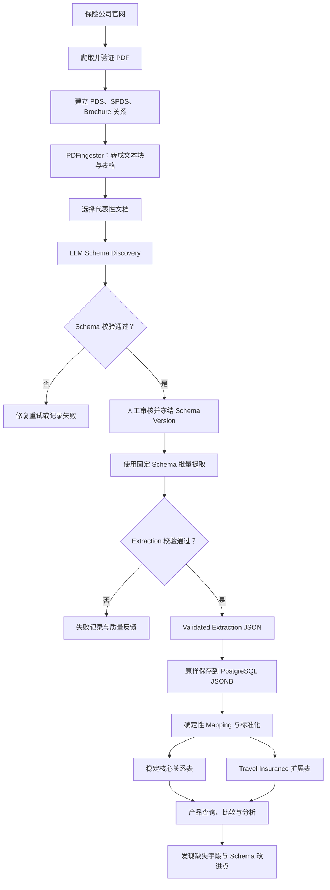
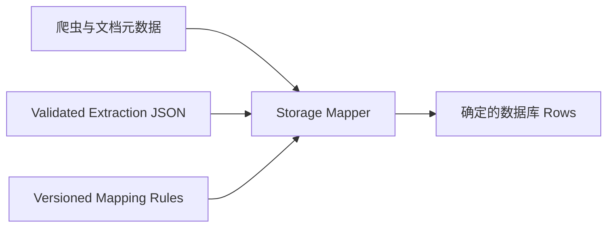
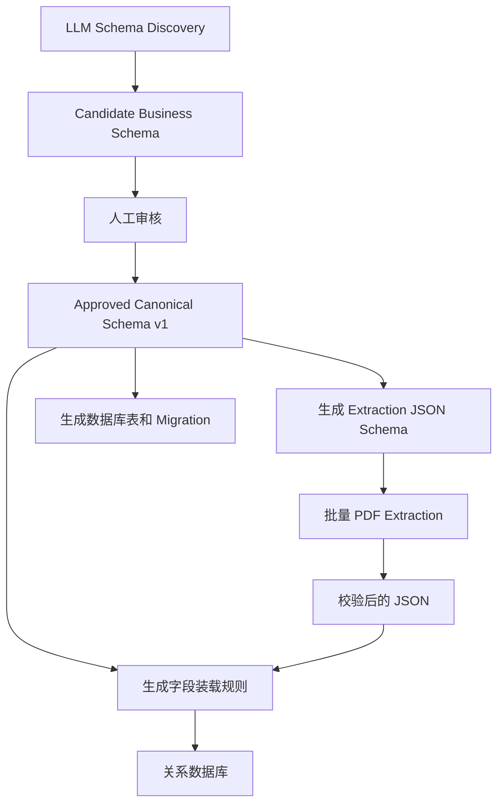
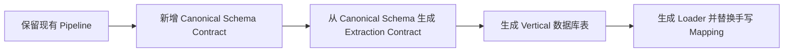
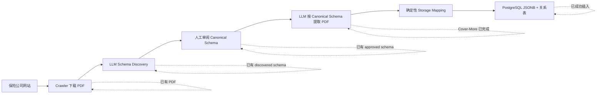

# 06. Project architecture, consensus refinement, and PostgreSQL storage (Part 2 of 2)

[Conversation index](../aiLogJamesW0203_English.md)

Session ID: `019fcbf7-3415-7a10-8370-45d1f1a501a4`

Recorded UTC range: 2026-08-04T08:50:48.378Z to 2026-08-19T11:02:13.110Z

Messages in this file: 97 of 279

Chinese prose is translated into English. Existing English and fenced code are retained; inline identifiers, paths and link destinations retain their original spelling. Statements describe what the participants said at the recorded time; historical results have not been rerun for this archive. Image attachments appear as text placeholders. See the index for scope and export rules.

---

<a id="msg-55634fbdcbd4ca95"></a>

### [2026-08-18T04:23:26.007Z] Codex

No extensive refactoring is needed. The most suitable approach is to add database persistence as a stage after extraction rather than rewriting the existing pipeline.

```text
现有部分（基本保留）
PDF → Discovery → Extraction → Validated JSON
                                      ↓
新增部分
                            Mapping → PostgreSQL
```

Parts that essentially need no changes:

- The crawler and PDF downloads;
- PDFingestor;
- OpenAI/Anthropic providers;
- Schema discovery;
- Structured-output validation;
- Extraction;
- Token usage and failure records.

Existing parts requiring small adjustments:

- Add a `storage` capability and mapping configuration to the manifest;
- In `src/run.py`, add a `load` or `persist` command;
- Add stable `document_id` and `schema_version_id` to extraction artifacts;
- Later split Travel taxonomy's mixed `product_type` into independent dimensions.

The main work can all go in new modules:

```text
src/storage/
  models.py          # 数据库实体
  mapper.py          # Extraction JSON → relational rows
  repository.py      # insert/upsert
  loader.py          # transaction orchestration

contracts/storage/
  canonical_record.schema.json
  storage_mapping.schema.json

configs/travel_insurance/
  storage_mapping.json

migrations/
  001_core_tables.sql
  002_travel_tables.sql
```

##### Three recommended steps

Step one: JSONB staging, the smallest change

Add:

```text
documents
schema_versions
extraction_runs
raw_extractions(payload JSONB)
```

Existing extraction JSON can be written almost unchanged. This stage already provides:

- No data loss;
- Traceable repeated runs;
- Every extraction linked to a PDF and schema;
- Room for subsequent normalization.

Step two: stable core relational tables

Add:

```text
insurers
products
product_releases
plans
product_release_documents
```

Implement deterministic mapping and upsert. Once complete, insurers, products, releases, and plans can be queried reliably.

Step three: Travel vertical tables

Add:

```text
travel_plan_details
benefit_definitions
plan_benefits
eligibility_rules
exclusions
```

Normalize Travel's `geographic_scope`, `trip_frequency`, `plan_tier`, benefits, and so on.

##### What approach would cause extensive refactoring

If the requirement were:

> Every time the LLM generates a schema, the program immediately creates or changes database tables dynamically.

That would require extensive changes and carry substantial risks:

- Discovery schemas would need SQL types and relationship definitions;
- Refinement would also have to handle database migrations;
- Every field change could trigger `ALTER TABLE`;
- Historical extractions might be incompatible with new table structures;
- Health and Travel would affect each other;
- Schema instability could directly damage the database.

Therefore, I do not recommend tightly coupling LLM schemas to database DDL.

The safer boundary is:

```text
LLM discovered schema
        ↓
reviewed canonical schema
        ↓
version-controlled storage mapping
        ↓
deterministic migration + loader
```

So the conclusion is that this can be implemented mainly through “new modules,” without overturning the current structure. Phase one could simply add a storage consumer to the existing pipeline; once verified stable, frequently used JSONB fields can gradually become formal relational columns. This approach also best matches your aim of low-cost future migration to verticals such as car insurance.

---

<a id="msg-da465602ce3111bd"></a>

### [2026-08-18T04:25:09.512Z] User

Okay, help me improve it toward this goal.

---

<a id="msg-d4dc343b242432f2"></a>

### [2026-08-18T04:25:22.881Z] Codex

I will implement this by “incrementally adding a storage stage,” leaving the crawler, discovery, and extraction intact. I will define stable data contracts and database boundaries first, then use test-driven development for migrations, mapping, idempotent writes, and the CLI; since the target is PostgreSQL and repository rules require separate approval for dependencies, I will first check existing dependencies and project guidelines, complete what I can without adding any, and explicitly explain if a database driver is necessary. I will use specification-first development, interface design, incremental implementation, test-driven development, and Git workflow to control scope.

---

<a id="msg-fe7f3cbea6571177"></a>

### [2026-08-18T04:25:42.989Z] User

Dependencies are fine; you may add them.

---

<a id="msg-079f856de2159d61"></a>

### [2026-08-18T04:25:51.272Z] Codex

Understood; dependency additions are approved. I will use `psycopg` (the modern Python driver in the official PostgreSQL ecosystem) as the sole new runtime dependency and proceed with the confirmed direction: one PostgreSQL database, relational tables plus JSONB, PDFs outside the database, raw extraction staged first, then transactional mapping and idempotent upserts; unreviewed LLM schemas will not execute DDL automatically. If a second new dependency becomes necessary, I will explain separately.

---

<a id="msg-971fd57271806328"></a>

### [2026-08-18T04:27:56.984Z] Codex

After inspection, the dependency plan needs two packages: `SQLAlchemy 2.x` to support production PostgreSQL and offline SQLite integration tests with the same schema/transaction/upsert code, and `psycopg[binary] 3.x` for actual PostgreSQL connections. This allows full table creation and repeated-insert logic to be tested without a local PostgreSQL service, while still generating PostgreSQL `JSONB`, primary/foreign keys, and unique constraints; no further database components beyond an ORM or migration framework will be introduced. Your dependency authorization covers both.

---

<a id="msg-6efe54f3c0ffcf9a"></a>

### [2026-08-18T04:29:22.817Z] User

What would the overall workflow be? Starting with PDF crawling, then LLM discovered schema, and everything afterward—restate the logic in detail, focusing on a clear, coherent explanation of why it works this way.

---

<a id="msg-ddc6097f68f555e6"></a>

### [2026-08-18T04:29:47.596Z] Codex

Yes. The core idea of the entire chain is: **preserve evidence before discovering structure; generate verifiable JSON before writing stable parts into relational tables; failure at any stage must not contaminate the next.**

```text
官网
 → 爬取并验证 PDF
 → 建立 PDS / SPDS / Brochure 关系
 → PDFingestor 转成文本块和表格
 → 选取代表性 PDS
 → LLM 发现“应该提取哪些字段”
 → JSON Schema + 业务规则校验
 → 人工审核并冻结 schema version
 → 用固定 schema 批量提取每份 PDF
 → 保存 validated extraction JSON
 → 原样写入 PostgreSQL JSONB staging
 → deterministic mapping / normalization
 → 事务性写入产品、版本、文档和 Travel 扩展表
 → 查询、比较、质量分析
 → 把失败反馈给下一轮 schema refinement
```

Why organize it in these layers:

1. **The crawler handles evidence, not product understanding.**
   It downloads PDFs, calculates SHA-256, identifies document types, and links “which PDS this SPDS amends and which PDS this brochure summarizes.” The model then receives trustworthy, traceable input.

2. **PDFingestor turns PDFs into material an LLM can read easily.**
   It preserves page numbers, reading order, and tables, avoiding treating the PDF as one large block of unstructured text. The raw PDF remains; parsing results are only an intermediate layer.

3. **Schema discovery discovers fields rather than extracting product data.**
   The LLM reads representative PDS documents from several companies and answers “which fields are needed for cross-company comparison,” such as product name, geographic scope, trip frequency, cancellation cover, and excess. The response must pass the JSON contract and business validation before becoming an official schema.

4. **The discovered schema is reviewed before becoming an extraction contract.**
   Raw LLM output can drift, so it cannot directly create database tables. The reviewed schema is versioned and compiled into a strict extraction JSON Schema; all subsequent documents use the same version for extraction.

5. **Extraction actually creates product records.**
   One Travel PDS can return multiple products/releases. Each result includes `_unfilled`, notes, and provenance; uncertainty becomes `null`, never a guess. Output is validated again, and failure stops the process.

6. **The database preserves complete raw results before normalization.**
   A validated extraction artifact is first written in full to `raw_extractions.payload JSONB`. This prevents any field being lost even when mapping is incomplete, and allows replay and remapping.

7. **The Mapper performs only deterministic transformations, with no LLM calls.**
   It converts stable fields into relational records: insurer, document, product, product_release, and Travel dimensions. Long-tail benefits remain in JSONB initially; once stable, they can become child tables such as `plan_benefits`.

8. **The Loader writes idempotently within one transaction.**
   Documents use content hashes, products and releases use deterministic identities, and extractions use run IDs. Reloading the same artifact does not add duplicate rows; failure in any table rolls back the entire write.

9. **Database results feed back into the schema.**
   We can measure fill rates, enum mismatches, frequently empty fields, and recurring JSONB fields. Only fields supported by evidence and review are promoted to formal relational columns.

I will synchronize this full logic into the PRD/README and continue implementing in this order. The storage PRD, architectural decision, and implementation plan are complete; next are the mapping contract, database tables, and offline end-to-end tests.

---

<a id="msg-87e35fb5750b502b"></a>

### [2026-08-18T04:31:04.236Z] Codex

The first contract layer is complete and tested: Travel's manifest now explicitly enables storage, and the mapping deterministically separates the mixed `product_type` into geography, trip frequency, customer group, and travel mode; Private Health still defaults to storage disabled, preserving its existing flow. Next I will install the newly approved SQLAlchemy and Psycopg packages, then implement the database tables.

---

<a id="msg-5c2a6d8a82b5af0e"></a>

### [2026-08-18T04:35:07.461Z] User

Pause implementation for now; let me sort out the logic first.

---

<a id="msg-9030bf169b5f50d7"></a>

### [2026-08-18T04:35:16.593Z] Codex

Okay, I will stop implementation immediately and will not continue writing the mapper, repository, or CLI. To avoid leaving the branch broken with “tests written but implementation absent,” I will only withdraw the uncommitted mapper test draft just created, preserving the two committed, tested safe points: storage specifications/contracts and the canonical database schema. Then I will focus on helping you clarify the overall logic.

---

<a id="msg-e0f1fa186347f8ea"></a>

### [2026-08-18T04:36:19.941Z] Codex

Okay, I will stop at the current commit, with no more code changes or OpenAI calls. I will use a “complex-system understanding” approach to clearly separate the layers of “documents, LLM schema, extraction results, and relational database,” and first confirm the worktree has no unfinished changes.

---

<a id="msg-f9f92d7c18418bfd"></a>

### [2026-08-18T04:36:32.050Z] Codex

I will explain it as three distinct but connected “contracts”: ① which fields the LLM should discover, ② which JSON each PDF must produce after the schema is fixed, and ③ how that JSON is reliably stored in relational tables. Separating these three concepts makes the entire chain easier to follow.

---

<a id="msg-33cea78cc25427f0"></a>

### [2026-08-18T04:38:19.560Z] Codex

Okay, implementation is stopped: I did not continue writing the mapper, database writes, or CLI, and made no further OpenAI calls. The current `feat/travel-insurance` worktree is clean, 6 commits ahead of the remote, and not yet pushed.

First, the project in one sentence:

> The crawler finds evidence, the LLM designs and fills in “structured forms,” and deterministic code validates and stores the data; the LLM neither creates tables directly nor directly changes database structures.

You can understand it as this chain:



##### First distinguish four things

This is the most important part of the entire logic.

###### 1. Raw PDF evidence

These are published by the insurer:

- PDS: primary legal and coverage terms
- SPDS: supplements or amendments to a PDS
- Brochure: product overview and marketing summary
- TMD/FSG: target market, sales, and financial services information

They are factual sources, but not structured data.

###### 2. LLM discovered schema

It answers:

> “Which fields should we extract from PDFs to compare Travel Insurance products?”

For example:

- `product_name`
- `product_type`
- `geographic_scope`
- `trip_frequency`
- `medical_cover`
- `cancellation_cover`
- `excess`
- `age_limits`
- `cruise_cover`

It is more like a “product information questionnaire” designed with LLM assistance, not SQL table-creation statements.

###### 3. Extraction JSON

Once reviewed and frozen, the schema is used to process each PDF. Each document's result is like a completed form:

```json
{
  "products": [
    {
      "product_name": "International Comprehensive",
      "product_type": "international_single_trip",
      "medical_cover": {
        "available": true,
        "limit": "Unlimited"
      }
    }
  ]
}
```

This JSON must pass validation against the fixed schema before entering the database stage.

###### 4. Relational storage schema

This is a stable database structure designed by people and maintained in code, for example:

- `products`
- `product_releases`
- `documents`
- `schema_versions`
- `extraction_runs`
- `travel_product_details`

It answers a different question:

> “How can data be inserted, related, deduplicated, and queried reliably over time?”

Therefore:

> The LLM schema determines “what to extract”; the database schema determines “how to store it”; storage mapping translates the former into the latter.

---

##### Stage one: acquiring and organizing PDFs

###### 1. Crawl official websites

The Crawler starts from configured insurer pages:

1. Visit permitted domains and product pages.
2. Find PDF links.
3. Before downloading, check domains, response types, and file sizes.
4. After downloading, check PDF file signatures.
5. Calculate SHA-256 to identify identical files.
6. Save provenance such as source URLs, download times, and titles.

This layer only “finds reliable materials”; it does not interpret insurance product contents.

###### 2. Classify documents

After downloading, identify whether the document is:

- PDS
- SPDS
- Brochure
- TMD
- FSG
- Unidentified document

Classification is necessary because different documents have different legal standing.

###### 3. Establish relationships between documents

PDS, SPDS, and Brochure should not be handled as three unrelated files:

```text
某个 Product Release
├── Primary PDS
├── Applicable SPDS
└── Supporting Brochure
```

When interpreting a product:

- The PDS is the base contract;
- The SPDS overrides or supplements parts of the PDS;
- The Brochure helps identify plan names, selling points, and summaries, but cannot override the PDS;
- Different effective dates for the same product should be treated as different releases.

Each document is stored separately in the database, but linked to the same product version through `product_release_documents`.

---

##### Stage two: converting PDFs into evidence the LLM can process

`PDFingestor` does not directly generate insurance data; it only reconstructs document structure:

- Extract text by page;
- Preserve reading order where possible;
- Extract tables;
- Save location information such as page numbers and table IDs;
- Cache parsing results.

The output can be understood as:

```text
Page 12
  Text block: Cancellation cover applies when...
  Table 3:
    International Comprehensive | Unlimited
    Essentials                  | $10,000
```

Page numbers and table sources are retained so we can later answer:

> Which page and table in the PDF did this value come from?

---

##### Stage three: Schema Discovery

###### Why not simply write a Travel Schema?

Because different insurers express things differently:

- Some classify by Single Trip / Multi Trip;
- Some by Basic / Comprehensive;
- Some treat Cruise as a standalone product;
- Some treat Cruise as an add-on;
- Some make Business Travel a separate product;
- Some place it under Annual Multi-Trip.

Writing a schema by hand from only one company's PDFs can easily mistake that company's product structure for the industry's structure.

###### What does Discovery actually do?

Sample representative PDS documents from multiple companies and ask the LLM to:

1. Identify recurring product concepts;
2. Merge synonymous fields;
3. Determine field types;
4. Provide allowed values, explanations, and aliases;
5. Identify Travel product classification dimensions;
6. Produce a candidate extraction schema.

The LLM is not extracting all products here; it is designing the “common form to use for later product extraction.”

###### Why multiple companies and a holdout?

If only Cover-More is used:

```text
Schema ≈ Cover-More 的文档结构
```

If multiple companies such as Cover-More, Allianz, 1Cover, and nib are used:

```text
Schema ≈ 行业共同结构 + 必要差异
```

Some PDFs should also be held out of discovery and used afterward to test whether the schema generalizes.

---

##### Stage four: validate, review, and freeze the Schema

LLM output cannot directly become a production contract; it must pass, in order:

1. JSON format validation;
2. Discovered-schema contract validation;
3. Business-rule validation;
4. A bounded number of repair requests if necessary;
5. Human review;
6. Assignment of a `schema_version`.

For example, a Travel schema must explicitly identify:

- Which field contains the product collection;
- Which field is the product name;
- Which field is the product type;
- The allowed product-type values;
- Field types and required-field rules.

Once frozen, a Schema Version cannot be silently changed by an individual LLM call.

This was also why the previous Travel discovery failed: the result lacked an explicit `product_type_field`. The code contract has been corrected, but the API has not been called again to verify it.

---

##### Stage five: batch extraction using the fixed Schema

Only after the schema is frozen does the pipeline begin actual data extraction.

For each valid PDS document package:

```text
Primary PDS
+ applicable SPDS
+ supporting brochure
+ frozen extraction schema
        ↓
Extraction
```

One Travel Insurance PDS usually contains multiple plans, so output is typically:

```json
{
  "products": [
    {...},
    {...},
    {...}
  ]
}
```

The extraction principles are:

- Output only fields defined in the schema;
- Use `null` for uncertainty rather than guessing;
- Record unfilled fields and explanations;
- Preserve page numbers or source evidence where possible;
- Validate output again against the dynamic extraction schema.

Only validated results become a `validated extraction artifact`.

---

##### Stage six: why both relational tables and JSONB are needed

We do not need two systems, “a relational database + a separate JSON database.”

Our choice is:

> One PostgreSQL database using both ordinary relational tables and PostgreSQL JSONB fields.

The two storage forms serve different purposes.

###### JSONB retains complete raw results

Save the validated extraction artifact unchanged:

```text
raw_extractions.artifact
```

This is done to:

- Retain fields not yet mapped;
- Preserve the LLM's full output at that time;
- Reload into tables after improving the mapping;
- Avoid further API charges;
- Trace how a datum was originally produced.

###### Relational tables store stable, frequently queried data

For example:

```text
products
- product_id
- vertical_code
- insurer_code
- canonical_name

travel_product_details
- release_id
- geographic_scope
- trip_frequency
- plan_tier
- customer_segment
- trip_style
```

This supports reliable execution of:

```sql
查找所有 international + annual multi-trip 产品
比较不同 insurer 的 single-trip 产品
统计有 cruise cover 的产品数量
```

Putting everything in JSONB makes queries, constraints, deduplication, and joins increasingly difficult; forcing everything into relational columns requires frequent database migrations whenever new fields change.

So we use:

> Stable fields go into relational tables; open-ended and potentially changing fields remain in JSONB.

---

##### Stage seven: deterministic Mapping

Mapping bridges the extraction schema and database schema, and this layer does not use an LLM.

For example, extraction output:

```json
{
  "product_name": "International Comprehensive",
  "product_type": "international_single_trip"
}
```

Mapping reliably converts it to:

```text
products.canonical_name = International Comprehensive

travel_product_details.geographic_scope = international
travel_product_details.trip_frequency = single_trip
```

The current Travel mapping defines this decomposition:

| Extracted product type | Geographic scope | Trip frequency / other dimension |
|---|---|---|
| `international_single_trip` | `international` | `single_trip` |
| `international_multi_trip` | `international` | `annual_multi_trip` |
| `domestic` | `domestic` | — |
| `inbound` | `inbound` | — |
| `business` | — | `customer_segment=business` |
| `cruise` | — | `trip_style=cruise` |

There is another question for future discussion:

`business` and `cruise` may be independent dimensions rather than product types at the same level as `domestic` and `international`.

For example, a product could simultaneously be:

```text
international
+ annual multi-trip
+ business
+ cruise cover available
```

Separating this information into orthogonal dimensions in relational tables therefore supports queries better than storing only one `product_type`.

---

##### Stage eight: transactional database loading

The plan is to perform the following in one database transaction when loading an artifact:

1. Confirm the vertical;
2. Confirm the insurer;
3. Register the PDF document;
4. Register the schema version;
5. Register the extraction run;
6. Save the complete raw JSONB;
7. Upsert products;
8. Upsert product releases;
9. Establish PDS/SPDS/Brochure relationships;
10. Write `travel_product_details`.

If any step fails, the whole transaction rolls back, leaving no partially written data.

Stable IDs and unique constraints also ensure:

- The same PDF is not duplicated;
- The same schema version is not duplicated;
- The same extraction run is not duplicated;
- Reloading the same product does not create another product;
- Loading the same artifact twice leaves table row counts unchanged.

This is an idempotent load: “repeating the operation yields the same result.”

---

##### Stage nine: querying and the feedback loop

Loading is not the endpoint. The database can expose schema weaknesses:

- Fields that stay empty;
- New fields frequently appearing in JSONB;
- Ambiguous field definitions;
- Products that cannot be classified reliably;
- Values needing enum standardization;
- Information worth promoting from JSONB to formal relational columns.

If a JSONB field becomes stable after validation across several companies, for example:

```text
maximum_trip_duration_days
```

A reviewed database migration can promote it to a relational field.

The correct direction is:

```text
数据证据
→ 发现稳定模式
→ 人工审核
→ 更新 extraction schema
→ 更新 storage mapping
→ 数据库 migration
```

Rather than letting the LLM automatically modify the database when it sees new fields.

---

##### What is reused and what is added for Car Insurance

Directly reusable:

- Crawler
- PDF downloading and validation
- PDFingestor
- Schema discovery
- Schema validation
- Extraction lifecycle
- Raw JSONB
- Core relational tables
- Transactions and idempotency

To add:

- Car Insurance manifest;
- Car-specific prompts and business validation;
- Car storage mapping;
- A `car_product_details` extension table.

So the ideal migration does not copy the entire pipeline, but:

```text
共享 pipeline
+ vertical manifest
+ vertical validator
+ vertical mapping
+ vertical extension table
```

---

##### Exactly where the project currently stands

Already present:

- Travel document crawling and classification;
- Manifest-driven vertical configuration;
- Travel schema discovery and extraction code;
- Travel storage mapping configuration;
- PostgreSQL/JSONB storage PRD;
- SQLAlchemy definitions for core relational tables and `travel_product_details`.

Not yet implemented:

- A mapper converting extraction JSON to database records;
- Repository and transactional upserts;
- `storage-init` / `storage-load` CLI;
- An actual PostgreSQL database smoke test;
- A second OpenAI Travel discovery test after the contract fix.

Related design files:

- [Relational Storage PRD](/Users/yangyajing/Library/CloudStorage/OneDrive-TheUniversityofMelbourne/UoM/MAST90106/proj/CapstoneProject-unimelb/tasks/travel-insurance-worktree/docs/specs/relational-storage-prd.md)
- [PostgreSQL + JSONB ADR](/Users/yangyajing/Library/CloudStorage/OneDrive-TheUniversityofMelbourne/UoM/MAST90106/proj/CapstoneProject-unimelb/tasks/travel-insurance-worktree/docs/decisions/001-postgresql-hybrid-storage.md)
- [Travel Storage Mapping](/Users/yangyajing/Library/CloudStorage/OneDrive-TheUniversityofMelbourne/UoM/MAST90106/proj/CapstoneProject-unimelb/tasks/travel-insurance-worktree/configs/travel_insurance/storage_mapping.json)
- [Canonical Storage Schema](/Users/yangyajing/Library/CloudStorage/OneDrive-TheUniversityofMelbourne/UoM/MAST90106/proj/CapstoneProject-unimelb/tasks/travel-insurance-worktree/src/storage/schema.py)

For now, remember the most important sentence:

> The LLM schema is an “extraction form,” not a database schema; the project maintains a stable relational structure, and mapping translates between the two.

---

<a id="msg-a17d62b4e6c27178"></a>

### [2026-08-18T04:39:07.622Z] User

How is this deterministic mapping obtained?

---

<a id="msg-281017641d1245c6"></a>

### [2026-08-18T04:39:29.057Z] Codex

I will separate “where mapping comes from” and “how mapping executes,” because deterministic means fixed execution results, not that rules emerge automatically from nowhere. The key is which reviewed business facts they rely on.

---

<a id="msg-cc080d0e447ebcb1"></a>

### [2026-08-18T04:40:14.495Z] Codex

Deterministic mapping is not “generated” by an LLM at runtime; it is manually defined, sample-validated, and versioned using the following four types of information:

```text
冻结后的 Extraction Schema
+ 稳定的数据库 Schema
+ Travel Insurance 业务分类规则
+ 多家公司真实提取样本
             ↓
      Storage Mapping
```

“Deterministic” means:

> The same extraction artifact under the same mapping version must produce exactly the same database records, no matter how many times it runs.

##### Where mapping information comes from

Not every field comes from the LLM:

| Data | Source |
|---|---|
| `document_id` | PDF SHA-256 |
| `insurer_code` | Crawler configuration/manifest |
| `document_type` | Document classifier |
| PDS/SPDS/Brochure relationships | Crawler acquisition artifact |
| `schema_version` | Reviewed and frozen schema |
| `run_id`, provider, model | Extraction execution records |
| Product name, coverage | LLM extraction JSON |
| Product classification dimensions | Extraction results + manually approved taxonomy |
| `product_id`, `release_id` | Calculated by the program using fixed formulas |

Mapping therefore merges two data streams:



##### How to design a Mapping Rule

Each extraction field generally falls into one of these five cases.

###### 1. Direct mapping

The field means exactly the same as the database column:

```text
extraction.product_name
    → products.canonical_name
```

At most, perform deterministic format cleanup:

- Trim leading and trailing spaces;
- Collapse repeated spaces;
- Normalize Unicode;
- Do not use the LLM to rewrite product names.

###### 2. Enum normalization

Different PDFs may use different wording, but the schema already groups it into fixed enums.

For example:

```text
"Annual Multi Trip"
"Annual Multi-Trip"
"Multi Trip Annual"
        ↓ extraction schema
"international_multi_trip"
```

The storage mapper accepts only standard values:

```text
international_multi_trip
    → geographic_scope = international
    → trip_frequency = annual_multi_trip
```

The Mapper does not reinterpret natural language.

###### 3. Split one field into multiple dimensions

The current Travel mapping decomposes `product_type`:

| `product_type` | Output |
|---|---|
| `international_single_trip` | `geographic_scope=international`, `trip_frequency=single_trip` |
| `international_multi_trip` | `geographic_scope=international`, `trip_frequency=annual_multi_trip` |
| `domestic` | `geographic_scope=domestic` |
| `inbound` | `geographic_scope=inbound` |
| `business` | `customer_segment=business` |
| `cruise` | `trip_style=cruise` |

These correspondences are reviewed by the team and written into configuration, not judged by an LLM for every request.

###### 4. Keep nested fields in JSONB

For example:

```json
{
  "medical_cover": {
    "available": true,
    "limit": "Unlimited",
    "conditions": ["Subject to policy wording"]
  }
}
```

If the structure is not stable enough to warrant separate tables, retain it in full in:

```text
travel_product_details.attributes
```

Once the structure is confirmed stable, promote it to relational tables through a database migration.

###### 5. Entity relationship mapping

For example, relationships between PDS, SPDS, Brochure, and product versions:

```text
PDS      → document_role = primary_pds
SPDS     → document_role = supplement_spds
Brochure → document_role = brochure
```

These relationships mainly come from crawling and should not be guessed again by the LLM.

---

##### A complete example

Suppose the validated extraction is:

```json
{
  "products": [
    {
      "product_name": "International Comprehensive",
      "product_type": "international_single_trip",
      "cruise_cover": {
        "available": true,
        "additional_premium": true
      },
      "medical_cover": {
        "limit": "Unlimited"
      }
    }
  ]
}
```

Mapping produces:

```text
products
├── canonical_name = International Comprehensive
├── vertical_code = travel_insurance
└── insurer_code = cover_more
```

```text
product_releases
├── product_id = deterministic hash
├── document_id = PDF SHA-256 identity
├── schema_version_id = travel_schema_v1
└── source_product_type = international_single_trip
```

```text
travel_product_details
├── geographic_scope = international
├── trip_frequency = single_trip
├── cruise_cover_available = true
└── attributes =
    {
      "cruise_cover": {...},
      "medical_cover": {...}
    }
```

At the same time, the full raw extraction JSON is saved to:

```text
raw_extractions.artifact
```

Even if mapping changes later, it can be converted again without another LLM call.

##### How mapping is “produced”

Recommended process:

1. Successfully complete schema discovery across multiple insurers.
2. Manually review and freeze `travel_schema_v1`.
3. Use that schema to extract data from several real PDS documents.
4. Collect the fields and enum values actually observed.
5. Divide fields into:
   - Stable relational fields;
   - Deterministically convertible fields;
   - Fields temporarily retained in JSONB;
   - Rejected anomalous fields.
6. Write a declarative mapping file.
7. Have Travel Insurance business staff review classification meanings.
8. Write tests with fixed inputs and expected database rows.
9. Freeze `mapping_version=1.0`.
10. At runtime, only load and execute the rules.

An LLM can suggest candidate correspondences in step 5, but its suggestions must be reviewed by people and written into fixed configuration; production loading no longer asks the LLM.

##### The current Mapping is not final

The current [storage_mapping.json](/Users/yangyajing/Library/CloudStorage/OneDrive-TheUniversityofMelbourne/UoM/MAST90106/proj/CapstoneProject-unimelb/tasks/travel-insurance-worktree/configs/travel_insurance/storage_mapping.json) is a first design draft, mainly defining:

- The product collection field is `products`;
- The identity field is `product_name`;
- The classification field is `product_type`;
- How `product_type` decomposes into Travel dimensions.

But it has not yet been validated by successful extractions across multiple companies.

Pay particular attention to:

> `business` and `cruise` are very likely not mutually exclusive product types at the same level as `domestic` and `international`.

One product could simultaneously be:

```text
international
+ annual multi-trip
+ business customer
+ cruise cover
```

Therefore, a safer final extraction schema should directly produce orthogonal fields:

```json
{
  "geographic_scope": "international",
  "trip_frequency": "annual_multi_trip",
  "customer_segment": "business",
  "trip_style": "cruise"
}
```

Most storage mapping would then become simple one-to-one mapping, reducing ambiguity caused by inferring other dimensions from `product_type`.

The final principle is:

> The LLM normalizes different companies' natural language into standard semantics; mapping mechanically converts those standardized semantics into database records.

---

<a id="msg-97ee07c0e7e8555e"></a>

### [2026-08-18T04:41:17.482Z] User

What is this mapping? Isn't it the database structure?

---

<a id="msg-afb1ec8dcfc2675d"></a>

### [2026-08-18T04:41:22.951Z] Codex

You are stuck on two easily confused concepts: the database structure describes “which tables and columns exist,” while mapping describes “which table and column each extracted value goes into.” I will separate them with a concrete example.

---

<a id="msg-263ababdc6083265"></a>

### [2026-08-18T04:41:48.788Z] Codex

No. Database structure and mapping are different things.

The simplest analogy:

> The database structure is “which shelves exist in a warehouse”; mapping is “which shelf each item belongs on.”

##### 1. Database structure: defines what can be stored

For example, the database has two tables:

```text
products
- product_id
- insurer_code
- canonical_name

travel_product_details
- release_id
- geographic_scope
- trip_frequency
```

It only specifies:

- Which tables exist;
- Which columns each table has;
- The column types;
- The primary keys, foreign keys, and unique constraints.

This currently corresponds to [src/storage/schema.py](/Users/yangyajing/Library/CloudStorage/OneDrive-TheUniversityofMelbourne/UoM/MAST90106/proj/CapstoneProject-unimelb/tasks/travel-insurance-worktree/src/storage/schema.py).

##### 2. Mapping: defines how data enters those tables

Suppose the LLM outputs:

```json
{
  "products": [
    {
      "product_name": "International Comprehensive",
      "product_type": "international_single_trip"
    }
  ]
}
```

The database structure does not automatically know:

- Which table `product_name` belongs in;
- Whether to preserve `product_type` unchanged;
- How many database rows one JSON product should produce;
- Whether `international_single_trip` should split into two fields.

Mapping specifies:

```text
products[*].product_name
    → products.canonical_name

products[*].product_type
    → product_releases.source_product_type

international_single_trip
    → travel_product_details.geographic_scope = international
    → travel_product_details.trip_frequency = single_trip
```

This currently corresponds to [storage_mapping.json](/Users/yangyajing/Library/CloudStorage/OneDrive-TheUniversityofMelbourne/UoM/MAST90106/proj/CapstoneProject-unimelb/tasks/travel-insurance-worktree/configs/travel_insurance/storage_mapping.json).

##### The exact relationship among all three

```text
Extraction Schema
“LLM 应输出什么 JSON”
          ↓
Storage Mapping
“JSON 字段如何转换成数据库行”
          ↓
Database Schema
“数据库允许有哪些表、列和关系”
```

For example:

| Layer | Definition |
|---|---|
| Extraction Schema | Must output `product_name` and `product_type` |
| Mapping | Put `product_name` in `products.canonical_name` |
| Database Schema | The `products` table has a `canonical_name` column |

##### Why not make Extraction JSON identical to the database structure?

In theory, that is possible, but it creates tight coupling.

These database fields do not exist in PDFs:

- `product_id`
- `release_id`
- `document_id`
- `schema_version_id`
- `run_id`
- Foreign-key relationships

The program must generate them using PDF hashes, schema versions, insurers, and product names, rather than having the LLM fill them in.

Also, one product JSON may ultimately generate all of these:

```text
1 行 products
1 行 product_releases
1 行 travel_product_details
3 行 product_release_documents
1 行 raw_extractions
```

The LLM only needs to express “what this insurance product is”; it should not organize database foreign keys and multi-table records.

##### Is Mapping a kind of Schema?

In a broad sense it is also a “mapping contract,” but it is not the database schema.

More precisely:

- `schema.py`: database structure contract;
- discovered schema: LLM output contract;
- `storage_mapping.json`: translation rules between the contracts.

So remember this sentence:

> Schema defines what each side looks like; mapping defines how the two sides correspond.

---

<a id="msg-38332317152b96fa"></a>

### [2026-08-18T04:42:29.058Z] User

So schema and mapping are two things? Schema is structure, and mapping is the correspondence—can I understand it that way?

---

<a id="msg-b3a9bdad14ae75bf"></a>

### [2026-08-18T04:42:34.231Z] Codex

Yes, you can.

More precisely, the project has two kinds of schema:

```text
Extraction Schema
定义 LLM 输出的 JSON 结构
        ↓
      Mapping
定义 JSON 字段如何转换、拆分并写入数据库
        ↓
Database Schema
定义数据库的表、列、类型和关联关系
```

For example:

```text
Extraction Schema:
product_type 是一个字符串

Mapping:
international_single_trip
→ geographic_scope = international
→ trip_frequency = single_trip

Database Schema:
travel_product_details 表中存在
geographic_scope 和 trip_frequency 两列
```

So remember:

> Schema defines “what it looks like”; Mapping defines “how one structure is converted to another.”

---

<a id="msg-47c0cabf9d469ceb"></a>

### [2026-08-18T04:43:46.357Z] User

I want the Extraction Schema, once manually reviewed, to be the final database schema. Is that possible?

---

<a id="msg-911bf510f483de65"></a>

### [2026-08-18T04:43:53.689Z] Codex

We can design toward that, but I will first distinguish “one authoritative business Schema” from “exactly the same physical structure.” This concerns stable interfaces among LLM output, validators, and databases, so I will assess the best approach using a single source of truth.

---

<a id="msg-a4c86db7352433e1"></a>

### [2026-08-18T04:44:35.740Z] Codex

Yes, and this better fits the goal of “reducing vertical migration costs.” But the definition needs a slight adjustment:

> The manually reviewed Extraction Schema should become the final “Canonical Business Schema,” from which the database structure is generated automatically, rather than executing the LLM's JSON Schema unchanged as SQL.

Recommended structure:



##### Why they cannot be exactly identical unchanged

Extraction Schema concerns business content extractable from PDFs:

```text
product_name
geographic_scope
trip_frequency
medical_cover
benefits[]
```

But the database must also contain system fields absent from PDFs:

```text
product_id
document_id
run_id
schema_version_id
created_at
foreign keys
unique constraints
```

Arrays and nested JSON objects also cannot directly correspond to a single relational table. For example:

```json
{
  "product_name": "Comprehensive",
  "benefits": [
    {"name": "Medical", "limit": "Unlimited"},
    {"name": "Cancellation", "limit": "$10,000"}
  ]
}
```

A relational database usually needs this transformed to:

```text
products                    1 行
product_releases            1 行
benefits                    2 行
```

So the reviewed Schema can determine the final business structure, but the database must still add technical fields and relationship design.

##### A more suitable Schema format

The current discovered schema can be extended to contain both extraction and storage definitions:

```json
{
  "field": "geographic_scope",
  "type": "string",
  "enum": ["domestic", "international", "inbound"],
  "required": true,
  "storage": {
    "entity": "travel_product_details",
    "column": "geographic_scope",
    "sql_type": "varchar",
    "nullable": false
  }
}
```

For arrays:

```json
{
  "field": "benefits",
  "type": "array",
  "storage": {
    "strategy": "child_table",
    "table": "product_benefits"
  }
}
```

For temporarily unstable objects:

```json
{
  "field": "special_conditions",
  "type": "object",
  "storage": {
    "strategy": "jsonb"
  }
}
```

Human review would then cover more than “what the LLM extracts”; it also covers:

- Business meaning of fields;
- Field types;
- Whether they are required;
- Enum values;
- Whether they enter relational tables;
- Their destination tables and columns;
- Whether nested fields become separate tables or JSONB.

##### Is Mapping still needed

Yes, but its role changes.

The original approach:

```text
Extraction Schema
+ 人工编写 Mapping
+ Database Schema
```

Your desired approach:

```text
Approved Canonical Schema
→ 自动生成 Database Schema
→ 自动生成 Mapping
```

Mapping therefore becomes a loading program automatically generated from the canonical schema, rather than another business configuration maintained separately by hand.

Only a little fixed technical mapping remains, for example:

```text
PDF SHA-256 → document_id
run metadata → extraction_runs
product record → 自动生成 product_id
nested array → child table rows
```

##### Recommendations for the current project

I recommend adjusting the final architecture to:

1. The LLM produces candidate schemas only.
2. Human review publishes `approved_schema_v1`.
3. `approved_schema_v1` becomes the single source of truth.
4. Generate the extraction validator from it.
5. Generate SQLAlchemy table definitions or database migrations from it.
6. Generate the JSON-to-row loader from it.
7. Still store complete extraction JSON in JSONB as raw evidence.
8. Publish `v2` when the schema changes and generate an explicit database migration.

This achieves your core goal:

> Adding Car Insurance primarily becomes reviewing a new canonical schema; database structures, validators, and most mapping can be generated automatically.

So the final answer is:

> The manually reviewed Extraction Schema can determine the final database business structure, but it should be upgraded to a Canonical Schema from which the program generates the physical database Schema; do not directly execute unconverted LLM JSON Schema.

---

<a id="msg-bc385b5a823153ce"></a>

### [2026-08-18T04:47:49.140Z] User

Okay. Would that require extensive refactoring of the original content?

---

<a id="msg-6fafd13e9f74b132"></a>

### [2026-08-18T04:47:58.583Z] Codex

I will assess the impact against current code boundaries instead of answering only conceptually. I will focus on the existing discovery contract, extraction validator, vertical manifest, and newly added storage schema to confirm what can stay and what needs an adapter layer. This calls for gradual migration, avoiding overturning the pipeline at once.

---

<a id="msg-115ec366704d5df3"></a>

### [2026-08-18T04:48:17.040Z] Codex

The existing code shows that the core crawler, PDF parsing, OpenAI request lifecycle, and extraction execution can stay. The real changes focus on Schema contracts and their downstream compilation/storage boundaries: a “moderate, incrementally achievable” refactor, not a rewrite of the entire pipeline.

---

<a id="msg-40b8e122b9d79d22"></a>

### [2026-08-18T04:49:02.413Z] Codex

No extensive rewrite is needed, but this is a “moderate architectural adjustment.” The key depends on what you mean by the “final Database Schema.”

| Approach | Change size | Recommendation |
|---|---:|---|
| Extraction Schema directly generates the entire database, including runs, documents, and foreign keys | Large | Not recommended |
| Human-reviewed Canonical Schema generates business tables while system core tables stay fixed | Moderate | Recommended |

##### Recommended boundary

Divide the database into two parts.

###### Fixed system core tables

These are not discovered from PDFs and should remain maintained by the project:

```text
verticals
insurers
documents
schema_versions
extraction_runs
raw_extractions
```

Because they include:

- PDF hash;
- API provider/model;
- schema version;
- run ID;
- Source path;
- Timestamps;
- Raw JSONB.

The LLM should not determine these structures.

###### Canonical Schema determines business tables

The manually reviewed schema determines:

```text
products
product_releases
travel_product_details
product_benefits
product_exclusions
```

For example, reviewed fields:

```json
{
  "name": "geographic_scope",
  "type": "enum",
  "values": ["domestic", "international", "inbound"],
  "storage": {
    "entity": "travel_product_details",
    "nullable": false
  }
}
```

The program generates from these:

```text
travel_product_details.geographic_scope VARCHAR NOT NULL
```

This achieves your intended result:

> The manually reviewed Schema is the single source of truth for the business database structure.

##### Existing components that need no changes

These can essentially all stay:

- `src/scraper/`: web and PDF crawling;
- `src/PDFingestor/`: PDF text and table parsing;
- `src/common/openai_run.py`: OpenAI request lifecycle;
- Provider/model configuration;
- Token usage and cost statistics;
- PDF sampling;
- Artifact envelope;
- Manifest-driven vertical selection;
- Most extraction execution flow.

So this does not overturn the original pipeline.

##### Main areas requiring adjustment

###### 1. Add an Approved Canonical Schema

Change the flow from:

```text
Discovery Schema
→ 直接用于 Extraction
```

To:

```text
Candidate Schema
→ 人工审核
→ Approved Canonical Schema
```

Clearly distinguish candidate and approved versions to prevent unreviewed LLM output affecting the database.

###### 2. Extend field definitions

Current fields are roughly:

```json
{
  "name": "trip_frequency",
  "type": "enum",
  "values": ["single_trip", "annual_multi_trip"]
}
```

Add storage information:

```json
{
  "name": "trip_frequency",
  "type": "enum",
  "values": ["single_trip", "annual_multi_trip"],
  "storage": {
    "entity": "travel_product_details",
    "strategy": "column",
    "nullable": true
  }
}
```

###### 3. Add a Canonical Schema Compiler

The same approved schema generates three artifacts:

```text
Approved Canonical Schema
├── Extraction JSON Schema
├── SQLAlchemy/Database Schema
└── JSON-to-row Loader
```

The project already has `compile_extraction_contract()` and `SchemaLoader`, and even preliminary `entity_schema_v2` support, so this is not starting from scratch.

###### 4. Adjust the Storage layer

The current [src/storage/schema.py](/Users/yangyajing/Library/CloudStorage/OneDrive-TheUniversityofMelbourne/UoM/MAST90106/proj/CapstoneProject-unimelb/tasks/travel-insurance-worktree/src/storage/schema.py) contains handwritten table structures.

It could become:

```text
固定核心表：继续手写
Vertical 业务表：由 Canonical Schema 生成
```

###### 5. Reduce reliance on a standalone Mapping file

The current [storage_mapping.json](/Users/yangyajing/Library/CloudStorage/OneDrive-TheUniversityofMelbourne/UoM/MAST90106/proj/CapstoneProject-unimelb/tasks/travel-insurance-worktree/configs/travel_insurance/storage_mapping.json) need not be deleted immediately.

During migration:

1. Have Canonical Schema also generate the new mapping;
2. Test that the generated results match the old mapping;
3. Once the new loader is stable;
4. Remove the handwritten mapping.

Mapping still exists in the end, but as a generated artifact rather than a second manually maintained source of business truth.

##### Four recommended steps for gradual migration



Each step can be tested independently:

1. Add canonical schema without changing existing behavior;
2. Test consistency between generated extraction schema and current results;
3. Generate Travel tables while keeping core tables fixed;
4. Ensure new and old mappings produce identical database rows for the same input;
5. Deprecate the old mapping only at the end.

##### Actual impact assessment

This is “Schema and Storage subsystem refactoring,” not “whole-project refactoring.”

More affected:

- Schema contract;
- Schema validation;
- Schema compiler;
- Human review output;
- Storage schema;
- Database migrations;
- Storage tests.

Minimally affected or unaffected:

- Crawler;
- PDF downloads;
- PDFingestor;
- OpenAI client;
- Sampling;
- Token/cost;
-Document acquisition;
- Most CLI commands.

Conclusion:

> If fixed core tables remain and only human-reviewed Canonical Schema generates vertical business tables, the changes are moderate and can be completed gradually; requiring LLM Schema to directly define the entire database would become extensive refactoring with significantly higher risks.

---

<a id="msg-5330f7c192c428bc"></a>

### [2026-08-18T04:50:38.342Z] User

Selected earlier text 1:

Human-reviewed Canonical Schema generates business tables, system core tables stay fixedModerateRecommended

User request:

Let's do it this way. That still allows human in the loop to standardize and complete this schema, right?

---

<a id="msg-757e51908f3cc0bc"></a>

### [2026-08-18T04:50:52.373Z] Codex

:codex-annotation{index="1"} Yes, and this approach is better suited to Human-in-the-loop.

The flow becomes:

```text
LLM Discovery
→ Candidate Canonical Schema
→ 自动规则校验
→ 人工审核、修改、批准
→ Approved Canonical Schema v1
→ 生成 Extraction Schema
→ 生成 Vertical 数据库表
→ 生成 Loader
→ 使用真实 PDF 验证
```

Human review must decide:

- Whether each field has a clear business meaning;
- Whether field names are standardized;
- Whether types are correct;
- Whether fields are required and allow `null`;
- Whether enums are complete;
- Which products fields apply to;
- Whether to use ordinary columns, child tables, or JSONB;
- Which fields make up product identity;
- How to store arrays and nested objects.

For example:

```json
{
  "name": "benefits",
  "type": "list[object]",
  "storage": {
    "strategy": "child_table",
    "entity": "product_benefits"
  },
  "review": {
    "status": "approved",
    "reviewed_by": "human",
    "reason": "Benefits require independent comparison and filtering"
  }
}
```

After human approval, the Schema should be frozen:

```text
approved_schema_v1
├── extraction_contract_v1
├── database_schema_v1
└── loader_v1
```

If gaps are found later, do not modify `v1` directly; instead:

```text
真实 Extraction 反馈
→ 新的 Candidate Change
→ 人工审核
→ approved_schema_v2
→ 数据库 Migration v1 → v2
```

Remember, “complete” does not mean unchanging forever, but:

> A complete version confirmed by people, capable of stable extraction and table creation within the current business scope and available evidence.

Human-in-the-loop is therefore retained and becomes the system's most important release gate: the LLM can propose fields, but only human-approved Canonical Schemas can generate formal database structures.

---

<a id="msg-065a7ebada90b924"></a>

### [2026-08-18T04:52:01.244Z] User

Okay, do it that way.

---

<a id="msg-d56b354d136cb9ed"></a>

### [2026-08-18T04:52:10.485Z] Codex

Okay. I will implement “fixed core tables + a human-approved Canonical Schema generating vertical business tables, the Extraction Contract, and the Loader.” This affects public Schema contracts and multiple-file migration, so I will use specification-driven development, interface design, test-driven development, incremental implementation, and Git workflow guidelines; I will update design and tests first, then replace the handwritten mapping in stages to avoid breaking the existing Travel pipeline.

---

<a id="msg-cca670f0fad1d3e8"></a>

### [2026-08-18T04:52:42.536Z] Codex

The current Travel worktree lacks several engineering-guideline documents present on main, so I will read main's guidelines as constraints while treating Travel's own README and dependency policy as the source of functional facts; I will not copy main's files into or overwrite this branch.

---

<a id="msg-c67623e4701c38db"></a>

### [2026-08-18T04:53:18.169Z] Codex

I will proceed with these accepted assumptions: the LLM does not determine fixed provenance/run tables; human-approved Canonical Schema is the sole source of truth for business fields; old discovered schemas and current CLI commands remain compatible initially; full raw extraction stays in JSONB; every schema change produces a new version rather than overwriting in place. First I will record these in the existing PRD, ADR, and task plan.

---

<a id="msg-bcaa92608494c793"></a>

### [2026-08-18T04:53:58.828Z] Codex

The specification's key decision is that candidate LLM Schemas cannot directly produce DDL; only an `approved` Canonical Schema carrying a human approval record is accepted by the compiler. It generates the extraction contract, vertical storage metadata, and deterministic load plan together; fixed run tables remain code-maintained. This design will be a new PRD/ADR rather than erasing earlier decision history.

---

<a id="msg-73cbbc4ac285b33a"></a>

### [2026-08-18T04:56:59.949Z] Codex

The specification and ADR are written. This repository's `.gitignore` ignores all of `docs/`, so new documents must be explicitly force-added to version control like the existing PRD/ADR; I will add only these two new design documents and the plan file, without including other ignored content.

---

<a id="msg-7c23fcddc2388bdc"></a>

### [2026-08-18T04:57:50.146Z] Codex

Starting the first reversible slice: establish only the Canonical Schema lifecycle and safety boundaries. Tests will first show that candidates cannot compile, approval records are mandatory, and SQL identifiers and core bindings are restricted; existing extraction and database code will remain untouched at this stage.

---

<a id="msg-6386b7f938b9a636"></a>

### [2026-08-18T05:00:17.399Z] Codex

The first slice is complete: the candidate/approved lifecycle, human approval records, field identities, permitted core bindings, SQL identifiers, and JSONB restrictions now have fail-closed tests. This safety boundary does not alter existing discovered-schema behavior; I will run relevant compatibility tests and save a commit first.

---

<a id="msg-28ff46f2d4890c32"></a>

### [2026-08-18T05:53:54.082Z] Codex

The second slice only implements “the same approved schema → extraction JSON contract.” Extraction will not be made to fit database rows; it still outputs product-oriented JSON, but field types, requiredness, and enums all come from the same Canonical Schema.

---

<a id="msg-e785f296582274c1"></a>

### [2026-08-18T06:00:23.205Z] Codex

The third slice turns “mapping” into a compilation result: an approved schema generates a vertical extension table with foreign keys, types, and enum constraints, and compiles validated extraction into a pure-data load plan. This stage still makes no database connections or LLM calls and does not implement transactional writes, keeping risks controlled.

---

<a id="msg-0604602d0eb885b4"></a>

### [2026-08-18T06:02:41.131Z] Codex

Canonical storage compilation now works: the same approved schema produces a typed extension table and a deterministic load plan; `list[object]` is not split into tables without authorization, but is preserved in full in attributes JSONB. Next I will run compatibility regression tests and save a commit, then connect the CLI/human approval entry points.

---

<a id="msg-fd52d385c1a5ac86"></a>

### [2026-08-18T06:03:57.740Z] Codex

The CLI will remain side-effect-free: `canonical-compile` only reads a human-approved schema and writes an extraction contract and PostgreSQL DDL preview to a new output directory; it does not connect to databases, execute migrations, or overwrite existing files. Reviewers can inspect the generated results before deciding whether to proceed to database migration.

---

<a id="msg-81deae1e854dcb10"></a>

### [2026-08-18T06:06:35.579Z] Codex

The CLI preview entry point is ready, but checking the full chain revealed a missing interface: the existing `extract` command only recognizes old discovered schemas. Without connecting this layer, Canonical Schema can generate a contract but cannot actually drive PDF extraction. Next I will compatibly let `extract` accept both old schemas and approved Canonical Schemas, preserving default behavior for the old flow.

---

<a id="msg-2cdb2fe26876f636"></a>

### [2026-08-18T06:08:11.473Z] Codex

Both usage paths now work: reviewers can first run `canonical-compile` to inspect extraction contracts/DDL, or the existing `extract` command can directly accept approved Canonical Schemas. Candidates are rejected on both paths, and extraction tests for old discovered schemas still pass. Next I will save CLI and extraction adaptations in two atomic commits.

---

<a id="msg-25dbd7db1b552558"></a>

### [2026-08-18T06:10:01.376Z] Codex

Implementation now meets this specification's completion conditions: approval gate, Canonical→Extraction, Canonical→Vertical SQL, Canonical→Load Plan, CLI preview, and `extract` compatibility are connected. Final validation begins now; this step runs only offline tests and CLI help, without connecting to OpenAI or PostgreSQL.

---

<a id="msg-4e6166f2b78e749f"></a>

### [2026-08-18T06:10:28.846Z] Codex

Offline validation passed: all 321 tests, compileall, and both CLI help checks passed. Before committing, I will review the new public contracts, candidate approval boundary, SQL generation, and backward compatibility under the code-quality guidelines, focusing on “candidates bypassing approval,” “lost fields,” “unsafe DDL identifiers/constraints,” and regressions in old extraction.

---

<a id="msg-a29d7688b0c07bd0"></a>

### [2026-08-18T06:11:37.811Z] Codex

The quality check found three issues to fix before finishing: ① the contract permits two fields to write to the same core column, potentially overwriting values; ② optional scalar Canonical fields are rejected by the provider in OpenAI strict mode; ③ the old `schema.py` still handwrites a Travel business table, conflicting with “Canonical Schema as the single source of business truth.” I will add regression tests and fix each issue.

---

<a id="msg-126fae3768c0fc75"></a>

### [2026-08-18T06:14:47.079Z] Codex

The core chain is implemented; I am performing a final round of boundary tightening and regression validation, focusing on Canonical Schema field conflicts, OpenAI strict-mode compatibility, and removing the Travel business table still hardcoded in the core layer.

---

<a id="msg-3b9cec0949a15ff6"></a>

### [2026-08-18T06:15:29.364Z] Codex

Fixes for the three review findings passed 44 focused tests: core fields can no longer be overwritten through duplicate bindings; optional fields automatically disable incompatible provider strict mode; and the Travel detail table has been removed from the fixed core structure and can only be generated from a reviewed Canonical Schema. Next is full regression testing.

---

<a id="msg-36effb9fd8b0bec8"></a>

### [2026-08-18T06:17:20.451Z] Codex

Full offline regression passed: all 325 tests succeeded, and CLI help and the PostgreSQL DDL preview path also work. I will only check the worktree, commit history, and remote differences now; this round made no OpenAI calls and did not connect to or modify a database.

---

<a id="msg-ed5d678fe30390e9"></a>

### [2026-08-18T06:17:46.674Z] Codex

This stage is complete. The branch is `feat/travel-insurance`, the worktree is clean, and nothing has been pushed to the remote.

Implemented:

- Human-reviewed Canonical Schema is the sole authority for business structures.
- A `candidate` Schema cannot generate downstream structures; only an `approved` Schema with a human review record may proceed.
- Automatic generation of:
  - LLM Extraction JSON Schema
  - Vertical PostgreSQL table-creation DDL
  - A deterministic Core / Extension / JSONB Load Plan
- Extraction can directly read Approved Canonical Schema.
- The previously hardcoded `travel_product_details` in the fixed core database was removed and is now generated dynamically from Canonical Schema.
- Added checks for conflicting field bindings, identity-field types, and OpenAI strict-mode compatibility.

Key files:

- [Canonical Schema PRD](/Users/yangyajing/Library/CloudStorage/OneDrive-TheUniversityofMelbourne/UoM/MAST90106/proj/CapstoneProject-unimelb/tasks/travel-insurance-worktree/docs/specs/approved-canonical-schema-prd.md)
- [Architectural decision record](/Users/yangyajing/Library/CloudStorage/OneDrive-TheUniversityofMelbourne/UoM/MAST90106/proj/CapstoneProject-unimelb/tasks/travel-insurance-worktree/docs/decisions/002-approved-canonical-schema-authority.md)
- [Canonical Schema Contract](/Users/yangyajing/Library/CloudStorage/OneDrive-TheUniversityofMelbourne/UoM/MAST90106/proj/CapstoneProject-unimelb/tasks/travel-insurance-worktree/contracts/canonical_schema.schema.json)
- [Schema validation and Extraction Contract compilation](/Users/yangyajing/Library/CloudStorage/OneDrive-TheUniversityofMelbourne/UoM/MAST90106/proj/CapstoneProject-unimelb/tasks/travel-insurance-worktree/src/schema/canonical.py)
- [Database structure and Load Plan compilation](/Users/yangyajing/Library/CloudStorage/OneDrive-TheUniversityofMelbourne/UoM/MAST90106/proj/CapstoneProject-unimelb/tasks/travel-insurance-worktree/src/storage/canonical.py)
- [CLI entry point](/Users/yangyajing/Library/CloudStorage/OneDrive-TheUniversityofMelbourne/UoM/MAST90106/proj/CapstoneProject-unimelb/tasks/travel-insurance-worktree/src/run.py)

Verification results:

- `compileall`: passed
- Offline tests: 325/325 passed
- CLI help and Canonical Schema compilation command: passed
- Credential scan: no keys found
- No OpenAI calls or connections/modifications to real PostgreSQL

The implementation currently reaches “generating executable table structures and deterministic insertion plans.” Actual database DDL execution, transactional inserts, and the upsert repository remain for the next phase. A real Travel Canonical Schema also needs human field review before it can officially be marked `approved`.

---

<a id="msg-ed2e9a8a76ebe9d9"></a>

### [2026-08-18T06:21:39.391Z] User

What do I need to do to proceed to the next step?

---

<a id="msg-8606918f04f3d39d"></a>

### [2026-08-18T06:21:45.139Z] Codex

I will explain in the order “first establish the human approval artifact, then separately verify extraction, table creation, and stable writes,” using commands actually available on this branch so unimplemented steps are not presented as usable. I will use `understanding-anything` to break the next phase into an executable, verifiable flow.

---

<a id="msg-fd958cea111b70bd"></a>

### [2026-08-18T06:22:20.600Z] Codex

The next key step is to obtain a real Travel Canonical Schema confirmed by you, rather than connecting the database first. It is the shared basis for subsequent extraction, table creation, and insertion.

Recommended order:

1. Generate `candidate_canonical_schema.json` from the current Travel discovered schema.
2. Manually review the fields:
   - Whether product name and product type are correct
   - Types, requiredness, and nullability
   - Whether enum categories are complete
   - Put frequently queried fields in relational columns
   - Temporarily keep complex structures such as benefits and exclusions in JSONB
3. After review, fill in:
   - `status: approved`
   - `reviewed_by`
   - `reviewed_at`
   - `rationale`
   - A fixed version such as `1.0.0`
4. Run offline compilation:

```bash
.venv/bin/python src/run.py canonical-compile \
  --manifest configs/travel_insurance/manifest.json \
  --schema path/to/approved_canonical_schema.json \
  --output-dir outputs/travel_insurance/compiled_schema_v1
```

It will generate:

```text
extraction_contract.json
vertical_table.sql
```

5. Manually inspect SQL and the Extraction Contract, then proceed to database writes once confirmed:
   - Create fixed core tables
   - Apply `vertical_table.sql`
   - Implement the transactional repository/upsert
   - Convert extraction JSON into a deterministic Load Plan
   - Save raw JSONB and relational fields together
6. Finally, select one Travel PDS for end-to-end testing:

```text
PDF
 → Approved Canonical Schema 提取
 → JSON Schema 验证
 → Load Plan
 → PostgreSQL 插入
 → 查询并核对结果
```

For now, you only need to confirm one thing: allow me to generate the first `candidate_canonical_schema.json` from the current Travel discovered schema and downloaded PDFs. This can be entirely offline, without OpenAI calls or API charges. I will then list the fields individually for your review; no tables will be created or database writes made before your explicit approval.

---

<a id="msg-a0d4a328f425b57d"></a>

### [2026-08-18T06:55:12.069Z] User

List what I need to do at each step and the Bash commands to use, so I can check them one by one.

---

<a id="msg-76643bb0c6b09dc5"></a>

### [2026-08-18T06:55:19.662Z] Codex

I will organize this as a step-by-step command checklist, first checking the current worktree, configuration files, existing Travel data, and CLI arguments so copied paths and commands match this branch. I will use `planning-and-task-breakdown` to define each step's inputs, commands, expected output, and pass criteria.

---

<a id="msg-9736106277bcdec7"></a>

### [2026-08-18T07:00:16.816Z] Codex

Below is the list based on the “actual currently executable state.” Do one step at a time and continue after seeing the expected result.

First, the boundaries:

- Steps 0–8: supported by current code.
- Step 9: can generate a deterministic Load Plan, but does not write to the database.
- Step 10: `storage-init` and `storage-load` are not implemented yet, so stable insertion into PostgreSQL is not currently available.

##### Step 0: enter the correct Travel worktree

```bash
PROJECT_ROOT="/Users/yangyajing/Library/CloudStorage/OneDrive-TheUniversityofMelbourne/UoM/MAST90106/proj/CapstoneProject-unimelb"
TRAVEL_ROOT="$PROJECT_ROOT/tasks/travel-insurance-worktree"
PYTHON_BIN="$PROJECT_ROOT/.venv/bin/python"

cd "$TRAVEL_ROOT"
```

Check the location and branch:

```bash
pwd
git branch --show-current
git status --short
"$PYTHON_BIN" --version
```

Expected result:

```text
.../tasks/travel-insurance-worktree
feat/travel-insurance
```

`git status --short` should have no output, indicating a clean worktree.

Note: the Travel worktree has no `.venv` of its own, so use `$PYTHON_BIN` consistently afterward.

---

##### Step 1: load `.env`

The project's CLI does not automatically load `.env`.

First check the main project's `.env`:

```bash
test -f "$PROJECT_ROOT/.env" && echo ".env exists" || echo ".env missing"
```

If it exists, load it into the current terminal:

```bash
set -a
source "$PROJECT_ROOT/.env"
set +a
```

Check that the provider, model, and API Key are recognized, without printing the Key:

```bash
"$PYTHON_BIN" -c '
from src.common.model_config import resolve_selection, resolve_api_key
selection = resolve_selection()
key, key_name = resolve_api_key(selection)
print("provider:", selection.provider)
print("model:", selection.model)
print("document_input:", selection.document_input)
print("key_environment:", key_name)
print("key_configured:", bool(key))
'
```

Expected output resembles:

```text
provider: openai
model: gpt-5
document_input: markdown
key_environment: MY_OPENAI_API_KEY
key_configured: True
```

If `key_configured` is `False`, stop before any further API testing.

---

##### Step 2: investigate the previous OpenAI 401 organization issue

Check only whether organization/project environment variables exist, without printing their values:

```bash
env | cut -d= -f1 | rg '^OPENAI_(ORG|ORGANIZATION|PROJECT)'
```

If old organization or project variables appear and you do not need to specify them explicitly, clear them in the current terminal:

```bash
unset OPENAI_ORG_ID
unset OPENAI_ORGANIZATION
unset OPENAI_PROJECT_ID
```

Also check `$PROJECT_ROOT/.env` and comment out organization/project configuration no longer used.

Then perform a minimal authentication check. This accesses OpenAI but generates no content:

```bash
"$PYTHON_BIN" -c '
import os
from openai import OpenAI

key = os.getenv("MY_OPENAI_API_KEY") or os.getenv("OPENAI_API_KEY")
if not key:
    raise RuntimeError("OpenAI API key is not configured")

client = OpenAI(api_key=key)
models = client.models.list()
print("OpenAI authentication OK")
print("visible_models:", len(models.data))
'
```

Pass criterion:

```text
OpenAI authentication OK
```

If you still get:

```text
invalid_organization
```

Do not continue discovery. The issue still concerns the organization owning the OpenAI Key, project permissions, or stale organization configuration in the terminal, rather than PDF or Schema code.

---

##### Step 3: run offline tests

This step uses no network and incurs no API charges:

```bash
"$PYTHON_BIN" -m compileall src tests
```

```bash
"$PYTHON_BIN" -m unittest discover -s tests
```

```bash
"$PYTHON_BIN" src/run.py --help
```

Expected:

```text
Ran 325 tests
OK
```

Help should include:

```text
discover
extract
batch
crawl
canonical-compile
```

---

##### Step 4: check the downloaded Travel PDFs

List all PDFs:

```bash
rg --files data/travel_insurance/raw/PDFs | rg '\.pdf$' | sort
```

Count them:

```bash
rg --files data/travel_insurance/raw/PDFs | rg '\.pdf$' | wc -l
```

You should currently see Cover-More and SCTI PDS, SPDS, TMD, and FSG documents.

###### To recheck page discovery results only

This accesses insurer websites, but does not call OpenAI or download PDFs:

```bash
"$PYTHON_BIN" src/run.py crawl \
  --manifest configs/travel_insurance/manifest.json \
  --insurer cover_more \
  --discovery-only
```

###### To download Cover-More files again

```bash
"$PYTHON_BIN" src/run.py crawl \
  --manifest configs/travel_insurance/manifest.json \
  --insurer cover_more
```

Inspect the acquisition results:

```bash
rg --files outputs/travel_insurance/acquisition | sort
```

If the existing PDFs suffice, skip recrawling.

---

##### Step 5: run Travel discovered schema

There is currently no successfully generated Travel discovered schema, so this is the next first API step that genuinely needs completing.

First define the output path:

```bash
DISCOVERED_SCHEMA="outputs/travel_insurance/discovered_schema_v1.json"
USAGE_LOG="outputs/travel_insurance/discovery_usage_v1.jsonl"
```

Check whether the target file already exists:

```bash
test -e "$DISCOVERED_SCHEMA" && echo "output already exists" || echo "output available"
```

Use three representative PDS documents:

```bash
"$PYTHON_BIN" src/run.py discover \
  --manifest configs/travel_insurance/manifest.json \
  --samples \
  data/travel_insurance/raw/PDFs/cover_more/pds/6a76ab3cd692d154389f9f5f6938cec3e7aa62ecd9add172747afc22c658da83_cover-more-pds.pdf \
  data/travel_insurance/raw/PDFs/scti/pds/c9580b4d6c1e326d36d5eafa3f5e49b4ec1d07d5b50a6afcdfb9c919b0f67237_view-international-comprehensive-pds.pdf \
  data/travel_insurance/raw/PDFs/scti/pds/1a52730b0ff2b2431c4291114718ab6907fa5d3410a0124deb9fb8488700d123_download-domestic-product-disclosure-statement-pds.pdf \
  --provider openai \
  --model "${LLM_MODEL:-gpt-5}" \
  --document-input markdown \
  --output "$DISCOVERED_SCHEMA" \
  --usage-log "$USAGE_LOG"
```

This step:

- Calls OpenAI;
- Incurs API charges;
- Sends converted PDF content to OpenAI;
- May take several minutes.

Check results:

```bash
"$PYTHON_BIN" -c '
import json
from pathlib import Path

path = Path("outputs/travel_insurance/discovered_schema_v1.json")
artifact = json.loads(path.read_text(encoding="utf-8"))

print("status:", artifact.get("status"))
print("artifact_type:", artifact.get("artifact_type"))
print("vertical:", artifact.get("data", {}).get("vertical"))
print("version:", artifact.get("data", {}).get("version"))
print("field_count:", len(artifact.get("data", {}).get("fields", [])))
'
```

Pass criterion:

```text
status: success
artifact_type: discovered_schema
vertical: travel_insurance
```

View the full formatted file:

```bash
"$PYTHON_BIN" -m json.tool "$DISCOVERED_SCHEMA" | less
```

Press `q` to exit `less`.

If it fails, inspect the error file:

```bash
rg --files outputs/travel_insurance/errors/schema_discovery | sort
```

---

##### Step 6: generate Candidate Canonical Schema

There is no `canonical-init` CLI at this stage; existing Bash commands alone cannot automate it because field semantics and database storage strategies require decisions.

Suggested file location:

```text
outputs/travel_insurance/canonical_schema_v1.candidate.json
```

Review these three inputs together:

```bash
code \
  "$DISCOVERED_SCHEMA" \
  configs/travel_insurance/storage_mapping.json \
  contracts/canonical_schema.schema.json
```

Then ask me to generate the following based on them:

```text
outputs/travel_insurance/canonical_schema_v1.candidate.json
```

Focus human review on:

- Whether `product_name` correctly binds to `products.canonical_name`
- Whether `product_type` correctly binds to `product_releases.source_product_type`
- Whether the `product_type` enum covers the required categories
- Which fields need frequent filtering or aggregation
- Use `extension_column` for stable, frequently queried fields
- For open nested structures such as `benefits` and `exclusions`, use `jsonb`
- Whether `required` and `nullable` reflect real PDFs
- Whether field names and descriptions are clear
- The Candidate's `status` must be `candidate`
- The Candidate's `review` must be `null`

---

##### Step 7: validate Candidate Schema

Assuming the file has been generated:

```bash
CANDIDATE_SCHEMA="outputs/travel_insurance/canonical_schema_v1.candidate.json"
```

Run validation:

```bash
CANDIDATE_SCHEMA="$CANDIDATE_SCHEMA" "$PYTHON_BIN" -c '
import json
import os
from pathlib import Path
from src.schema.canonical import validate_canonical_schema

path = Path(os.environ["CANDIDATE_SCHEMA"])
schema = json.loads(path.read_text(encoding="utf-8"))
validate_canonical_schema(schema)

print("Candidate schema is valid")
print("status:", schema["status"])
print("vertical:", schema["vertical"])
print("version:", schema["version"])
print("fields:", len(schema["fields"]))
'
```

Pass criterion:

```text
Candidate schema is valid
status: candidate
vertical: travel_insurance
```

A Candidate cannot generate table-creation DDL at this point; this is an intentional safety restriction.

You can also verify that the compiler actually rejects it:

```bash
"$PYTHON_BIN" src/run.py canonical-compile \
  --manifest configs/travel_insurance/manifest.json \
  --schema "$CANDIDATE_SCHEMA" \
  --output-dir outputs/travel_insurance/candidate_should_not_compile
```

Expected failure message:

```text
Canonical Schema must be human-approved
```

No output directory should be generated either.

---

##### Step 8: manually approve Canonical Schema

First copy it to the formal configuration file, refusing to overwrite an existing file:

```bash
APPROVED_SCHEMA="configs/travel_insurance/canonical_schema_v1.json"
cp -n "$CANDIDATE_SCHEMA" "$APPROVED_SCHEMA"
```

Open for editing:

```bash
code "$APPROVED_SCHEMA"
```

Manual changes required:

```json
{
  "version": "1.0.0",
  "status": "approved",
  "review": {
    "reviewed_by": "你的名字",
    "reviewed_at": "ISO-8601时间",
    "rationale": "说明审核了哪些字段、分类和存储策略。"
  }
}
```

Do not merely change `status`. Carefully review the fields before completing the review record.

Validate the Approved Schema:

```bash
APPROVED_SCHEMA="$APPROVED_SCHEMA" "$PYTHON_BIN" -c '
import json
import os
from pathlib import Path
from src.schema.canonical import require_approved_canonical_schema

path = Path(os.environ["APPROVED_SCHEMA"])
schema = json.loads(path.read_text(encoding="utf-8"))
require_approved_canonical_schema(schema)

print("Approved schema is valid")
print("vertical:", schema["vertical"])
print("version:", schema["version"])
print("reviewed_by:", schema["review"]["reviewed_by"])
'
```

Pass criterion:

```text
Approved schema is valid
vertical: travel_insurance
version: 1.0.0
```

---

##### Step 9: generate the Extraction Contract and PostgreSQL DDL

Define a new output directory:

```bash
COMPILED_SCHEMA="outputs/travel_insurance/compiled_schema_v1"
```

Confirm it does not exist:

```bash
test -e "$COMPILED_SCHEMA" && echo "directory already exists" || echo "directory available"
```

Compile:

```bash
"$PYTHON_BIN" src/run.py canonical-compile \
  --manifest configs/travel_insurance/manifest.json \
  --schema "$APPROVED_SCHEMA" \
  --output-dir "$COMPILED_SCHEMA"
```

Expected generated files:

```text
outputs/travel_insurance/compiled_schema_v1/extraction_contract.json
outputs/travel_insurance/compiled_schema_v1/vertical_table.sql
```

Check:

```bash
rg --files "$COMPILED_SCHEMA" | sort
```

View the Extraction Contract:

```bash
"$PYTHON_BIN" -m json.tool \
  "$COMPILED_SCHEMA/extraction_contract.json" | less
```

View PostgreSQL DDL:

```bash
sed -n '1,240p' "$COMPILED_SCHEMA/vertical_table.sql"
```

Focus on:

- Whether `travel_product_details` is created
- Whether `release_id` links to `product_releases`
- Whether stable fields are separate columns
- Whether enums generate CHECK constraints
- Whether open fields enter `attributes JSONB`
- Whether there are no unexpected fields or table names

This step does not connect to the database.

---

##### Step 10: extract one PDS using the Approved Schema

Choose the Cover-More Business PDS:

```bash
TEST_PDF="data/travel_insurance/raw/PDFs/cover_more/pds/21d57b70e6fe14b4f692d967a45f8de762234045c45e00c99c852e9ad6bd82ad_view-the-business-pds.pdf"
EXTRACTION_ARTIFACT="outputs/travel_insurance/extractions/cover_more_business_canonical_v1.json"
```

Check whether the output file already exists:

```bash
test -e "$EXTRACTION_ARTIFACT" && echo "output already exists" || echo "output available"
```

Run extraction:

```bash
"$PYTHON_BIN" src/run.py extract \
  --manifest configs/travel_insurance/manifest.json \
  --schema "$APPROVED_SCHEMA" \
  --pdf "$TEST_PDF" \
  --output "$EXTRACTION_ARTIFACT" \
  --provider openai \
  --model "${LLM_MODEL:-gpt-5}"
```

This step:

- Calls OpenAI;
- Incurs API charges;
- Sends PDFingestor-generated document text to OpenAI.

Check results:

```bash
EXTRACTION_ARTIFACT="$EXTRACTION_ARTIFACT" "$PYTHON_BIN" -c '
import json
import os
from pathlib import Path

path = Path(os.environ["EXTRACTION_ARTIFACT"])
artifact = json.loads(path.read_text(encoding="utf-8"))

print("vertical:", artifact["vertical"])
print("schema_version:", artifact["schema_version"])
print("provider:", artifact["provider"])

products = artifact["data"]["products"]
print("product_count:", len(products))

for product in products:
    print("-", product["product_name"], "/", product["product_type"])
'
```

Pass criterion:

- `vertical` is `travel_insurance`
- `schema_version` is `1.0.0`
- At least one product is extracted
- `product_name` and `product_type` have values
- Enum, requiredness, and nullability checks all pass

View the full result:

```bash
"$PYTHON_BIN" -m json.tool "$EXTRACTION_ARTIFACT" | less
```

---

##### Step 11: generate a deterministic Load Plan

The program can currently separate Extraction JSON into:

- Fixed core fields
- Travel extension fields
- JSONB attributes

It still does not write to a database at this point.

Define the output:

```bash
LOAD_PLAN="outputs/travel_insurance/load_plans/cover_more_business_v1.json"
mkdir -p "$(dirname "$LOAD_PLAN")"
```

Generate the Load Plan:

```bash
APPROVED_SCHEMA="$APPROVED_SCHEMA" \
EXTRACTION_ARTIFACT="$EXTRACTION_ARTIFACT" \
"$PYTHON_BIN" -c '
import json
import os
from dataclasses import asdict
from pathlib import Path
from src.storage.canonical import compile_canonical_load_plan

schema = json.loads(
    Path(os.environ["APPROVED_SCHEMA"]).read_text(encoding="utf-8")
)
artifact = json.loads(
    Path(os.environ["EXTRACTION_ARTIFACT"]).read_text(encoding="utf-8")
)

plan = compile_canonical_load_plan(schema, artifact["data"])
print(json.dumps(asdict(plan), ensure_ascii=False, indent=2, sort_keys=True))
' > "$LOAD_PLAN"
```

View the result:

```bash
"$PYTHON_BIN" -m json.tool "$LOAD_PLAN" | less
```

For each product, focus on:

```text
product_name
product_type
core_values
extension_values
attributes
```

This step makes no LLM calls or database connections.

---

##### Step 12: confirm the current database-functionality boundary

Run:

```bash
"$PYTHON_BIN" src/run.py --help | rg 'storage-init|storage-load'
```

No output is currently expected, because these two commands are not implemented yet:

```text
storage-init
storage-load
```

Therefore, do not manually apply `vertical_table.sql` to production now. The following are still missing:

- Integrated initialization of fixed core tables and dynamic Travel tables
- Schema-version persistence
- Document hashes and deterministic IDs
- Raw extraction JSONB storage
- Multi-table writes in one transaction
- Idempotent upsert
- Failure rollback
- Repeated-load tests

---

##### Step 13: commands that should exist after the next implementation phase

The next phase needs these two CLI commands:

```bash
"$PYTHON_BIN" src/run.py storage-init \
  --manifest configs/travel_insurance/manifest.json \
  --schema "$APPROVED_SCHEMA"
```

And:

```bash
"$PYTHON_BIN" src/run.py storage-load \
  --manifest configs/travel_insurance/manifest.json \
  --schema "$APPROVED_SCHEMA" \
  --artifact "$EXTRACTION_ARTIFACT" \
  --insurer-code cover_more
```

Provide the database connection through `.env`:

```dotenv
KONKRD_DATABASE_URL=[REDACTED_DATABASE_URL]
```

After loading, execute `storage-load` twice consecutively and verify that the second run creates no duplicates; only then does it count as “stable insertion.”

##### How far you should proceed now

For now, I recommend executing:

```text
第 0 步：确认分支
第 1 步：加载环境
第 2 步：解决 OpenAI 401
第 3 步：跑离线测试
第 4 步：确认 PDF
第 5 步：生成 discovered schema
```

After step 5, give me the generated [Travel discovered schema](/Users/yangyajing/Library/CloudStorage/OneDrive-TheUniversityofMelbourne/UoM/MAST90106/proj/CapstoneProject-unimelb/tasks/travel-insurance-worktree/outputs/travel_insurance/discovered_schema_v1.json). I can then generate a Candidate Canonical Schema for your field-by-field human review.

---

<a id="msg-50587e6ebf0814b4"></a>

### [2026-08-18T23:06:56.920Z] User

I have now reached the load plan in step 11. Can you review this load plan and check whether anything produced by the entire flow so far has problems?

---

<a id="msg-2bc1444d72f17e82"></a>

### [2026-08-18T23:07:09.012Z] Codex

I will treat step 11 as an end-to-end artifact review: first check that the discovered schema, Approved Canonical Schema, compiled contract/DDL, extraction artifact, and load plan agree with each other, then assess completeness, types, mapping destinations, and production capabilities still missing. I will use `code-review-and-quality` for read-only inspection and validation, without modifying files.

---

<a id="msg-cc293a147021bd32"></a>

### [2026-08-18T23:07:29.154Z] Codex

I found the complete artifact chain. There are also two uncommitted code changes (the Travel extraction prompt and its test) plus an untracked Approved Canonical Schema; I will include these in the review because the prompt changes directly affect the reliability of this extraction and load plan. I will not modify these files.

---

<a id="msg-ab462c3d8850a937"></a>

### [2026-08-18T23:09:31.205Z] Codex

The core assessment is becoming clear: the Load Plan is reproducible and consistent with extraction, but the “Approved” review record and provenance/IDs needed for future database writes have production-level gaps. I will rerun full offline tests with the current uncommitted prompt changes to check for code regressions, then list findings by severity.

---

<a id="msg-20b1774c043d9660"></a>

### [2026-08-18T23:09:59.272Z] Codex

To determine whether the contents merely “pass JSON validation” or actually reflect the PDS, I will also use PDF inspection to spot-check key facts: product type, the age-74 limit, 30/60/90-day choices, and several headline benefits. This only reads the local Cover-More PDF, with no uploads or API calls.

---

<a id="msg-17ef599667126138"></a>

### [2026-08-18T23:12:40.448Z] Codex

Conclusion: this Load Plan is good in terms of “pure transformation correctness,” but the whole flow is currently a valid PoC rather than production-ready. Four main issues must be handled, the most serious being an accidental bypass of Approved Schema approval validation.

##### Main issues

###### 1. The Approved Schema actually lacks valid approval

The current [Canonical Schema](/Users/yangyajing/Library/CloudStorage/OneDrive-TheUniversityofMelbourne/UoM/MAST90106/proj/CapstoneProject-unimelb/tasks/travel-insurance-worktree/configs/travel_insurance/canonical_schema_v1.json:5) is:

```json
"status": "approved",
"reviewed_at": "ISO-8601时间",
"rationale": "test"
```

The issues are:

- `reviewed_at` is not a valid date;
- `rationale: test` does not explain what was reviewed;
- The description still says `Candidate canonical business schema`;
- Compared with the Candidate, the Approved version changes only `status` and `review`, with no human-review record of field design.

More seriously, the program accepted this invalid timestamp. The environment lacks `rfc3339-validator`, silently disabling JSON Schema's `date-time` format check.

Therefore, this Schema should temporarily revert to:

```json
"status": "candidate",
"review": null
```

After fixing date validation and completing genuine human review, approve, compile, extract, and generate the Load Plan again.

---

###### 2. The `max_trip_duration_days` data model is not accurate enough

The source PDS explicitly states these selectable durations per journey:

```text
30、60 或 90 天
```

I spot-checked the raw local PDS: the age-74 limit, Annual Multi-Trip, 30/60/90 days, $10,000 rental vehicle excess, $25,000 baggage, and $5,000,000 liability all match the PDF. Source: :codex-file-citation{path="/Users/yangyajing/Library/CloudStorage/OneDrive-TheUniversityofMelbourne/UoM/MAST90106/proj/CapstoneProject-unimelb/tasks/travel-insurance-worktree/data/travel_insurance/raw/PDFs/cover_more/pds/21d57b70e6fe14b4f692d967a45f8de762234045c45e00c99c852e9ad6bd82ad_view-the-business-pds.pdf" purpose="source"}

However, in the [Extraction Artifact](/Users/yangyajing/Library/CloudStorage/OneDrive-TheUniversityofMelbourne/UoM/MAST90106/proj/CapstoneProject-unimelb/tasks/travel-insurance-worktree/outputs/travel_insurance/extractions/cover_more_business_canonical_v1.json:17) and [Load Plan](/Users/yangyajing/Library/CloudStorage/OneDrive-TheUniversityofMelbourne/UoM/MAST90106/proj/CapstoneProject-unimelb/tasks/travel-insurance-worktree/outputs/travel_insurance/load_plans/cover_more_business_v1.json:675):

```json
"max_trip_duration_days": null
```

The LLM made no factual error: it retained 30/60/90 in add-ons/options and explained the reason in `_notes`. But the current single-number field cannot express “multiple selectable durations.”

I recommend separating the semantics into:

```text
max_available_trip_duration_days = 90
trip_duration_options_days = [30, 60, 90]
```

Or at least defining `max_trip_duration_days` as “the maximum permitted by the product,” in which case the extracted value should be `90`.

---

###### 3. The Load Plan is not yet directly usable for stable database insertion

The current Load Plan correctly contains:

- `core_values`
- `extension_values`
- `attributes`
- `vertical`
- `schema_version`

But lacks what actual database insertion needs:

- `insurer_code`
- `document_id` and PDF hash
- `schema_version_id`
- `run_id`
- `product_id`
- `release_id`
- PDS/SPDS/Brochure document relationships
- Upsert conflict policy
- Transaction boundaries

In particular, [ExtractionResult](/Users/yangyajing/Library/CloudStorage/OneDrive-TheUniversityofMelbourne/UoM/MAST90106/proj/CapstoneProject-unimelb/tasks/travel-insurance-worktree/src/models.py:67) itself does not save `run_id`. The `run_id` exists only in the usage log, so database loading cannot reliably link them.

The current Load Plan is therefore a “business-field mapping plan,” not yet a complete “database-write plan.”

---

###### 4. Extraction cost and stability are not yet suitable for production

The [Extraction usage log](/Users/yangyajing/Library/CloudStorage/OneDrive-TheUniversityofMelbourne/UoM/MAST90106/proj/CapstoneProject-unimelb/tasks/travel-insurance-worktree/outputs/travel_insurance/extraction_usage.jsonl:1) shows:

- First run: all 3 attempts failed;
- Second run: the first two failed, and only attempt 3 succeeded;
- The successful run took approximately 346 seconds;
- That run used approximately 217,839 tokens in total;
- Including the earlier failed run, extraction logs currently total approximately 435,095 tokens;
- Including discovery, the full experiment totals approximately 643,450 tokens.

Your Travel prompt change is reasonable and covered by tests, but success still required two repairs. Before production, you should:

- Save the specific validation error from every failed attempt;
- Analyze whether failures still concern extra fields or nested JSON;
- Reduce context resent with every retry;
- Consider progressively tightening nested objects such as benefits into formal contracts;
- Test at least four Travel product types rather than only the Business PDS.

##### What works well

This Load Plan passed these checks:

- All 29 Canonical fields appear in extraction;
- The 6 null fields exactly match `_unfilled`;
- 2 core fields map correctly;
- 12 extension columns map correctly;
- 15 open fields are fully preserved in JSONB attributes;
- The same Schema and Extraction regenerate an identical Load Plan;
- The PDF SHA-256 matches the filename;
- The Extraction Contract matches recompilation from the Approved Schema;
- Extracted 1 product, 19 benefits, 4 options, and 52 evidence entries;
- PostgreSQL DDL foreign keys, enum CHECKs, and JSONB are correct;
- All 326 offline tests passed with the current uncommitted prompt changes.

So the current transformation chain:

```text
Canonical Schema
→ Extraction Contract
→ Extraction JSON
→ Core / Extension / JSONB Load Plan
```

Is logically coherent, with no lost fields or random mapping.

##### Recommended next-step order

1. Fix the `date-time` approval-validation vulnerability.
2. Temporarily return the Schema to `candidate`.
3. Decide the formal model for 30/60/90 days.
4. Run one holdout extraction each for International Single Trip, Domestic, and ordinary Annual Multi-Trip.
5. Complete genuine human review again, with a valid timestamp and rationale.
6. Regenerate the contract, DDL, extraction, and load plan.
7. Implement `storage-init` / `storage-load` with deterministic IDs, raw artifacts, transactions, and upsert.

Until these issues are resolved, I do not recommend committing the current Canonical Schema as a formal production contract or applying the current DDL directly.

---

<a id="msg-6bd72ad2553478c7"></a>

### [2026-08-18T23:16:53.936Z] User

I want to run through the entire chain once first. Can this plan do that? Is it workable just for testing?

---

<a id="msg-7f2e1a0b85fbea36"></a>

### [2026-08-18T23:17:43.074Z] Codex

Yes. The current Load Plan is sufficient for a test end-to-end run, but it does not itself write to a database; a thin storage loader still needs to be added.

I recommend first running the whole flow using SQLite, because:

- No PostgreSQL installation or service startup is needed;
- SQLAlchemy and JSON support already exist;
- It can validate table creation, transactions, multi-table inserts, foreign keys, and repeated loads;
- Existing Extraction Artifacts can be reused without more OpenAI calls;
- Afterward, run a PostgreSQL dialect-level smoke test.

Current state:

| Component | State |
|---|---|
| PDF acquisition | Complete |
| Schema discovery | Complete |
| Canonical Schema | Generated; approval information needs correction |
| Extraction Contract | Generated |
| PDF extraction | Complete |
| Load Plan | Complete and consistently mapped |
| Core table definitions | Complete |
| Dynamic Travel table definitions | Complete |
| Transactional writes/idempotent upsert | Not yet implemented |
| Database query validation | Not yet implemented |

##### What must be added for end-to-end testing

Add a `storage-load` testing path:

```text
Extraction Artifact
  + Approved Canonical Schema
  + insurer_code
  + source PDF
  ↓
验证 Extraction JSON
  ↓
生成 Load Plan
  ↓
计算 deterministic IDs
  ↓
一个事务中写入核心表和 Travel 表
  ↓
再次加载同一 Artifact
  ↓
确认没有重复数据
```

The Loader must add system information currently missing from the Load Plan:

- PDF SHA-256 → `document_id`
- Canonical Schema content/version → `schema_version_id`
- Artifact content → test `run_id`
- vertical + insurer + product name → `product_id`
- product + document → `release_id`
- `insurer_code=cover_more`

These can all be generated deterministically, without an LLM.

##### Suggested test database location

```text
outputs/travel_insurance/storage_smoke/travel_smoke.sqlite3
```

This file is under outputs and will not be committed to Git.

The intended command could be designed as:

```bash
"$PYTHON_BIN" src/run.py storage-load \
  --manifest configs/travel_insurance/manifest.json \
  --schema configs/travel_insurance/canonical_schema_v1.json \
  --artifact outputs/travel_insurance/extractions/cover_more_business_canonical_v1.json \
  --insurer-code cover_more \
  --database-url \
  "sqlite+pysqlite:///outputs/travel_insurance/storage_smoke/travel_smoke.sqlite3"
```

Then run the identical command again to verify idempotency.

##### Expected database results

After the first load:

```text
verticals                     1
insurers                      1
documents                     1
schema_versions               1
extraction_runs               1
raw_extractions               1
products                      1
product_releases              1
product_release_documents     1
travel_product_details        1
```

After loading the same Artifact a second time, the counts should stay unchanged.

Query results should include:

```text
product_name                  Business Annual Multi-Trip
product_type                  international_multi_trip
geographic_scope              international
trip_frequency                annual_multi_trip
customer_segment              business
age_eligibility_max           74
rental_vehicle_excess         10000
personal_liability            5000000
baggage_limit                 25000
attributes.benefits           19 项
attributes.add_ons            4 项
```

##### Only one issue needs handling before starting

First correct the Canonical Schema's approval information to a genuine format:

```json
"status": "approved",
"review": {
  "reviewed_by": "James",
  "reviewed_at": "2026-08-19T09:30:00+10:00",
  "rationale": "Approved for a local end-to-end storage smoke test; field semantics and storage strategies will receive further review before production."
}
```

For testing the plumbing first, `max_trip_duration_days=null` can remain temporarily as a known data-model issue. It does not impede database-chain testing.

So yes, it is possible without extensive refactoring. The only missing pieces are a transactional, idempotent storage loader and testing CLI. Once complete, the chain can truly run:

```text
PDF → LLM Extraction → Validation → Load Plan → Database → Query
```

Passing SQLite proves only workflow and idempotency; a PostgreSQL smoke test is then needed to prove JSONB, CHECK constraints, and the real PostgreSQL driver also work.

---

<a id="msg-f6227058bcbda94e"></a>

### [2026-08-18T23:38:26.192Z] User

Selected earlier text 1:

Only one issue needs handling before startingFirst correct the Canonical Schema's approval information to a genuine format:JSON"status": "approved",
"review": {
  "reviewed_by": "James",
  "reviewed_at": "2026-08-19T09:30:00+10:00",
  "rationale": "Approved for a local end-to-end storage smoke test; field semantics and storage strategies will receive further review before production."
}For testing the plumbing first, max_trip_duration_days=null can remain temporarily as a known data-model issue. It does not impede database-chain testing.

Selected earlier text 2:

SQLite

User request:

Agreed;
Don't use lite; use Postgres SQL directly.

---

<a id="msg-3839f60a10861b09"></a>

### [2026-08-18T23:38:41.753Z] Codex

Understood. I will implement the PostgreSQL path directly, without SQLite: first correct the approval record and date validation, then use tests to add `storage-init`, transactional `storage-load`, deterministic IDs, and repeated-load verification; finally, if the current `.env` configures `KONKRD_DATABASE_URL`, run a real PostgreSQL smoke test. I will use Git workflow, incremental implementation, and test-driven development skills in that order.

---

<a id="msg-079c8e65528651b0"></a>

### [2026-08-18T23:41:00.070Z] Codex

Inspection shows this machine has no `psql`, PostgreSQL server, or Docker, and no `KONKRD_DATABASE_URL` configured; SQLAlchemy 2.0.52 and psycopg 3.3.4 are available. I will therefore finish the PostgreSQL-only loader and CLI first, with no new SQLite path in offline tests; a real database smoke test will eventually need a PostgreSQL URL or local PostgreSQL service. First I will fix the known approval-gate defect.

---

<a id="msg-bbbc6a6ea4b59e75"></a>

### [2026-08-18T23:41:55.402Z] Codex

The approval gate is fixed: it no longer relies on an optional third-party format checker and rejects placeholder dates; the Canonical Schema now has a properly time-zoned approval record “for local PostgreSQL smoke testing only.” This slice's tests passed; I will commit it separately before moving to the loader.

---

<a id="msg-eed335190f7173b0"></a>

### [2026-08-18T23:44:32.316Z] Codex

I will continue in your confirmed direction: approval metadata is fixed, and the new persistence path accepts PostgreSQL only. I will first run the newly written boundary tests to confirm expected failures, then progressively add preparation, table creation, idempotent writes, and CLI; existing user changes will not be overwritten.

---

<a id="msg-1551ed219d88bb64"></a>

### [2026-08-18T23:45:07.950Z] Codex

The red result matches expectations: all 6 tests fail because the storage service does not yet exist, proving that the tests cover the new boundary. Next I will implement the pure preparation layer, which does not connect to a database and handles only approval validation, artifact/PDF association checks, hashing, and deterministic ID generation; this fixes the most error-prone data boundaries first.

---

<a id="msg-6a17926607329ca3"></a>

### [2026-08-18T23:46:01.264Z] Codex

The preparation layer is green, with 30 related tests passing. It now ensures that “approved Canonical Schema—extraction artifact—raw PDF” belong to the same vertical and generates reproducible hash IDs; database passwords are read only from environment variables, and SQLite URLs are rejected before engine creation. The next layer will establish PostgreSQL idempotent-write and single-transaction rollback semantics.

---

<a id="msg-a34155b38c28b18f"></a>

### [2026-08-18T23:49:21.545Z] Codex

Transaction orchestration is also green: core and vertical extension tables initialize within the same `engine.begin()`; all writes for one artifact also share one transaction, and exceptions cause automatic rollback through the context manager. The repository saves raw JSON before normalized product rows and checks content consistency for duplicate runs/schemas/documents. Now I will connect it to the public CLI.

---

<a id="msg-2c603431052f24d3"></a>

### [2026-08-18T23:50:32.652Z] Codex

The real Cover‑More extraction file passed the new pre-load validation: recognized as `cover_more / pds`, yielding 1 product and a write plan for `travel_product_details`. No database connection has occurred yet, so this cannot be called a passed PostgreSQL end-to-end test; I will align commands and design documentation first, then run full offline regression testing.

---

<a id="msg-53af7f64537f8477"></a>

### [2026-08-18T23:51:03.935Z] Codex

Because this phase accepts CLI input and writes to databases, I will additionally review it under security-hardening guidelines, focusing on connection-string leakage, path escapes, SQL parameter binding, transaction boundaries, and duplicate ID collisions. This may tighten a few validations, but will not change your confirmed PostgreSQL-only architecture.

---

<a id="msg-9851a709957b6674"></a>

### [2026-08-18T23:54:45.570Z] Codex

The CLI and documentation now consistently specify PostgreSQL only: `storage-init` and `storage-load` default to the approved Canonical Schema in the manifest and obtain the connection string solely from `KONKRD_DATABASE_URL`, with no `--database-url` argument that could leave passwords in shell history. Security checks also add insurer identifier, file size, path boundary, and PDF signature validation. I will now run the repository's required full offline regression suite.

---

<a id="msg-3a9531ec57c47443"></a>

### [2026-08-18T23:54:59.104Z] Codex

Full offline regression passed: all 344 tests succeeded. The only unverified piece is “create tables in real PostgreSQL → load the same artifact twice → query unchanged row counts.” This machine has no PostgreSQL service or `psql`, so I plan to install local PostgreSQL 17 solely for this smoke test; I will not change `.env` or access the OpenAI API.

---

<a id="msg-c021162d0a2f2078"></a>

### [2026-08-18T23:55:54.681Z] Codex

PostgreSQL 17 is installed. Next I will start the local database process and create a separate `konkrd_travel_smoke` test database; test data will be written only there, without changing `.env` or touching other databases.

---

<a id="msg-2fc62e5d357cd5e1"></a>

### [2026-08-18T23:56:59.600Z] Codex

The first real PostgreSQL load succeeded: 1 raw extraction, 1 product, and 1 release, with deterministic IDs for the schema/document/run. I will now record each table's first-load row count and execute the identical second load to verify idempotency.

---

<a id="msg-3c239520711eb6f8"></a>

### [2026-08-18T23:58:53.144Z] Codex

Real PostgreSQL integration tests passed three checks: every table's row count remains unchanged after reloading; raw/attributes are PostgreSQL `jsonb`; and different artifacts forged with the same run ID cause a conflict and full transaction rollback. Following pre-delivery quality guidelines, I am now performing the final diff review and full regression suite, focusing on conflicts among interfaces, documentation, and your existing changes.

---

<a id="msg-d759fd5df70ce815"></a>

### [2026-08-19T00:02:57.011Z] Codex

Final review found no blockers; I fixed two generalization details: the JSONB column name now comes from Canonical Schema instead of being hardcoded as `attributes`; re-extracting the same product/document updates the release in a controlled way to the current schema/version while preserving full raw history. Next I will commit only this PostgreSQL storage work, leaving your existing prompt and migration-test changes uncommitted.

---

<a id="msg-a216b5ade43f9a61"></a>

### [2026-08-19T00:04:32.032Z] Codex

Completed and committed to `feat/travel-insurance`, commit `1fcfd7e`. Not yet pushed to the remote.

- :codex-annotation{index="1"} Canonical Schema now uses a real approval format with RFC3339 timestamp validation. [canonical_schema_v1.json](</Users/yangyajing/Library/CloudStorage/OneDrive-TheUniversityofMelbourne/UoM/MAST90106/proj/CapstoneProject-unimelb/tasks/travel-insurance-worktree/configs/travel_insurance/canonical_schema_v1.json>) is currently approved for a local PostgreSQL smoke test; `max_trip_duration_days=null` remains a future business-review item.

- :codex-annotation{index="2"} The new storage chain supports PostgreSQL only and explicitly rejects SQLite URLs. The implementation is in [service.py](</Users/yangyajing/Library/CloudStorage/OneDrive-TheUniversityofMelbourne/UoM/MAST90106/proj/CapstoneProject-unimelb/tasks/travel-insurance-worktree/src/storage/service.py:82>) and [repository.py](</Users/yangyajing/Library/CloudStorage/OneDrive-TheUniversityofMelbourne/UoM/MAST90106/proj/CapstoneProject-unimelb/tasks/travel-insurance-worktree/src/storage/repository.py:53>).

Real PostgreSQL test results:

- PostgreSQL 17, local test database: `konkrd_travel_smoke`
- Cover-More artifact loaded successfully
- After two consecutive loads, row counts in all 10 related tables remained `1`
- Product: `Business Annual Multi-Trip`
- Type: `international_multi_trip`
- Raw artifact and extension attributes confirmed as `jsonb`
- Run ID conflict test successfully triggered full transaction rollback
- Offline regression: 347 tests passed, with 1 real-database test skipped by default
- Separate real PostgreSQL integration test: passed

Usage is documented in [README.md](</Users/yangyajing/Library/CloudStorage/OneDrive-TheUniversityofMelbourne/UoM/MAST90106/proj/CapstoneProject-unimelb/tasks/travel-insurance-worktree/README.md:218>):

```bash
.venv/bin/python src/run.py storage-init \
  --manifest configs/travel_insurance/manifest.json

.venv/bin/python src/run.py storage-load \
  --manifest configs/travel_insurance/manifest.json \
  --artifact outputs/travel_insurance/extractions/cover_more_business_canonical_v1.json \
  --insurer-code cover_more
```

This validation reused existing PDFs and extraction results without new OpenAI calls or API charges. Your previously uncommitted prompt and migration-test changes remain fully intact and were excluded from this commit.

---

<a id="msg-1df308e2af5b5955"></a>

### [2026-08-19T00:35:46.257Z] User

How do I view this Postgres SQL? Is there a visual interface?

---

<a id="msg-30c400c2b7fd44af"></a>

### [2026-08-19T00:35:56.495Z] Codex

Yes, viewing local PostgreSQL visually is convenient. I will first check whether your computer already has a database GUI, then give you the shortest connection procedure; I will also include a command-line viewing method.

---

<a id="msg-539e806156a5cdde"></a>

### [2026-08-19T00:36:56.459Z] Codex

Yes. Your computer currently has only VS Code detected, with no database GUI such as DBeaver or pgAdmin. I most recommend installing the free DBeaver Community.

###### Option one: view visually in DBeaver

Download and install [DBeaver Community](https://dbeaver.io/download/), or:

```bash
brew install --cask dbeaver-community
```

After opening it, select:

```text
New Database Connection
→ PostgreSQL
```

Enter:

```text
Host: localhost
Port: 5432
Database: konkrd_travel_smoke
Username: yangyajing
Password: 留空
SSL: Disable
```

The current local test database uses trust authentication, so a password is generally unnecessary.

After connecting, expand:

```text
konkrd_travel_smoke
└── Schemas
    └── public
        └── Tables
```

The main tables include:

- `products`: product entities
- `product_releases`: product versions
- `travel_product_details`: Travel-specific fields
- `documents`: PDF information and hashes
- `extraction_runs`: records of each extraction
- `raw_extractions`: complete raw JSONB
- `schema_versions`: approved Canonical Schemas

In DBeaver, right-click a table and select `View Data → All Rows` to view it.

###### If the connection fails

Start PostgreSQL first:

```bash
/opt/homebrew/opt/postgresql@17/bin/pg_ctl \
  -D /opt/homebrew/var/postgresql@17 \
  -l /private/tmp/konkrd-postgresql-17.log \
  start
```

You can also register it as a startup service:

```bash
brew services start postgresql@17
```

###### Option two: view directly from the command line

Enter the database:

```bash
/opt/homebrew/opt/postgresql@17/bin/psql \
  -d konkrd_travel_smoke
```

Common commands:

```sql
\dt
\d products
\d travel_product_details
```

View currently stored products:

```sql
SELECT
    p.canonical_name,
    pr.source_product_type,
    t.geographic_scope,
    t.cruise_cover_available,
    t.attributes
FROM products p
JOIN product_releases pr
    ON pr.product_id = p.product_id
JOIN travel_product_details t
    ON t.release_id = pr.release_id;
```

View raw LLM extraction JSON:

```sql
SELECT
    run_id,
    payload_sha256,
    jsonb_pretty(artifact)
FROM raw_extractions;
```

Exit:

```sql
\q
```

PostgreSQL is not a database file you can simply double-click. Physical data is in `/opt/homebrew/var/postgresql@17`, but do not edit that directory manually; connect through DBeaver, pgAdmin, or `psql` to view it.

---

<a id="msg-077a411d2196cad2"></a>

### [2026-08-19T10:54:04.557Z] User

Which is better, DBeaver or pgAdmin?

---

<a id="msg-efaa7ea0cd3c636a"></a>

### [2026-08-19T10:54:11.672Z] Codex

I will compare them based on this project's actual needs: local PostgreSQL, intuitive viewing of tables and JSONB, and possible expansion to multiple verticals, rather than simply comparing feature counts. First I will check their current official versions and positioning.

---

<a id="msg-29d9a59c04e0be0c"></a>

### [2026-08-19T10:54:35.703Z] Codex

For your current project, I recommend **DBeaver Community**.

| Comparison | DBeaver | pgAdmin |
|---|---|---|
| Positioning | General-purpose database client | PostgreSQL-specific administration tool |
| Viewing table data | More intuitive, similar to Excel | Supported, but more administration-oriented |
| Viewing JSONB | Convenient | Supported, but the reading experience is average |
| ER diagrams | Automatically generated and intuitive to use | Has an ERD tool |
| SQL editing | Easy to use | Full-featured |
| Data import/export | Very convenient | Supported |
| PostgreSQL operations | Basic features suffice | Stronger: monitoring, Vacuum, permissions, backup/recovery |
| Future connections to other databases | Supports MySQL, SQLite, SQL Server, etc. | PostgreSQL only |
| Learning curve | Lower | Slightly higher |

DBeaver Community is a free, open-source, multi-database tool with ERD, data transfer, import/export, and other features. [DBeaver official introduction](https://dbeaver.io/about/)

pgAdmin is more like a professional PostgreSQL administration console, with strengths in query plans, permissions, monitoring, backup/recovery, Vacuum, and database object management. [pgAdmin official features](https://www.pgadmin.org/features/)

Your main needs are:

- See what data the pipeline inserted
- Browse `products` and `travel_product_details`
- Expand and read `JSONB`
- Execute validation SQL
- View relationships between tables
- Possibly add verticals such as car insurance later

So **DBeaver** is more suitable. Consider pgAdmin later when you need database user permissions, performance monitoring, and backup/recovery.

Installation command:

```bash
brew install --cask dbeaver-community
```

Connection parameters:

```text
Host: localhost
Port: 5432
Database: konkrd_travel_smoke
Username: yangyajing
Password: 留空
SSL: Disable
```

In one sentence: **use DBeaver for daily development and data viewing; use pgAdmin for professional PostgreSQL administration.**

---

<a id="msg-4d77716ce4b7c563"></a>

### [2026-08-19T10:55:55.594Z] User

Selected earlier text 1:

DBeaver

User request:

Can you install this dependency for me directly?

---

<a id="msg-cc80fe149b0ffadc"></a>

### [2026-08-19T10:56:00.146Z] Codex

Yes. I will install DBeaver Community through Homebrew now; this installs only the local GUI application, without modifying project dependencies, code, or database contents.

---

<a id="msg-19c082e755b92ac1"></a>

### [2026-08-19T10:56:49.806Z] Codex

DBeaver Community 26.1.5 has downloaded and application installation is underway; afterward I will confirm that the `.app` exists.

---

<a id="msg-fbc9d5d450c9f45d"></a>

### [2026-08-19T10:57:00.926Z] Codex

:codex-annotation{index="1"} DBeaver Community was installed successfully.

- Version: `26.1.5`
- Application location: `/Applications/DBeaver.app`
- Command-line launch: `dbeaver`

Search for “DBeaver” in Launchpad/Spotlight to open it. Use these database connection settings:

```text
Host: localhost
Port: 5432
Database: konkrd_travel_smoke
Username: yangyajing
Password: 留空
SSL: Disable
```

---

<a id="msg-c5b56e3a8ae08494"></a>

### [2026-08-19T11:00:20.541Z] User

Has the previous LLM extraction been inserted? What else needs doing to run the complete flow once?

---

<a id="msg-4616338520a87443"></a>

### [2026-08-19T11:00:28.017Z] Codex

I will query local `konkrd_travel_smoke` directly to confirm that the raw LLM artifact, normalized product, and Travel extension table all contain data, then list each stage as “completed / not yet completed.”

---

<a id="msg-38cd78817529d929"></a>

### [2026-08-19T11:00:49.125Z] Codex

The database is confirmed to contain more than empty tables: the previous Cover‑More extraction returned by OpenAI `gpt-5` is in both raw JSONB and relational tables. Each core business table currently has 1 record. Next I will check the crawl, schema, and extraction artifacts on disk to determine which links remain manual and which can already be connected with commands.

---

<a id="msg-e832b7c9be9b5575"></a>

### [2026-08-19T11:02:13.110Z] Codex

Yes, the previous LLM extraction results were inserted successfully into PostgreSQL, with more than just a saved JSON document.

The current database records are:

| Item | Current value |
|---|---|
| Provider | `openai` |
| Model | `gpt-5` |
| Product | `Business Annual Multi-Trip` |
| Product type | `international_multi_trip` |
| `documents` | 1 |
| `schema_versions` | 1 |
| `extraction_runs` | 1 |
| `raw_extractions` | 1 |
| `products` | 1 |
| `product_releases` | 1 |
| `travel_product_details` | 1 |

The raw LLM response is stored as JSONB in `raw_extractions.artifact`; deterministically mapped data is stored in `products`, `product_releases`, and `travel_product_details` respectively.

The corresponding raw file is:

- [Cover-More Business PDS](</Users/yangyajing/Library/CloudStorage/OneDrive-TheUniversityofMelbourne/UoM/MAST90106/proj/CapstoneProject-unimelb/tasks/travel-insurance-worktree/data/travel_insurance/raw/PDFs/cover_more/pds/21d57b70e6fe14b4f692d967a45f8de762234045c45e00c99c852e9ad6bd82ad_view-the-business-pds.pdf>)
- [LLM extraction JSON](</Users/yangyajing/Library/CloudStorage/OneDrive-TheUniversityofMelbourne/UoM/MAST90106/proj/CapstoneProject-unimelb/tasks/travel-insurance-worktree/outputs/travel_insurance/extractions/cover_more_business_canonical_v1.json>)
- [Approved Canonical Schema](</Users/yangyajing/Library/CloudStorage/OneDrive-TheUniversityofMelbourne/UoM/MAST90106/proj/CapstoneProject-unimelb/tasks/travel-insurance-worktree/configs/travel_insurance/canonical_schema_v1.json>)

##### How far the flow currently runs



Artifacts for every stage exist, but they were produced in separate stages; there has not yet been a single overall command rerunning continuously from the website.

##### Recommended next step: run a new PDF through PDF → LLM → PostgreSQL

I suggest the SCTI International Comprehensive PDS to demonstrate this works beyond Cover-More.

###### 1. Enter the correct worktree

```bash
cd "/Users/yangyajing/Library/CloudStorage/OneDrive-TheUniversityofMelbourne/UoM/MAST90106/proj/CapstoneProject-unimelb/tasks/travel-insurance-worktree"
```

Confirm the branch:

```bash
git branch --show-current
```

Expected output:

```text
feat/travel-insurance
```

###### 2. Start PostgreSQL

```bash
brew services start postgresql@17
```

Configure the current shell:

```bash
set -a
source .env
set +a

export KONKRD_DATABASE_URL='[REDACTED_DATABASE_URL]'
```

###### 3. Initialize the database

This command is idempotent; running it again does not delete existing data:

```bash
.venv/bin/python src/run.py storage-init \
  --manifest configs/travel_insurance/manifest.json
```

###### 4. Extract a new SCTI PDS using the LLM

```bash
.venv/bin/python src/run.py extract \
  --manifest configs/travel_insurance/manifest.json \
  --schema configs/travel_insurance/canonical_schema_v1.json \
  --pdf data/travel_insurance/raw/PDFs/scti/pds/c9580b4d6c1e326d36d5eafa3f5e49b4ec1d07d5b50a6afcdfb9c919b0f67237_view-international-comprehensive-pds.pdf \
  --output outputs/travel_insurance/extractions/scti_international_comprehensive_e2e.json
```

This calls OpenAI and incurs API charges.

###### 5. Insert the new extraction into PostgreSQL

```bash
.venv/bin/python src/run.py storage-load \
  --manifest configs/travel_insurance/manifest.json \
  --schema configs/travel_insurance/canonical_schema_v1.json \
  --artifact outputs/travel_insurance/extractions/scti_international_comprehensive_e2e.json \
  --insurer-code scti
```

###### 6. Check in DBeaver

Refresh `public → Tables` and focus on:

- `raw_extractions`
- `products`
- `product_releases`
- `travel_product_details`

You can also run:

```sql
SELECT
    i.code AS insurer,
    p.canonical_name,
    pr.source_product_type,
    t.geographic_scope,
    t.cruise_cover_available,
    t.attributes
FROM products p
JOIN insurers i
    ON i.code = p.insurer_code
JOIN product_releases pr
    ON pr.product_id = p.product_id
JOIN travel_product_details t
    ON t.release_id = pr.release_id
ORDER BY i.code, p.canonical_name;
```

After success, you should see both `cover_more` and `scti`.

##### For a “truly complete development workflow” starting from the website

Also rerun:

1. `crawl`: acquire PDFs from insurer websites.
2. `discover`: have the LLM discover fields from multiple PDS documents.
3. Human review: convert the discovered schema to an approved Canonical Schema.
4. `canonical-compile`: generate the extraction contract and PostgreSQL DDL.
5. `extract`: extract products using the approved Schema.
6. `storage-init`: create the database structure.
7. `storage-load`: write raw JSONB and relational tables.
8. Validate in DBeaver/SQL.

Step 3 must retain human review, so the full flow will not be completely unattended.

##### Engineering capabilities still missing

The main chain works for one PDF. Batch operation and approaching production still require:

- An orchestration CLI to run the full flow with one command.
- After `batch` extraction, automatically running `storage-load` on each result.
- Persisting PDS, SPDS, Brochure, TMD, and FSG relationships in the database.
- Formal business review of Canonical Schema; current approval covers only smoke testing.
- Formal database migrations for Canonical Schema v2 instead of relying solely on `create_all`.
- Passwords, backups, and access permissions for the production database.

Therefore, the most sensible next step is: **run SCTI PDS → OpenAI extraction → PostgreSQL once to confirm full persistence for a second insurer.**

---
